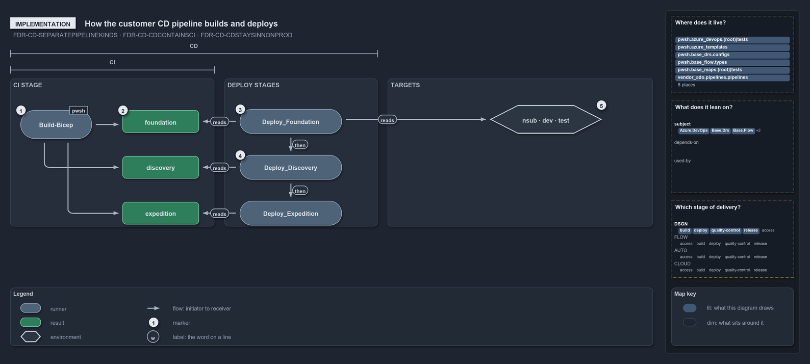

# How the customer CD pipeline builds and deploys

```text
How the customer CD pipeline builds and deploys.

1  Build-Bicep                       the CI stage builds each of the three templates once
2  foundation, discovery, expedition the three artifacts it publishes, untagged
3  Deploy_Foundation                 the first of three deploy stages, main only
4  dependsOn                         the chain Foundation -> Discovery -> Expedition
5  nsub, dev, test                   the non-prod targets, the last rung CD reaches

Supports FDR-CD-SEPARATEPIPELINEKINDS, FDR-CD-CDCONTAINSCI and FDR-CD-CDSTAYSINNONPROD (implementation lens).
```

Every customer CD ado pipeline in cats extends one template, `.ado/pipelines/extends/cd-customer.yaml`. The thin root pipelines
(`cd-apex.yaml`, `cd-nova.yaml`, `cd-flux.yaml`) supply only the customer key and the per-deployment environment, slot, service connection
and subscription assert. In code order, the template runs one CI stage that builds and publishes three artifacts, then three deploy stages
that apply them in dependency order. Each deploy stage reaches the non-prod targets and no others; the prod subscription is the manual
DEPLOY pipeline's.

```yml drawio
description:
  The customer CD pipeline builds each of the three templates once in the CI stage, then three chained deploy stages apply the published
  artifacts to the non-prod targets and stop there.
about:
  rules: [FDR-CD-SEPARATEPIPELINEKINDS, FDR-CD-CDCONTAINSCI, FDR-CD-CDSTAYSINNONPROD]
  lens: implementation
content:
  title: How the customer CD pipeline builds and deploys
  kind: explanation
  flow: left-to-right
  theme: dark
  bands:
    - { id: band-ci, label: CI STAGE }
    - { id: band-deploy, label: DEPLOY STAGES }
    - { id: band-targets, label: TARGETS }
  spans:
    - id: span-ci
      label: CI
      over: [band-ci]
    - id: span-cd
      label: CD
      over: [band-ci, band-deploy]
  glyphs:
    - { id: g-build-bicep, kind: runner, label: Build-Bicep, in: band-ci }
    - { id: r-foundation, kind: result, label: foundation, in: band-ci }
    - { id: r-discovery, kind: result, label: discovery, in: band-ci }
    - { id: r-expedition, kind: result, label: expedition, in: band-ci }
    - { id: g-deploy-foundation, kind: runner, label: Deploy_Foundation, in: band-deploy }
    - { id: g-deploy-discovery, kind: runner, label: Deploy_Discovery, in: band-deploy }
    - { id: g-deploy-expedition, kind: runner, label: Deploy_Expedition, in: band-deploy }
    - { id: e-non-prod, kind: env, label: nsub · dev · test, in: band-targets }
  edges:
    - { from: g-build-bicep, to: r-foundation, kind: flow, label: "" }
    - { from: g-build-bicep, to: r-discovery, kind: flow, label: "" }
    - { from: g-build-bicep, to: r-expedition, kind: flow, label: "" }
    - { from: g-deploy-foundation, to: r-foundation, kind: flow, label: reads }
    - { from: g-deploy-discovery, to: r-discovery, kind: flow, label: reads }
    - { from: g-deploy-expedition, to: r-expedition, kind: flow, label: reads }
    - { from: g-deploy-foundation, to: g-deploy-discovery, kind: flow, label: then }
    - { from: g-deploy-discovery, to: g-deploy-expedition, kind: flow, label: then }
    - { from: g-deploy-foundation, to: e-non-prod, kind: flow, label: "" }
  markers:
    - { at: g-build-bicep, number: 1 }
    - { at: r-foundation, number: 2 }
    - { at: g-deploy-foundation, number: 3 }
    - { at: g-deploy-discovery, number: 4 }
    - { at: e-non-prod, number: 5 }
  legend: auto
  minimaps: [code-locations, module-neighbourhood, axis]
layout:
  band-ci: { x: 20, y: 108, w: 400, h: 290 }
  band-deploy: { x: 440, y: 108, w: 300, h: 290 }
  band-targets: { x: 760, y: 108, w: 520, h: 290 }
  g-build-bicep: { x: 40, y: 170, w: 140, h: 56 }
  r-foundation: { x: 240, y: 170, w: 150, h: 44 }
  r-discovery: { x: 240, y: 260, w: 150, h: 44 }
  r-expedition: { x: 240, y: 350, w: 150, h: 44 }
  g-deploy-foundation: { x: 470, y: 168, w: 200, h: 48 }
  g-deploy-discovery: { x: 470, y: 258, w: 200, h: 48 }
  g-deploy-expedition: { x: 470, y: 348, w: 200, h: 48 }
  e-non-prod: { x: 960, y: 160, w: 220, h: 56 }
```



## Walkthrough

1. **Build-Bicep.** The `CI` stage, displayed as "CI engine — build & verify", runs `Build-Bicep <template> -Customers <customer>` once for
   each of the three templates, building only that customer's configuration subfolder.
2. **Foundation, discovery, expedition.** After each build the stage publishes `out/template/<template>` as a pipeline artifact of the same
   name. The artifacts are built once and carry no tag.
3. **Deploy_Foundation.** Three deploy stages follow, each running only on `main`. Every deployment job downloads its artifact with
   `download: current` and runs `Deploy-Bicep -Environment <env> -Template <template> -SubscriptionIdAssertIs <guid> -ArtifactsFolder` on
   it, so nothing is rebuilt.
4. **dependsOn.** `Deploy_Foundation`, then `Deploy_Discovery`, then `Deploy_Expedition`: foundation owns the Key Vault the other two read,
   so the stages are chained with `dependsOn`.
5. **Non-prod targets.** Through the `sc-<customer>-nonprod` service connection, foundation and discovery deploy per subscription to `nsub`,
   and the expedition template deploys to `dev`, into the main-uat rung's `<unit>-main-uat` environment. `cd-apex` also deploys the
   expedition's special slot `dev-blu`; `cd-nova` carries non-prod entries only, and `cd-flux` has no expedition. The standalone
   `cd-shared.yaml` deploys `shared-nsub`, `shared-main-uat` and `shared-test`. The prod subscription's targets (`psub`, `preprod`, `prod`)
   are `deploy-apex.yaml`'s and `deploy-shared.yaml`'s, reached by a manual run: the exact artifact a certifying CD run built goes to
   pre-prod, then to prod (FDR-CD-TWOENVIRONMENTACTIVATION), and an approval check on a prod-tier environment is configured in the execution
   engine through `Sync-AdoEnvironmentApprovals` (FDR-CD-PRODAPPROVALGATE).

## Why it holds

- The CI component builds the artifact once and every downstream deploy consumes it unchanged (FDR-CD-SEPARATEPIPELINEKINDS).
- A CD pipeline always contains the CI component and then takes the artifact in a direction (FDR-CD-CDCONTAINSCI).
- CD's direction stays entirely within non-prod (FDR-CD-CDSTAYSINNONPROD).

## Where the code and the decision record differ

- No pipeline tags the artifact, and none runs the on-demand L3 environment or certifies RC or RBC.

## See also

- [The CI discipline and the promotion flow](../../drs/flow/cd-discipline-and-promotion-flow.md) — the decision this article explains.
- The other lenses on the same flow: [meta](one-artifact-climbs-unchanged.md), [architecture](pipeline-kinds-keyed-by-one-artifact.md),
  [operations](how-a-merge-to-main-reaches-non-prod.md) and [governance](ci-budget-is-the-only-quality-gate.md).
- [The flow explanations](index.md) · [How to read the diagrams](../index.md#how-to-read-the-diagrams)
