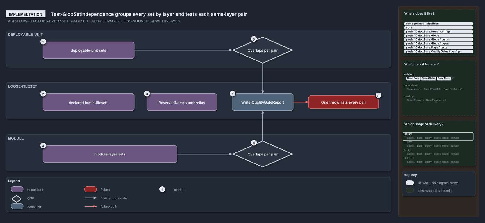

# Test-GlobSetIndependence groups every set by layer and tests each same-layer pair

```text
The independence gate groups every globset by layer and tests each same-layer pair for a shared file.

1  deployable-unit sets          the five layer: deployable-unit entries in globs.yml
2  declared loose-filesets       the five layer: loose-fileset entries; their group is skipped
3  ReservedNames umbrellas       four derived loose-filesets over the dot-folders; also skipped
4  module-layer sets             88 derived sets: aspects, internal files, module-leftovers
5  Overlaps per pair (units)     every deployable-unit pair tested for a shared own file
6  Overlaps per pair (modules)   the same pairwise test over the module group
7  Write-QualityGateReport       writes the report under out/test-globset-independence/
8  One throw lists every pair    on issues, one throw with one line per overlapping pair

Supports FDR-CD-GLOBS-EVERYSETHASLAYER and FDR-CD-GLOBS-NOOVERLAPWITHINLAYER (implementation lens).
```

The gate `Test-GlobSetIndependence` takes every declared and derived globset, computes each one's own members, groups the sets by `Layer`,
skips the `loose-fileset` group, and tests every pair inside the other groups for a shared file. Where a set's layer comes from therefore
decides whether it is ever compared with anything. All paths below are under `pwsh/Catzc.Base.Globs/`.



## Walkthrough

1. **deployable-unit sets.** The five entries in `configs/globs.yml` with `layer: deployable-unit`, loaded by `GlobsConfig` and returned by
   `Get-GlobSet`. `nova`, `apex`, `flux` and `shared` compose the base `template-azure-subscription-foundation`.
2. **declared loose-filesets.** The five entries with `layer: loose-fileset`: `automation`, `infrastructure`, `templates`, `markdown-scope`
   and `repository`. Their group is skipped, so they reach no gate.
3. **ReservedNames umbrellas.** `Get-ModuleGlobSet` builds one set per name in `GlobsConfig.ReservedNames` (`internal`, `vendor`,
   `compiled`, `scriptanalyzer`) over its dot-folder, with the layer `loose-fileset`. They join the skipped group.
4. **module-layer sets.** `Get-ModuleGlobSet` derives, with the layer `module`, two aspect sets per module folder through `AspectPartition`
   (80 from 40 folders; the tests aspect also takes the module's Go, Python and Bash test folders), one single-file set per
   `.internal/*.psm1` (7), and the catch-all `module-leftovers`: 88 sets in all.
5. **Overlaps per pair, deployable-unit.** `Test-GlobSetIndependence` reads the tracked files with `Get-TrackedFile` and builds each set's
   own members once, as a `HashSet`, through `GlobSet.SelectOwnMembers`: the set's own include and exclude rules, compose ignored. It then
   groups the sets with `Group-Object Layer` and tests every pair in the group with `HashSet.Overlaps`.
6. **Overlaps per pair, module.** The same pairwise test runs over the module group. Only an overlapping pair lists its shared paths, up to
   five of them, in one issue line.
7. **Write-QualityGateReport.** The gate ends by writing its report to `out/test-globset-independence/`, with the number of sets and tracked
   files as facts. With `-PassThru` it returns the result instead.
8. **One throw lists every pair.** When there are issues, the report throws once and lists every overlapping pair, one line each.

## Why it holds

- Every globset carries a layer; `deployable-unit` and `loose-fileset` are declared, and `module` is derived from the folders and the
  internal module files (FDR-CD-GLOBS-EVERYSETHASLAYER).
- Within a layer, no two globsets select a common file on their own contribution, compose ignored; validation is per layer, never across,
  and the `loose-fileset` layer is exempt (FDR-CD-GLOBS-NOOVERLAPWITHINLAYER).

## See also

- [Globset triggers](../../drs/flow/durable-sha-globs.md) — the decision this article explains.
- The other lenses on the same layers: [meta](peers-in-a-layer-never-overlap.md), [architecture](two-declared-layers-one-derived.md),
  [operations](declare-or-add-folder-gate-names-overlaps.md) and [governance](overlap-gated-for-units-and-modules.md).
- [The flow explanations](index.md) · [How to read the diagrams](../index.md#how-to-read-the-diagrams)
