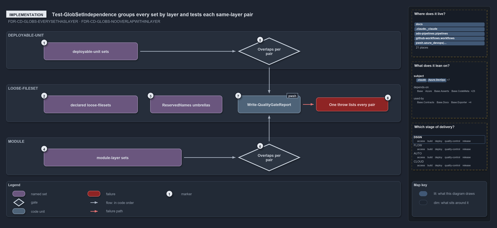

# How the independence check pairs globsets

```text
How the independence check pairs globsets.

1  deployable-unit sets          the five layer: deployable-unit entries in globs.yml
2  declared loose-filesets       the five layer: loose-fileset entries; their group is skipped
3  ReservedNames umbrellas       four derived loose-filesets over the dot-folders; also skipped
4  module-layer sets             88 derived sets: aspects, internal files, module-leftovers
5  Overlaps per pair (units)     every deployable-unit pair tested for a shared own file
6  Overlaps per pair (modules)   the same pairwise test over the module group
7  Write-QualityGateReport       writes the report under out/test-globset-independence/
8  One throw lists every pair    on issues, one throw with one line per overlapping pair

Supports FDR-GLOBS-EVERYSETHASLAYER and FDR-GLOBS-NOOVERLAPWITHINLAYER (implementation lens).
```

The gate `Test-GlobSetIndependence` takes every declared and derived globset, computes each one's own members, groups the sets by `Layer`,
skips the `loose-fileset` group, and tests every pair inside the other groups for a shared file. Where a set's layer comes from therefore
decides whether it is ever compared with anything. All paths below are under `pwsh/Base.Globs/`.

```yml drawio
description:
  The independence gate groups every declared and derived globset by layer, skips the loose-fileset group, tests each same-layer pair for a
  shared file, writes a report, and throws once with one line per overlapping pair.
about:
  rules: [FDR-GLOBS-EVERYSETHASLAYER, FDR-GLOBS-NOOVERLAPWITHINLAYER]
  lens: implementation
content:
  title: How the independence check pairs globsets
  kind: explanation
  flow: left-to-right
  theme: dark
  bands:
    - { id: band-deployable-unit, label: DEPLOYABLE-UNIT }
    - { id: band-loose-fileset, label: LOOSE-FILESET }
    - { id: band-module, label: MODULE }
  glyphs:
    - { id: s-deployable-units, kind: set, label: deployable-unit sets, in: band-deployable-unit }
    - { id: g-overlaps-units, kind: gate, label: Overlaps per pair, in: band-deployable-unit }
    - { id: s-declared-loose, kind: set, label: declared loose-filesets, in: band-loose-fileset }
    - { id: s-reserved-names, kind: set, label: ReservedNames umbrellas, in: band-loose-fileset }
    - { id: g-report, kind: code, label: Write-QualityGateReport, in: band-loose-fileset }
    - { id: f-throw, kind: failure, label: One throw lists every pair, in: band-loose-fileset }
    - { id: s-module-layer, kind: set, label: module-layer sets, in: band-module }
    - { id: g-overlaps-modules, kind: gate, label: Overlaps per pair, in: band-module }
  edges:
    - { from: s-deployable-units, to: g-overlaps-units, kind: flow, label: "" }
    - { from: s-module-layer, to: g-overlaps-modules, kind: flow, label: "" }
    - { from: g-overlaps-units, to: g-report, kind: flow, label: calls }
    - { from: g-overlaps-modules, to: g-report, kind: flow, label: calls }
    - { from: g-report, to: f-throw, kind: fail, label: "" }
  markers:
    - { at: s-deployable-units, number: 1 }
    - { at: s-declared-loose, number: 2 }
    - { at: s-reserved-names, number: 3 }
    - { at: s-module-layer, number: 4 }
    - { at: g-overlaps-units, number: 5 }
    - { at: g-overlaps-modules, number: 6 }
    - { at: g-report, number: 7 }
    - { at: f-throw, number: 8 }
  legend: auto
  minimaps: [code-locations, module-neighbourhood, axis]
layout:
  band-deployable-unit: { x: 20, y: 84, w: 1260, h: 120 }
  band-loose-fileset: { x: 20, y: 254, w: 1260, h: 120 }
  band-module: { x: 20, y: 424, w: 1260, h: 120 }
  s-deployable-units: { x: 140, y: 120, w: 300, h: 56 }
  g-overlaps-units: { x: 760, y: 104, w: 200, h: 88 }
  s-declared-loose: { x: 140, y: 290, w: 300, h: 56 }
  s-reserved-names: { x: 480, y: 290, w: 230, h: 56 }
  g-report: { x: 760, y: 290, w: 200, h: 56 }
  f-throw: { x: 1010, y: 296, w: 230, h: 44 }
  s-module-layer: { x: 140, y: 460, w: 440, h: 56 }
  g-overlaps-modules: { x: 760, y: 444, w: 200, h: 88 }
```



## Walkthrough

1. **deployable-unit sets.** The five entries in `configs/globs/globs.yml` with `layer: deployable-unit`, loaded by `GlobsConfig` and
   returned by `Get-GlobSet`. `nova`, `apex`, `flux` and `shared` compose the base `template-azure-subscription-foundation`.
2. **declared loose-filesets.** The five entries with `layer: loose-fileset`: `automation`, `infrastructure`, `templates`, `markdown-scope`
   and `repository`. Their group is skipped, so they reach no gate.
3. **ReservedNames umbrellas.** `Get-ModuleGlobSet` builds one set per name in `GlobsConfig.ReservedNames` (`internal`, `vendor`,
   `compiled`, `scriptanalyzer`) over its dot-folder, with the layer `loose-fileset`. They join the skipped group.
4. **module-layer sets.** `Get-ModuleGlobSet` derives, with the layer `module`, two aspect sets per module folder through `AspectPartition`
   (80 from 40 folders; the tests aspect also takes the module's Go, Python and Bash test folders), one single-file set per
   `.internal/*.psm1` (7), and the catch-all `module-leftovers`: 88 sets in all.
5. **Overlaps per pair, deployable-unit.** `Test-GlobSetIndependence` reads the tracked files with `Get-TrackedFile` and builds each set's
   own members once, as a `HashSet`, through `GlobSet.SelectOwnMembers`: the set's own include and exclude rules, compose ignored. It then
   groups the sets with `Group-Object Layer` and tests every pair in the group with `HashSet.Overlaps`.
6. **Overlaps per pair, module.** The same pairwise test runs over the module group. Only an overlapping pair lists its shared paths, up to
   five of them, in one issue line.
7. **Write-QualityGateReport.** The gate ends by writing its report to `out/test-globset-independence/`, with the number of sets and tracked
   files as facts. With `-PassThru` it returns the result instead.
8. **One throw lists every pair.** When there are issues, the report throws once and lists every overlapping pair, one line each.

## Why it holds

- Every globset carries a layer; `deployable-unit` and `loose-fileset` are declared, and `module` is derived from the folders and the
  internal module files (FDR-GLOBS-EVERYSETHASLAYER).
- Within a layer, no two globsets select a common file on their own contribution, compose ignored; validation is per layer, never across,
  and the `loose-fileset` layer is exempt (FDR-GLOBS-NOOVERLAPWITHINLAYER).

## See also

- [Globset triggers](../../drs/flow/durable-sha-globs.md) — the decision this article explains.
- The other lenses on the same layers: [meta](which-globsets-may-share-a-file.md), [architecture](two-declared-layers-one-derived.md),
  [operations](how-a-new-unit-or-module-folder-is-checked-for-overlap.md) and [governance](overlap-gated-for-units-and-modules.md).
- [The flow explanations](index.md) · [How to read the diagrams](../index.md#how-to-read-the-diagrams)
