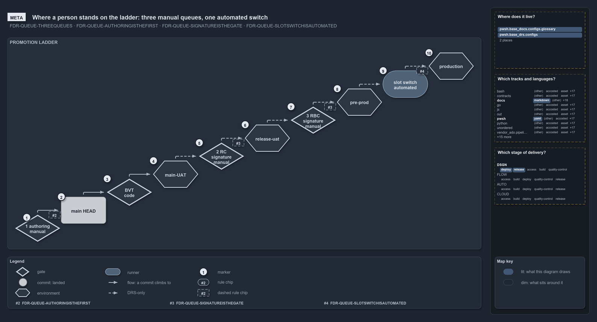

# The manual queues of the promotion ladder, in ten slides

Ten simple slides on where a person stands on the promotion ladder, one idea each, drawn from
[manual-queues](../../drs/flow/manual-queues.md) (`FDR-QUEUE`). Each slide is one diagram; the walkthrough under it says what its numbers
mean.

## Slide 1 — Where a person stands

```text
Where a person stands on the ladder: three manual queues, one automated switch.

1   authoring        queue 1: a person edits, pushes and merges; manual
2   main HEAD        the landed tip of the server's main
3   BVT              the one gate code runs; rejects a failing commit on its own
4   main-UAT         the first environment; its post-deployment test proves the service loads
5   RC signature     queue 2: one signature in the security registry, "main-UAT passed"; manual
6   release-uat      the second environment
7   RBC signature    queue 3: one signature, "release-uat passed"; manual
8   pre-prod         the staging slot of production
9   slot switch      automated and monitored; never a queue
10  production       the top rung

Supports FDR-QUEUE-THREEQUEUES, FDR-QUEUE-AUTHORINGISTHEFIRST, FDR-QUEUE-SIGNATUREISTHEGATE
and FDR-QUEUE-SLOTSWITCHISAUTOMATED (meta lens).
```

```yml drawio
description:
  The promotion ladder as ten rungs climbing left to right, the three manual queues drawn as gates marked manual, BVT as the one code gate,
  and the slot switch as an automated runner before production.
about:
  rules:
    - FDR-QUEUE-THREEQUEUES
    - FDR-QUEUE-AUTHORINGISTHEFIRST
    - FDR-QUEUE-SIGNATUREISTHEGATE
    - FDR-QUEUE-SLOTSWITCHISAUTOMATED
  lens: meta
content:
  title: "Where a person stands on the ladder: three manual queues, one automated switch"
  kind: explanation
  flow: top-to-bottom
  relation: a commit climbs to
  states: true
  theme: dark
  bands:
    - { id: band-ladder, label: PROMOTION LADDER }
  glyphs:
    - { id: g-authoring, kind: gate, label: "1 authoring\nmanual", in: band-ladder }
    - { id: c-main, kind: commit, label: main HEAD, in: band-ladder, state: landed, shape: box }
    - { id: g-bvt, kind: gate, label: "BVT\ncode", in: band-ladder }
    - { id: e-main-uat, kind: env, label: main-UAT, in: band-ladder }
    - { id: g-rc, kind: gate, label: "2 RC signature\nmanual", in: band-ladder }
    - { id: e-release-uat, kind: env, label: release-uat, in: band-ladder }
    - { id: g-rbc, kind: gate, label: "3 RBC signature\nmanual", in: band-ladder }
    - { id: e-pre-prod, kind: env, label: pre-prod, in: band-ladder }
    - { id: r-switch, kind: runner, label: "slot switch\nautomated", in: band-ladder }
    - { id: e-production, kind: env, label: production, in: band-ladder }
  ladders:
    - { band: band-ladder, rise: 48, w: 120, h: 72 }
  edges:
    - { from: g-authoring, to: c-main, kind: flow, label: "" }
    - { from: c-main, to: g-bvt, kind: flow, label: "" }
    - { from: g-bvt, to: e-main-uat, kind: flow, label: "" }
    - { from: e-main-uat, to: g-rc, kind: adr, label: "" }
    - { from: g-rc, to: e-release-uat, kind: adr, label: "" }
    - { from: e-release-uat, to: g-rbc, kind: adr, label: "" }
    - { from: g-rbc, to: e-pre-prod, kind: adr, label: "" }
    - { from: e-pre-prod, to: r-switch, kind: adr, label: "" }
    - { from: r-switch, to: e-production, kind: adr, label: "" }
  markers:
    - { at: g-authoring, number: 1 }
    - { at: c-main, number: 2, corner: top-left }
    - { at: g-bvt, number: 3, corner: top-left }
    - { at: e-main-uat, number: 4, corner: top-left }
    - { at: g-rc, number: 5, corner: top-left }
    - { at: e-release-uat, number: 6, corner: top-left }
    - { at: g-rbc, number: 7, corner: top-left }
    - { at: e-pre-prod, number: 8, corner: top-left }
    - { at: r-switch, number: 9, corner: top-left }
    - { at: e-production, number: 10, corner: top-left }
  chips:
    - { at: g-authoring, kind: rule, rule: FDR-QUEUE-AUTHORINGISTHEFIRST, gated: false }
    - { at: g-rc, kind: rule, rule: FDR-QUEUE-SIGNATUREISTHEGATE, gated: false }
    - { at: g-rbc, kind: rule, rule: FDR-QUEUE-SIGNATUREISTHEGATE, gated: false }
    - { at: r-switch, kind: rule, rule: FDR-QUEUE-SLOTSWITCHISAUTOMATED, gated: false }
  legend: auto
  minimaps: [code-locations, grid, axis]
```



### Walkthrough

1. **Authoring.** The first manual queue: a person edits one catalogue item, pushes it as the authenticated author to the server's topic
   HEAD, and the change enters main by the pull request or by an authorized direct merge (FDR-QUEUE-AUTHORINGISTHEFIRST).
2. **main HEAD.** The landed tip of the server's main, where the merge put the commit.
3. **BVT.** The one gate that code runs: a failing commit is rejected on its own, no person involved.
4. **main-UAT.** The first environment. CD deploys there on its own, and the post-deployment test proves the service loads.
5. **RC signature.** The second manual queue: a user with access enters one signature in the appointed security registry, "main-UAT passed
   its check" (FDR-QUEUE-SIGNATUREISTHEGATE).
6. **release-uat.** The second environment, deployed on its own after the RC signature.
7. **RBC signature.** The third manual queue: the same kind of signature, "release-uat passed its check".
8. **pre-prod.** The staging slot inside production, deployed on its own after the RBC signature.
9. **Slot switch.** Automated and monitored, never a queue: pre-prod and production trade places blue-green
   (FDR-QUEUE-SLOTSWITCHISAUTOMATED).
10. **production.** The top rung.

Three rungs are dashed-chipped manual queues, one rung is the BVT gate, one is the automated switch. That is the whole fact of the record
(FDR-QUEUE-THREEQUEUES).

## See also

- [The manual queues of the promotion ladder](../../drs/flow/manual-queues.md) — the decision these slides explain.
- [Only BVT has a gate in code; the sync-point rules are DRS-only](../design/sync-point-rules-are-drs-only.md) — the ladder with its sync
  point and dirty HEAD.
- [The flow explanations](index.md) · [How to read the diagrams](../index.md#how-to-read-the-diagrams)
