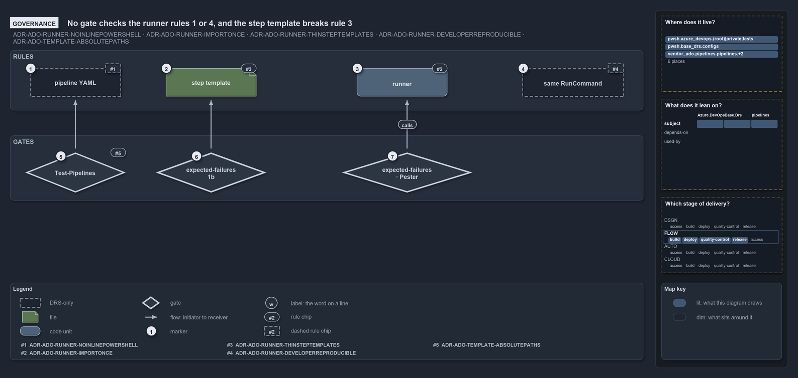

# No gate checks the runner rules 1 or 4, and the step template breaks rule 3

```text
No gate checks the runner rules 1 or 4, and the step template breaks rule 3.

1  pipeline YAML                rule 1: no inline PowerShell; holds, but no gate checks it
2  step template                rule 3: a thin wrapper; its guard contradicts it
3  runner                       rule 2: import once, run in the same scope; holds
4  same RunCommand              rule 4: developer-reproducible; no gate checks it
5  Test-Pipelines               checks ADR-ADO-NAME rule 4 (absolute template paths), no runner rule
6  expected-failures 1b         replays its own copy of the template's guard
7  expected-failures - Pester   steps 1a and 1c prove the trap; Pester covers the sanitizer

Supports ADR-ADO-RUNNER-NOINLINEPOWERSHELL, ADR-ADO-RUNNER-IMPORTONCE, ADR-ADO-RUNNER-THINSTEPTEMPLATES
and ADR-ADO-RUNNER-DEVELOPERREPRODUCIBLE, and ADR-ADO-TEMPLATE-ABSOLUTEPATHS (governance lens).
```

The pipeline runner pattern has four rules, one for each stage a pipeline step passes through: the YAML, the step template, the runner and
the command. The stages run left to right, each calling the next, and the arrows on the diagram show only which gate checks which stage. Two
rules hold today with no gate behind them, the step template contradicts the rule written for it, and the gates that do touch these stages
check something nearby rather than the rule itself.

```yml drawio
description:
  "The four stages a pipeline step passes through (the YAML, the step template, the runner, the command) and the gates that touch them: no
  gate checks the YAML or the command, and the gates that touch the template and the runner check something nearby, not the rule itself."
about:
  rules:
    - ADR-ADO-RUNNER-NOINLINEPOWERSHELL
    - ADR-ADO-RUNNER-IMPORTONCE
    - ADR-ADO-RUNNER-THINSTEPTEMPLATES
    - ADR-ADO-RUNNER-DEVELOPERREPRODUCIBLE
    - ADR-ADO-TEMPLATE-ABSOLUTEPATHS
  lens: governance
content:
  title: No gate checks the runner rules 1 or 4, and the step template breaks rule 3
  kind: explanation
  flow: left-to-right
  theme: dark
  bands:
    - { id: band-rules, label: RULES }
    - { id: band-gates, label: GATES }
  glyphs:
    - { id: a-pipeline-yaml, kind: drsonly, label: pipeline YAML, in: band-rules }
    - { id: f-step-template, kind: file, label: step template, in: band-rules }
    - { id: g-runner, kind: code, label: runner, in: band-rules }
    - { id: a-run-command, kind: drsonly, label: same RunCommand, in: band-rules }
    - { id: g-test-pipelines, kind: gate, label: Test-Pipelines, in: band-gates }
    - { id: g-failures-1b, kind: gate, label: expected-failures 1b, in: band-gates }
    - { id: g-failures-pester, kind: gate, label: expected-failures · Pester, in: band-gates }
  edges:
    - { from: g-test-pipelines, to: a-pipeline-yaml, kind: flow, label: "" }
    - { from: g-failures-1b, to: f-step-template, kind: flow, label: "" }
    - { from: g-failures-pester, to: g-runner, kind: flow, label: calls }
  markers:
    - { at: a-pipeline-yaml, number: 1 }
    - { at: f-step-template, number: 2 }
    - { at: g-runner, number: 3 }
    - { at: a-run-command, number: 4 }
    - { at: g-test-pipelines, number: 5 }
    - { at: g-failures-1b, number: 6 }
    - { at: g-failures-pester, number: 7 }
  chips:
    - { at: a-pipeline-yaml, kind: rule, rule: ADR-ADO-RUNNER-NOINLINEPOWERSHELL, gated: false }
    - { at: f-step-template, kind: rule, rule: ADR-ADO-RUNNER-THINSTEPTEMPLATES }
    - { at: g-runner, kind: rule, rule: ADR-ADO-RUNNER-IMPORTONCE }
    - { at: a-run-command, kind: rule, rule: ADR-ADO-RUNNER-DEVELOPERREPRODUCIBLE, gated: false }
    - { at: g-test-pipelines, kind: rule, rule: ADR-ADO-TEMPLATE-ABSOLUTEPATHS }
  legend: auto
  minimaps: [code-locations, module-neighbourhood, axis]
layout:
  band-rules: { x: 20, y: 84, w: 1260, h: 120 }
  band-gates: { x: 20, y: 254, w: 1260, h: 130 }
  a-pipeline-yaml: { x: 60, y: 120, w: 180, h: 56 }
  f-step-template: { x: 330, y: 120, w: 180, h: 56 }
  g-runner: { x: 710, y: 120, w: 180, h: 56 }
  a-run-command: { x: 1040, y: 120, w: 200, h: 56 }
  g-test-pipelines: { x: 50, y: 288, w: 200, h: 80 }
  g-failures-1b: { x: 310, y: 288, w: 220, h: 80 }
  g-failures-pester: { x: 680, y: 288, w: 260, h: 80 }
```



## Walkthrough

1. **Pipeline YAML.** Rule 1 says YAML steps never contain inline PowerShell. It holds today: the only inline scripts under
   `.ado/pipelines/` are the template's own tasks and the expected-failures pipeline. No gate checks it, so only the FDR keeps it.
2. **Step template.** Rule 3 says the template is a thin wrapper with no logic. The code contradicts it: each of the template's three tasks
   runs `Set-StrictMode` and a guard that throws on a multiline `RunCommand` without a `DisplayName`.
3. **Runner.** Rule 2 says the runner imports the module system once and runs the command in the same scope. `Invoke-AdoScript.ps1` does
   both.
4. **Same RunCommand.** Rule 4 says whatever string appears in `RunCommand` can be pasted into a local terminal after the importer. No code
   replays a `RunCommand` outside the runner, so only the FDR keeps it, and no gate stands below it.
5. **Test-Pipelines.** The pipeline-layout check runs over `.ado/pipelines/` and checks FDR-PIPELINE-TYPEPREFIX,
   ADR-ADO-NAME-FLATPIPELINESFOLDER, ADR-ADO-NAME-TEMPLATEKINDFOLDER, ADR-ADO-TEMPLATE-ABSOLUTEPATHS and
   FDR-PIPELINE-EXECUTABLEYAMLEXTENSION. The one that touches this stage is ADR-ADO-TEMPLATE-ABSOLUTEPATHS, that templates are referenced
   by absolute path. It checks no runner rule. Its L1 test requires zero violations over the real tree.
6. **Expected-failures 1b.** Step 1b of `ci-pwsh-expected-failures.yaml` proves that a multiline command without a display name throws, but
   it replays its own copy of the guard rather than running the template's. The pipeline itself is the sanctioned exception to rule 1: it
   inlines PowerShell on purpose.
7. **Expected-failures and Pester.** Steps 1a and 1c run `Invoke-AdoScript.ps1` to prove that the trap reports a failing command, and the L0
   Pester test for `ConvertFrom-AdoPipelineCommand` covers the sanitizer. No Pester test runs the runner itself.

## Why it holds

- YAML steps never contain inline PowerShell; all PowerShell runs through the runner or a step template that calls it
  (ADR-ADO-RUNNER-NOINLINEPOWERSHELL).
- The runner imports the module system once, and the command runs in the same scope (ADR-ADO-RUNNER-IMPORTONCE).
- Step templates are thin wrappers that add pipeline concerns and never contain logic (ADR-ADO-RUNNER-THINSTEPTEMPLATES).
- Every command is developer-reproducible: the `RunCommand` string runs as-is in a terminal after the importer
  (ADR-ADO-RUNNER-DEVELOPERREPRODUCIBLE).
- Templates are referenced by an absolute path under `/.ado/pipelines/` (ADR-ADO-TEMPLATE-ABSOLUTEPATHS).

## Where the code and the decision record differ

- The FDR says the step template holds no logic; each of its three tasks runs a strict-mode guard that throws before the runner starts.
- Step 1b re-implements the template's guard inline, so a change to the template's own guard is not covered by any run.
- No gate checks rule 1 or rule 4, and rule 2 is exercised only through the expected-failures pipeline, never by a Pester test.

## See also

- [Pipeline runner pattern](../../drs/ado/pipeline-runner-pattern.md) — the decision this article explains.
- [Pipeline naming and placement](../../drs/ado/pipeline-naming-and-placement.md) — the rules `Test-Pipelines` checks.
- The other lenses on the same runner: [meta](a-step-only-names-a-command.md), [architecture](the-runner-is-the-only-seam.md),
  [implementation](three-tasks-one-guard-one-runner.md) and [operations](the-step-is-named-after-its-command.md).
- [The flow explanations](index.md) · [How to read the diagrams](../index.md#how-to-read-the-diagrams)
