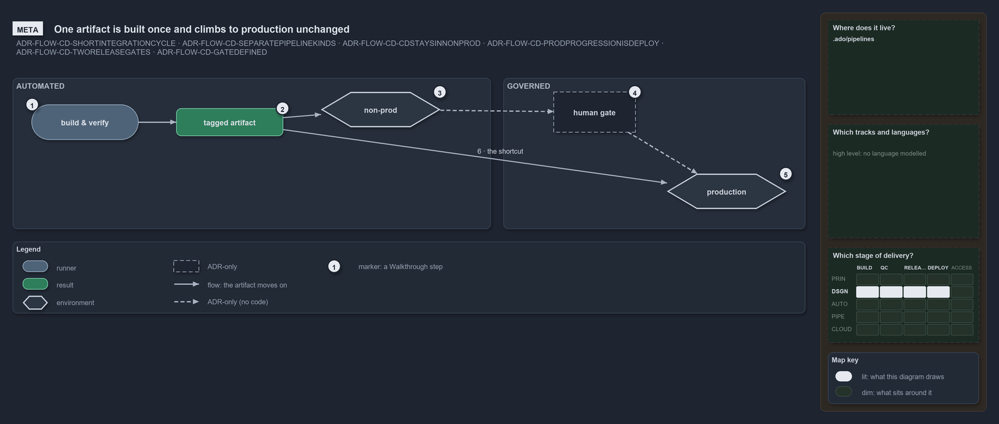

# One artifact is built once and climbs to production unchanged

```text
One artifact is built once and climbs to production unchanged.

1  build & verify    the CI discipline: every change integrated fast, within 5-10 minutes
2  tagged artifact   the one immutable artifact every downstream kind consumes
3  non-prod          the same bytes tested in non-prod, automated
4  human gate        a person certifies the artifact; it clears or holds, never half
5  production        past the gate, DEPLOY rolls the same artifact to prod
6  the shortcut      the CD pipelines deploy production themselves today, in the same run

Supports FDR-CD-SHORTINTEGRATIONCYCLE, FDR-CD-SEPARATEPIPELINEKINDS, FDR-CD-CDSTAYSINNONPROD, FDR-CD-PRODPROGRESSIONISDEPLOY, FDR-CD-TWORELEASEGATES and FDR-CD-GATEDEFINED (meta lens).
```

Build-once, deploy-many is the idea at the heart of the cats promotion flow. One artifact is built and verified once, tested in non-prod,
and then let into production by a manual gate. Because nothing downstream rebuilds it, production runs exactly the bytes that non-prod
certified. The flow splits into an automated side and a governed side, and the CD pipelines in the repository today deploy the prod tier
themselves, in the same run.



## Walkthrough

1. **Build & verify.** The CI discipline integrates every change into main fast, within a 5–10 minute integration budget on a team basis.
2. **Tagged artifact.** The build produces one immutable artifact, the key every downstream pipeline kind consumes unchanged. Cats calls it
   a release candidate: versioned, never rebuilt, and promotable toward production.
3. **Non-prod.** The same bytes are tested in non-prod: first an on-demand environment with system tests, then an always-on environment that
   tracks the latest main.
4. **Manual gate.** A person certifies the artifact and decides whether it may proceed; a gate clears or holds, never half. The approval
   check lives in the execution engine: the adopting team applies the shipped `environment-approvals.yml` with
   `Sync-AdoEnvironmentApprovals` (FDR-CD-PRODAPPROVALGATE), and this repository ships that tooling but runs no apply.
5. **Production.** Past the gate, the flow leaves automation and enters DEPLOY, the pipeline that acts once the gate clears.
6. **The shortcut.** The apex and shared CD pipelines deploy the artifact to the prod tier themselves, in the same run as non-prod; the
   approval check on those environments is the engine's, configured by the adopting team's apply.

## Why it holds

- CI is kept within a 5–10 minute integration cycle on a team basis (FDR-CD-SHORTINTEGRATIONCYCLE).
- Nothing downstream rebuilds the tagged artifact, so production is byte-identical to what non-prod certified
  (FDR-CD-SEPARATEPIPELINEKINDS).
- CD takes the artifact through non-prod only (FDR-CD-CDSTAYSINNONPROD), and progression toward prod enters DEPLOY behind a manual gate
  (FDR-CD-PRODPROGRESSIONISDEPLOY).
- RC and RBC are the manual gates (FDR-CD-TWORELEASEGATES). A gate decides; DEPLOY, the pipeline that acts, is not a gate
  (FDR-CD-GATEDEFINED).

## Where the code and the ADR differ

- The ADR keeps CD entirely within non-prod, but the apex and shared CD pipelines deploy `psub`, and apex the expedition `prod`, in the same
  run.
- No pipeline tags the artifact or runs the on-demand environment with system tests.

## See also

- [The CI discipline and the promotion flow](../../adr/flow/cd-discipline-and-promotion-flow.md) — the decision this article explains.
- The other lenses on the same flow: [architecture](pipeline-kinds-keyed-by-one-artifact.md),
  [implementation](cd-builds-once-then-deploys-prod-itself.md), [operations](a-merge-runs-cd-to-prod.md) and
  [governance](ci-budget-is-the-only-quality-gate.md).
- [The flow explanations](index.md) · [How to read the diagrams](../index.md#how-to-read-the-diagrams)
