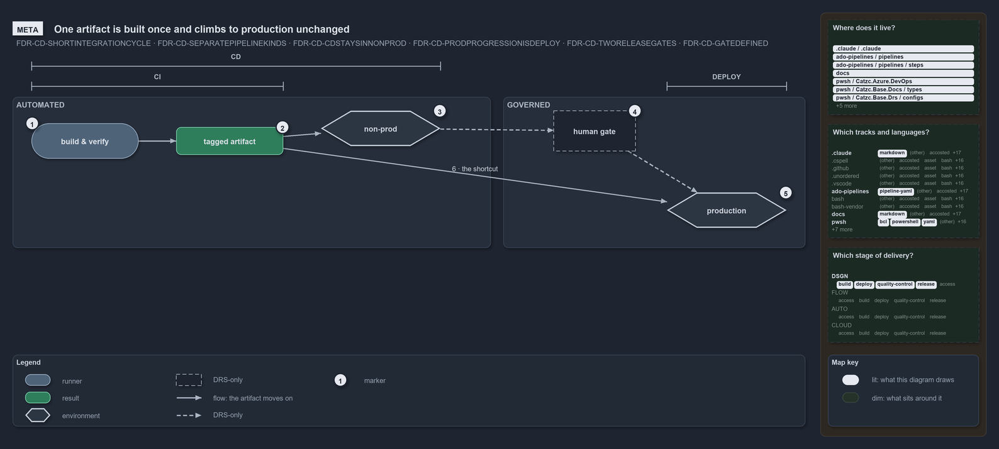

# One artifact is built once and climbs to production unchanged

```text
One artifact is built once and climbs to production unchanged.

1  build & verify    the CI discipline: every change integrated fast, within 5-10 minutes
2  tagged artifact   the one immutable artifact every downstream kind consumes
3  non-prod          the same bytes tested in non-prod, automated
4  human gate        a person certifies the artifact; it clears or holds, never half
5  production        past the gate, DEPLOY rolls the same artifact to prod

Supports FDR-CD-SHORTINTEGRATIONCYCLE, FDR-CD-SEPARATEPIPELINEKINDS, FDR-CD-CDSTAYSINNONPROD, FDR-CD-PRODPROGRESSIONISDEPLOY,
FDR-CD-TWORELEASEGATES and FDR-CD-GATEDEFINED (meta lens).
```

Build-once, deploy-many is the idea at the heart of the cats promotion flow. One artifact is built and verified once, tested in non-prod,
and then let into production by a manual gate. Because nothing downstream rebuilds it, production runs exactly the bytes that non-prod
certified. The flow splits into an automated side and a governed side: the CD pipelines in the repository stop in non-prod, and the prod tier
is reached only by the manual DEPLOY pipelines.

```yml drawio
description:
  One artifact is built and verified once, tested in non-prod, and let into production by a manual gate, so production runs exactly the
  bytes non-prod certified; the CD pipelines stop in non-prod and only DEPLOY reaches production.
about:
  adrs:
    - FDR-CD-SHORTINTEGRATIONCYCLE
    - FDR-CD-SEPARATEPIPELINEKINDS
    - FDR-CD-CDSTAYSINNONPROD
    - FDR-CD-PRODPROGRESSIONISDEPLOY
    - FDR-CD-TWORELEASEGATES
    - FDR-CD-GATEDEFINED
  lens: meta
content:
  title: One artifact is built once and climbs to production unchanged
  kind: explanation
  flow: left-to-right
  relation: the artifact moves on
  states: true
  theme: dark
  bands:
    - { id: band-automated, label: AUTOMATED }
    - { id: band-governed, label: GOVERNED }
  spans:
    - id: span-ci
      label: CI
      over: [g-build, r-artifact]
    - id: span-cd
      label: CD
      over: [g-build, r-artifact, e-non-prod]
    - id: span-deploy
      label: DEPLOY
      over: [e-production]
  glyphs:
    - { id: g-build, kind: runner, label: build & verify, in: band-automated }
    - { id: r-artifact, kind: result, label: tagged artifact, in: band-automated }
    - { id: e-non-prod, kind: env, label: non-prod, in: band-automated }
    - { id: a-human-gate, kind: drsonly, label: human gate, in: band-governed }
    - { id: e-production, kind: env, label: production, in: band-governed }
  edges:
    - { from: g-build, to: r-artifact, kind: flow, label: "" }
    - { from: r-artifact, to: e-non-prod, kind: flow, label: "" }
    - { from: e-non-prod, to: a-human-gate, kind: adr, label: "" }
    - { from: a-human-gate, to: e-production, kind: adr, label: "" }
  markers:
    - { at: g-build, number: 1 }
    - { at: r-artifact, number: 2 }
    - { at: e-non-prod, number: 3 }
    - { at: a-human-gate, number: 4 }
    - { at: e-production, number: 5 }
  legend: auto
  minimaps: [code-locations, grid, axis]
layout:
  band-automated: { x: 20, y: 108, w: 760, h: 240 }
  band-governed: { x: 800, y: 108, w: 480, h: 240 }
  g-build: { x: 50, y: 150, w: 170, h: 56 }
  r-artifact: { x: 280, y: 156, w: 170, h: 44 }
  e-non-prod: { x: 510, y: 124, w: 190, h: 56 }
  a-human-gate: { x: 880, y: 130, w: 130, h: 64 }
  e-production: { x: 1060, y: 280, w: 190, h: 56 }
```



## Walkthrough

1. **Build & verify.** The CI discipline integrates every change into main fast, within a 5–10 minute integration budget on a team basis.
2. **Tagged artifact.** The build produces one immutable artifact, the key every downstream pipeline kind consumes unchanged. Cats calls it
   a release candidate: versioned, never rebuilt, and promotable toward production.
3. **Non-prod.** The same bytes are tested in non-prod: first an on-demand environment with system tests, then an always-on environment that
   tracks the latest main.
4. **Manual gate.** A person certifies the artifact and decides whether it may proceed; a gate clears or holds, never half. The approval
   check lives in the execution engine: the adopting team applies the shipped `environment-approvals.yml` with
   `Sync-AdoEnvironmentApprovals` (FDR-CD-PRODAPPROVALGATE), and this repository ships that tooling but runs no apply.
5. **Production.** Past the gate, the flow leaves automation and enters DEPLOY, the pipeline that acts once the gate clears. In the
   repository, `deploy-apex.yaml` and `deploy-shared.yaml` are the only pipelines that reach `psub`, `preprod` and `prod`, by a `Target` of
   `prod` or `rollback`.

## Why it holds

- CI is kept within a 5–10 minute integration cycle on a team basis (FDR-CD-SHORTINTEGRATIONCYCLE).
- Nothing downstream rebuilds the tagged artifact, so production is byte-identical to what non-prod certified
  (FDR-CD-SEPARATEPIPELINEKINDS).
- CD takes the artifact through non-prod only (FDR-CD-CDSTAYSINNONPROD), and progression toward prod enters DEPLOY behind a manual gate
  (FDR-CD-PRODPROGRESSIONISDEPLOY).
- RC and RBC are the manual gates (FDR-CD-TWORELEASEGATES). A gate decides; DEPLOY, the pipeline that acts, is not a gate
  (FDR-CD-GATEDEFINED).

## Where the code and the decision record differ

- No pipeline tags the artifact or runs the on-demand environment with system tests.

## See also

- [The CI discipline and the promotion flow](../../drs/flow/cd-discipline-and-promotion-flow.md) — the decision this article explains.
- The other lenses on the same flow: [architecture](pipeline-kinds-keyed-by-one-artifact.md),
  [implementation](cd-builds-once-then-deploys-non-prod.md), [operations](a-merge-runs-cd-through-non-prod.md) and
  [governance](ci-budget-is-the-only-quality-gate.md).
- [The flow explanations](index.md) · [How to read the diagrams](../index.md#how-to-read-the-diagrams)
