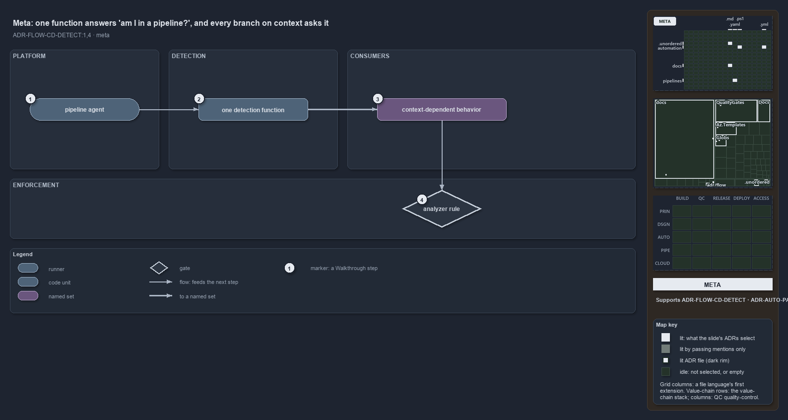

---
catzc:
  immutable:
    with_body_sha: c8276abe3bf0
    repo_status: clean
    path: docs/explanation/flow/one-boolean-answer-from-one-function.md
    folder: docs/explanation/flow
    name: one-boolean-answer-from-one-function
    filetype: md
    kind: explanation
    language: markdown
    track: docs
    tracktype: documentation
  edges:
    cites:
      - ADR-AUTO-PARITY#3
      - ADR-FLOW-CD-DETECT#{1,4}
    links:
      - docs/adr/automation/devbox-pipeline-parity.md
      - docs/adr/flow/pipeline-detection.md
      - docs/explanation/.assets/adr-flow-cd-detect--one-boolean-answer-from-one-function--meta.drawio.png
      - docs/explanation/flow/index.md
      - docs/explanation/flow/one-boolean-answer-from-one-function.drawio.md
      - docs/explanation/flow/one-gate-checks-the-raw-read-rule.md
      - docs/explanation/flow/the-analyzer-names-the-raw-read.md
      - docs/explanation/flow/the-loader-holds-the-one-detector.md
      - docs/explanation/flow/two-variables-read-in-one-place.md
      - docs/explanation/index.md#how-to-read-the-diagrams
---

# One function answers "am I in a pipeline?", and every branch on context asks it

```text
One function answers "am I in a pipeline?", and every branch on context asks it.

1  pipeline agent              the Azure DevOps agent or the GitHub Actions runner; it sets the signal
2  one detection function      Test-IsRunningInPipeline: reads the signal and answers true or false
3  context-dependent behavior  every function that behaves differently in a pipeline asks it
4  analyzer rule               flags any read of the signal outside the function

Supports ADR-FLOW-CD-DETECT#1 and #4 (meta lens).
```

Cats runs the same commands on a developer's machine and inside a CI/CD pipeline, and a few of them must behave differently in the two
places: where output goes, whether a pipeline variable is written, which git range counts as the change. Every one of those branches rests
on one question, "am I in a pipeline?", and cats answers it in exactly one function. The function reads the signal the pipeline agent sets,
answers true or false, and an analyzer rule makes sure nobody reads the signal anywhere else.



The diagram is described element by element in [its asset description](one-boolean-answer-from-one-function.drawio.md).

## Walkthrough

1. **Pipeline agent.** The Azure DevOps agent sets `TF_BUILD` on every pipeline run, and the GitHub Actions runner sets `GITHUB_ACTIONS`.
   Neither is set on a devbox, so together they are the reliable signal that the code runs in CI/CD.
2. **One detection function.** `Test-IsRunningInPipeline` is the one reader of that signal. It answers a boolean: if either variable is set,
   the code is in a pipeline; otherwise it is not. There is no third mode, and the variables it checks are an implementation detail that
   only this function knows.
3. **Context-dependent behavior.** Every function that behaves differently in a pipeline asks the function instead of the variables: the
   output root, the run environment, the change range, the pipeline-variable writer and twenty more. That makes the branches greppable: a
   search for the function's name finds every place cats branches on its execution context.
4. **Analyzer rule.** `Measure-NoRawPipelineDetection` flags a read of either variable anywhere outside the function as an error, so
   detection cannot drift back into the callers.

## Why it holds

- Never check the detection variables directly; call `Test-IsRunningInPipeline`, so the detection logic stays in one place
  (ADR-FLOW-CD-DETECT#1).
- Detection is boolean, not modal: the function returns true or false, and either variable set means a pipeline (ADR-FLOW-CD-DETECT#4).
- The function is the one seam between devbox and pipeline, and a command branches on it only where the two environments genuinely differ
  (ADR-AUTO-PARITY#3).

## See also

- [Pipeline detection](../../adr/flow/pipeline-detection.md) — the decision this article explains;
  [Devbox and pipeline parity](../../adr/automation/devbox-pipeline-parity.md) — the seam it keeps.
- The other lenses on the same detector: [architecture](the-loader-holds-the-one-detector.md),
  [implementation](two-variables-read-in-one-place.md), [operations](the-analyzer-names-the-raw-read.md) and
  [governance](one-gate-checks-the-raw-read-rule.md).
- [The flow explanations](index.md) · [How to read the diagrams](../index.md#how-to-read-the-diagrams)
