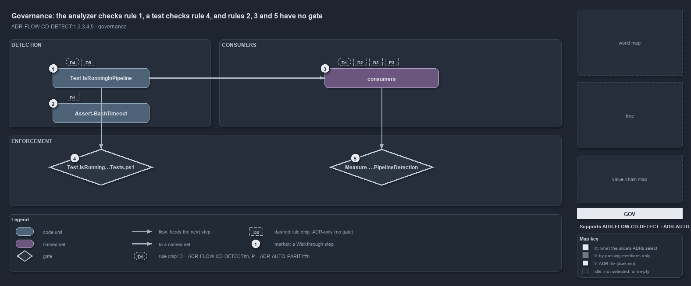

# docs/explanation/flow/one-gate-checks-the-raw-read-rule.md

`The analyzer checks rule 1, a test checks rule 4, and rules 2, 3 and 5 have no gate`

```text
The analyzer checks rule 1, a test checks rule 4, and rules 2, 3 and 5 have no gate.

1  Test-IsRunningInPipeline            the detector: rule 4 tested (D4), rule 5 unchecked (D5)
2  Assert-BashTimeout                  the C# hook: rule 1 unchecked there (dashed D1)
3  consumers                           24 call sites: rule 1 checked (D1); rules 2, 3 and P3 unchecked
4  Test-IsRunningInPipeline.Tests.ps1  the L0 test that proves the boolean's three cases
5  Measure-NoRawPipelineDetection      the analyzer rule, mapped to rule 1 in analyzer-adr-map.yml

Supports ADR-FLOW-CD-DETECT#1, #2, #3, #4 and #5 (governance lens).
```

Five rules govern pipeline detection in cats, and one gate carries most of the weight. The analyzer rule enforces the first, never read the
variables directly, on every PowerShell file; an L0 test pins the fourth, that the answer is a plain boolean. The other three rules, and the
one reader outside PowerShell, rest on the ADR alone.



The diagram is described element by element in
[its asset description](../../.assets/explanation/adr-flow-cd-detect--one-gate-checks-the-raw-read-rule--governance.drawio.md).

## Walkthrough

1. **Test-IsRunningInPipeline.** Rule 4, detection is boolean, is tested, so its chip is solid. Rule 5, only two variable reads and no I/O,
   is checked by nothing: a dashed chip.
2. **Assert-BashTimeout.** The C# hook reads both variables itself. The analyzer checks PowerShell files only, so rule 1 is unchecked there:
   a dashed chip. The hook stands alone on the diagram because nothing feeds it and nothing checks it.
3. **consumers.** The 24 call sites. Rule 1 is checked on them by the analyzer, so that chip is solid. Rule 2, context-dependent behavior
   must be intentional and visible, rule 3, prefer a parameter over detection, and ADR-AUTO-PARITY#3, branch on the seam only where the
   environments genuinely differ, have no gate: dashed chips.
4. **Test-IsRunningInPipeline.Tests.ps1.** An L0 logic test. It sets `TF_BUILD`, then `GITHUB_ACTIONS`, then neither, and asserts true, true
   and false.
5. **Measure-NoRawPipelineDetection.** The analyzer rule. `analyzer-adr-map.yml` maps it to ADR-FLOW-CD-DETECT#1, and `Test-AnalyzerAdrMap`
   fails when a custom rule is unmapped or cites a rule that does not exist, so the credit the rule-coverage report gives to this rule is
   itself checked.

## Why it holds

- Never check the detection variables directly; one analyzer rule checks it on every PowerShell file (ADR-FLOW-CD-DETECT#1).
- Context-dependent behavior must be intentional and visible, through the detector or a parameter; the ADR alone states it
  (ADR-FLOW-CD-DETECT#2).
- Prefer a parameter over detection; detection is the fallback; the ADR alone states it (ADR-FLOW-CD-DETECT#3).
- Detection is boolean, not modal; the L0 test proves all three cases (ADR-FLOW-CD-DETECT#4).
- The function stays fast, reading two variables and nothing else; the ADR alone states it (ADR-FLOW-CD-DETECT#5).
- A command branches on the seam only where the environments genuinely differ, never to change what it does; the ADR alone states it
  (ADR-AUTO-PARITY#3).

## Where the code and the ADR differ

- The ADR forbids every direct read of the variables, and the analyzer enforces that for PowerShell; the C# hook `Assert-BashTimeout` reads
  both, and no gate reaches it.
- The ADR says the analyzer rule flags raw reads anywhere outside `Test-IsRunningInPipeline`; the rule also exempts `*.Tests.ps1` files.

## See also

- [Pipeline detection](../../adr/flow/pipeline-detection.md) — the decision this article explains;
  [Devbox and pipeline parity](../../adr/automation/devbox-pipeline-parity.md) — the seam it keeps.
- The other lenses on the same detector: [meta](one-boolean-answer-from-one-function.md),
  [architecture](the-loader-holds-the-one-detector.md), [implementation](two-variables-read-in-one-place.md) and
  [operations](the-analyzer-names-the-raw-read.md).
- [The flow explanations](index.md) · [How to read the diagrams](../index.md#how-to-read-the-diagrams)
