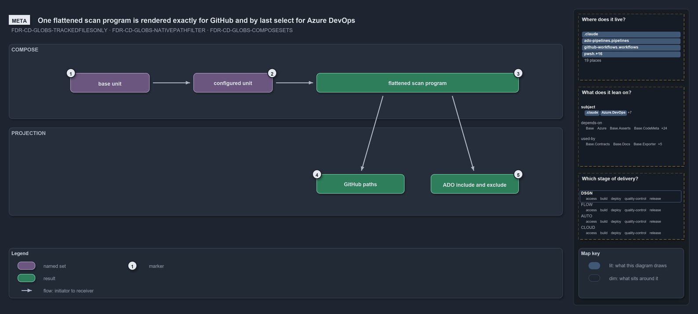

# One flattened scan program is rendered exactly for GitHub and by last select for Azure DevOps

```text
One flattened scan program is rendered exactly for GitHub and by last select for ADO.

1  base unit                the shared surface a configured unit composes; binds no pipeline
2  configured unit          a base plus its own configuration; its own rules come last
3  flattened scan program   the base's rules first, then the unit's own, last-match-wins
4  GitHub paths             the program in order, each drop as a ! negation: exact
5  ADO include and exclude  each pattern collapsed to its last select: order lost

Supports FDR-CD-GLOBS-TRACKEDFILESONLY, FDR-CD-GLOBS-NATIVEPATHFILTER and FDR-CD-GLOBS-COMPOSESETS (meta lens).
```

A globset in cats maps a deployable unit onto its files, and a pipeline triggers on that mapping. The mapping is an ordered scan program,
and a configured unit composes a base unit by putting the base's program first and its own rules last. Both vendors trigger on a projection
of that one flattened program, but only one of the two dialects can carry its order: GitHub paths reproduce it exactly, while Azure DevOps
keeps just each pattern's last select.

```yml drawio
description:
  "One flattened scan program composed from a base unit and a configured unit, and its two projections: GitHub paths keep the order exactly,
  Azure DevOps include and exclude collapse each pattern to its last select."
about:
  adrs: [FDR-CD-GLOBS-TRACKEDFILESONLY, FDR-CD-GLOBS-NATIVEPATHFILTER, FDR-CD-GLOBS-COMPOSESETS]
  lens: meta
content:
  title: One flattened scan program is rendered exactly for GitHub and by last select for Azure DevOps
  kind: explanation
  flow: top-to-bottom
  theme: dark
  bands:
    - { id: band-compose, label: COMPOSE }
    - { id: band-projection, label: PROJECTION }
  glyphs:
    - { id: s-base-unit, kind: set, label: base unit, in: band-compose }
    - { id: s-configured-unit, kind: set, label: configured unit, in: band-compose }
    - { id: r-program, kind: result, label: flattened scan program, in: band-compose }
    - { id: r-github-paths, kind: result, label: GitHub paths, in: band-projection }
    - { id: r-ado-filters, kind: result, label: ADO include and exclude, in: band-projection }
  edges:
    - { from: s-base-unit, to: s-configured-unit, kind: flow, label: "" }
    - { from: s-configured-unit, to: r-program, kind: flow, label: "" }
    - { from: r-program, to: r-github-paths, kind: flow, label: "" }
    - { from: r-program, to: r-ado-filters, kind: flow, label: "" }
  markers:
    - { at: s-base-unit, number: 1 }
    - { at: s-configured-unit, number: 2 }
    - { at: r-program, number: 3 }
    - { at: r-github-paths, number: 4 }
    - { at: r-ado-filters, number: 5 }
  legend: auto
  minimaps: [code-locations, module-neighbourhood, axis]
layout:
  band-compose: { x: 20, y: 84, w: 1260, h: 170 }
  band-projection: { x: 20, y: 274, w: 1260, h: 200 }
  s-base-unit: { x: 160, y: 150, w: 180, h: 44 }
  s-configured-unit: { x: 440, y: 150, w: 180, h: 44 }
  r-program: { x: 720, y: 150, w: 460, h: 44 }
  r-github-paths: { x: 720, y: 380, w: 200, h: 44 }
  r-ado-filters: { x: 980, y: 380, w: 200, h: 44 }
```



## Walkthrough

1. **Base unit.** A base unit is a deployable unit that exists only to be composed: a shared, un-configured surface such as a template
   without any deployment configuration. It binds no pipeline of its own and ships only through the configured units that compose it.
2. **Configured unit.** A configured unit is a base plus its own configuration, for example one customer's configuration folder. It names
   the bases it composes and binds the pipeline that deploys it.
3. **Flattened scan program.** The unit's program is the composed bases' programs first, deepest base first, then the unit's own select and
   drop rules last, so the unit's rules override its base. A file belongs when its last matching rule is a select; the program is built once
   and both projections read it.
4. **GitHub paths.** The GitHub projection is the program in order, each drop rendered as a `!` negation. GitHub paths are evaluated
   last-match-wins, the same way as membership, so this projection is exact.
5. **ADO include and exclude.** Azure DevOps path filters are order-independent: the union of the includes minus the union of the excludes.
   So each pattern is collapsed to its last select in the program, and a slice the base dropped and the unit re-added nets to an include.
   Azure DevOps keeps a deeper-folder include over a broader exclude, which carries the re-add.

## Why it holds

- Membership is an ordered scan program of select and drop rules over tracked files, evaluated last-match-wins with a default of
  not-selected; precedence is position, never kind (FDR-CD-GLOBS-TRACKEDFILESONLY).
- A pipeline, workflow or build-validation policy triggers on the globset's native path-filter projection: GitHub `on.*.paths` with ordered
  `!` negation, exact; Azure DevOps `trigger.paths.include` and `exclude`, order-independent, so each pattern is collapsed to its last
  select (FDR-CD-GLOBS-NATIVEPATHFILTER).
- A globset may compose other declared sets: the composed programs come first and the set's own rules last, and the flattened program is
  what both the projection and the durable SHA are computed from (FDR-CD-GLOBS-COMPOSESETS).

## See also

- [Globset triggers](../../drs/flow/durable-sha-globs.md) — the decision this article explains.
- The other lenses on the same projection: [architecture](globs-projects-and-three-consumers-read.md),
  [implementation](apex-thirteen-rules-seven-includes-six-excludes.md), [operations](print-projection-then-drift-names-the-filter.md) and
  [governance](drift-is-gated-generation-is-drs-only.md).
- [The flow explanations](index.md) · [How to read the diagrams](../index.md#how-to-read-the-diagrams)
