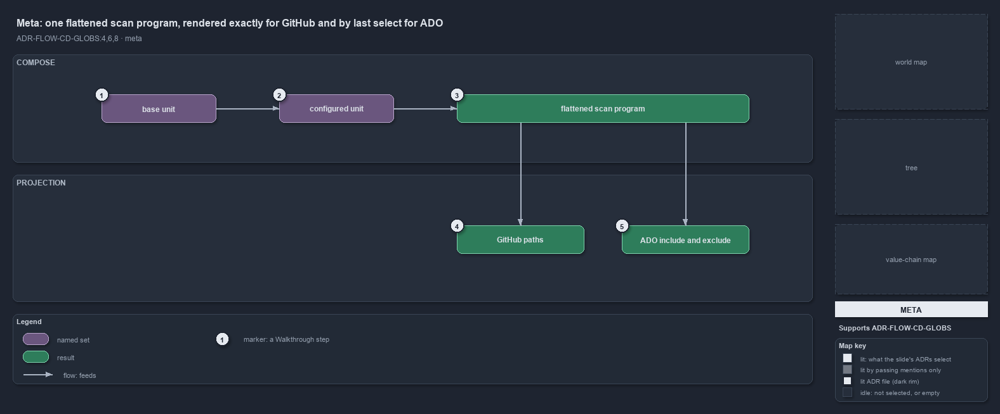

---
catzc:
  immutable:
    with_body_sha: db61cae23740
    path: docs/explanation/flow/one-program-two-vendor-dialects.md
    folder: docs/explanation/flow
    name: one-program-two-vendor-dialects
    filetype: md
    kind: explanation
    language: markdown
    track: docs
    tracktype: documentation
  edges:
    cites:
      - ADR-FLOW-CD-GLOBS#{4,6,8}
    links:
      - docs/.assets/explanation/adr-flow-cd-globs--one-program-two-vendor-dialects--meta.drawio.md
      - docs/.assets/explanation/adr-flow-cd-globs--one-program-two-vendor-dialects--meta.drawio.png
      - docs/adr/flow/durable-sha-globs.md
      - docs/explanation/flow/apex-thirteen-rules-seven-includes-six-excludes.md
      - docs/explanation/flow/drift-is-gated-generation-is-adr-only.md
      - docs/explanation/flow/globs-projects-and-three-consumers-read.md
      - docs/explanation/flow/index.md
      - docs/explanation/flow/print-projection-then-drift-names-the-filter.md
      - docs/explanation/index.md#how-to-read-the-diagrams
---

# One flattened scan program is rendered exactly for GitHub and by last select for Azure DevOps

```text
One flattened scan program is rendered exactly for GitHub and by last select for ADO.

1  base unit                the shared surface a configured unit composes; binds no pipeline
2  configured unit          a base plus its own configuration; its own rules come last
3  flattened scan program   the base's rules first, then the unit's own, last-match-wins
4  GitHub paths             the program in order, each drop as a ! negation: exact
5  ADO include and exclude  each pattern collapsed to its last select: order lost

Supports ADR-FLOW-CD-GLOBS#4, #6 and #8 (meta lens).
```

A globset in cats maps a deployable unit onto its files, and a pipeline triggers on that mapping. The mapping is an ordered scan program,
and a configured unit composes a base unit by putting the base's program first and its own rules last. Both vendors trigger on a projection
of that one flattened program, but only one of the two dialects can carry its order: GitHub paths reproduce it exactly, while Azure DevOps
keeps just each pattern's last select.



The diagram is described element by element in
[its asset description](../../.assets/explanation/adr-flow-cd-globs--one-program-two-vendor-dialects--meta.drawio.md).

## Walkthrough

1. **Base unit.** A base unit is a deployable unit that exists only to be composed: a shared, un-configured surface such as a template
   without any deployment configuration. It binds no pipeline of its own and ships only through the configured units that compose it.
2. **Configured unit.** A configured unit is a base plus its own configuration, for example one customer's configuration folder. It names
   the bases it composes and binds the pipeline that deploys it.
3. **Flattened scan program.** The unit's program is the composed bases' programs first, deepest base first, then the unit's own select and
   drop rules last, so the unit's rules override its base. A file belongs when its last matching rule is a select; the program is built once
   and both projections read it.
4. **GitHub paths.** The GitHub projection is the program in order, each drop rendered as a `!` negation. GitHub paths are evaluated
   last-match-wins, the same way as membership, so this projection is exact.
5. **ADO include and exclude.** Azure DevOps path filters are order-independent: the union of the includes minus the union of the excludes.
   So each pattern is collapsed to its last select in the program, and a slice the base dropped and the unit re-added nets to an include.
   Azure DevOps keeps a deeper-folder include over a broader exclude, which carries the re-add.

## Why it holds

- Membership is an ordered scan program of select and drop rules over tracked files, evaluated last-match-wins with a default of
  not-selected; precedence is position, never kind (ADR-FLOW-CD-GLOBS#4).
- A pipeline, workflow or build-validation policy triggers on the globset's native path-filter projection: GitHub `on.*.paths` with ordered
  `!` negation, exact; Azure DevOps `trigger.paths.include` and `exclude`, order-independent, so each pattern is collapsed to its last
  select (ADR-FLOW-CD-GLOBS#6).
- A globset may compose other declared sets: the composed programs come first and the set's own rules last, and the flattened program is
  what both the projection and the durable SHA are computed from (ADR-FLOW-CD-GLOBS#8).

## See also

- [Globset triggers](../../adr/flow/durable-sha-globs.md) — the decision this article explains.
- The other lenses on the same projection: [architecture](globs-projects-and-three-consumers-read.md),
  [implementation](apex-thirteen-rules-seven-includes-six-excludes.md), [operations](print-projection-then-drift-names-the-filter.md) and
  [governance](drift-is-gated-generation-is-adr-only.md).
- [The flow explanations](index.md) · [How to read the diagrams](../index.md#how-to-read-the-diagrams)
