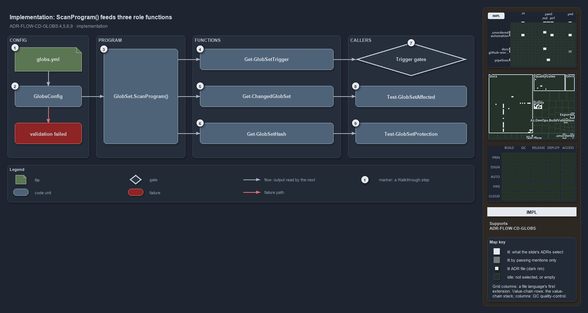

# One method, GlobSet.ScanProgram(), feeds all three globset role functions

```text
One method, GlobSet.ScanProgram(), feeds all three globset role functions.

1  globs.yml               the globsets map, read by Get-Config -Config globs
2  GlobsConfig             validates the registry at load and throws once with every error
3  GlobSet.ScanProgram()   composed programs first, own rules last, deduped, cached
4  Get-GlobSetTrigger      projects the program into GitHub and Azure DevOps path filters
5  Get-ChangedGlobSet      matches git's changed paths against every set
6  Get-GlobSetHash         folds the members' CR-stripped SHA-256 digests into one identity
7  Trigger gates           compare the projection with what pipelines and workflows declare
8  Test-GlobSetAffected    answers "is this set touched?", failing open on doubt
9  Test-GlobSetProtection  compares the live identity with the recorded one

Supports ADR-FLOW-CD-GLOBS#4, #5, #6 and #9 (implementation lens).
```

`GlobSet.ScanProgram()` is the one method behind a globset's membership, its trigger and its identity in cats. The code runs from
`globs.yml` through the validating load to that method, then to the three role functions and the function that reads each one's output.
Knowing that one method sits behind all three roles tells a reader where a change to the dialect or to compose lands.



The diagram is described element by element in [its asset description](one-scan-program-feeds-three-roles.drawio.md).

## Walkthrough

1. **globs.yml.** The `globsets:` map is read by `Get-Config -Config globs`, which returns a validated `[GlobsConfig]`.
2. **GlobsConfig.** The type validates the whole registry at load: unknown keys, malformed patterns, compose references and compose cycles.
   It collects every error and throws once with `globs config validation failed`, so a bad registry never reaches the program.
3. **GlobSet.ScanProgram().** The composed sets' programs come first, deepest base first, then the set's own `+` includes and `-` excludes
   last; identical rules are deduped keeping the last. The program is built lazily and cached, and `Matches()` evaluates it last-match-wins
   with a default of not-selected.
4. **Get-GlobSetTrigger.** Given `-Name`, it walks `ScanProgram()` once and returns `.GitHub` (the program in order, each `-` rendered as
   `!`) and `.AdoInclude` and `.AdoExclude` (each pattern collapsed to its last select).
5. **Get-ChangedGlobSet.** Given `-Range`, it takes the changed paths from `Get-ChangedFile` (`git diff --name-only --no-renames`) and
   returns every set whose `Matches()` selects one of them; `-IncludeModules` adds the derived module sets.
6. **Get-GlobSetHash.** Given `-Name`, it selects the members through `GlobSet.SelectMembers` over `git ls-files`, hashes each with
   `DurableHash.HashFile` (a CR-stripped SHA-256), and folds the `path|digest` lines with `DurableHash.HashFold`.
7. **`Trigger gates`.** `Test-AdoPipelineTriggerGlob`, `Test-GitHubWorkflowTriggerGlob` and `Test-GlobSetTriggerCoverage` call
   `Get-GlobSetTrigger` and compare its output with the filters the pipelines and workflows declare.
8. **Test-GlobSetAffected.** Given `-Name`, it resolves the range with `Get-GlobSetChangeRange`, then calls `Get-ChangedGlobSet`. It returns
   `$true` when the range is indeterminate or the diff fails, so it fails open, and it throws on an undeclared name.
9. **Test-GlobSetProtection.** It calls `Get-GlobSetHash` unless a hash is passed in, compares it with the recorded identity, and stores it
   as pending; `Protect-GlobSet` promotes it after a green scan. Both are no-ops in a pipeline.

## Why it holds

- A globset's membership is an ordered scan program evaluated last-match-wins over tracked files (ADR-FLOW-CD-GLOBS#4).
- The identity is the durable SHA, computed live per member file and folded into one SHA-256 (ADR-FLOW-CD-GLOBS#5).
- The trigger is the program projected into each vendor's native path-filter dialect (ADR-FLOW-CD-GLOBS#6).
- Whether a change touches a set is computed from git at real refs, failing open on any doubt (ADR-FLOW-CD-GLOBS#9).

## Where the code and the ADR differ

- The help text of `Get-GlobSetHash` still calls the hash "the marker file's sha256" and cites rule 9; the ADR says the identity is never
  committed (ADR-FLOW-CD-GLOBS#5).
- `Test-GlobSetAffected` cites fail-open as ADR-REPO-PROTGLOB#5; for the change check the ADR states it in ADR-FLOW-CD-GLOBS#9.

## See also

- [Globset triggers](../../adr/flow/durable-sha-globs.md) — the decision this article explains.
- The other lenses on the same globset roles: [meta](three-views-derived-live-from-one-program.md),
  [architecture](globs-module-owns-config-and-types.md), [operations](edit-globs-yml-then-read-the-output.md) and
  [governance](gates-check-source-and-trigger.md).
- [The flow explanations](index.md) · [How to read the diagrams](../index.md#how-to-read-the-diagrams)
