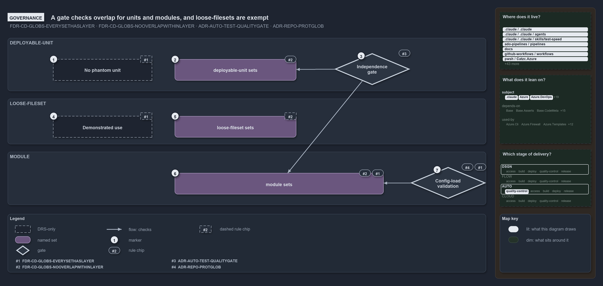

# A gate checks overlap for units and modules, and loose-filesets are exempt

```text
A quality gate keeps units and modules disjoint; loose-filesets are exempt; two prohibitions are DRS-only.

1  No phantom unit           a unit neither composed nor pipeline-bound; no code checks it
2  deployable-unit sets      disjoint on their own contribution, compose ignored
3  Independence gate         Test-GlobSetIndependence, a quality gate; zero issues today
4  Demonstrated use          a loose-fileset must earn its place; no code checks it
5  loose-fileset sets        exempt from the independence rule; the gate skips them
6  module sets               derived-only, disjoint on their own contribution
7  Config-load validation    GlobsConfig rejects a declared module layer or reserved name

Supports FDR-CD-GLOBS-EVERYSETHASLAYER, FDR-CD-GLOBS-NOOVERLAPWITHINLAYER, ADR-AUTO-TEST-QUALITYGATE
and ADR-REPO-PROTGLOB (governance lens).
```

The per-layer independence rule says that peers in a layer never share a file on their own contribution. In cats a quality gate enforces it
for the `deployable-unit` and `module` layers, config-load validation keeps the `module` layer derived-only, and the `loose-fileset` layer
is exempt by design. Two prohibitions in the same FDR, the phantom unit and the loose-fileset without a demonstrated use, have no check
behind them: they hold only as DRS rules.

```yml drawio
description:
  "Which checks keep globset layers disjoint: one quality gate covers the deployable-unit and module layers, config-load validation keeps
  the module layer derived-only, loose-filesets are exempt, and two prohibitions have no check at all."
about:
  adrs: [FDR-CD-GLOBS-EVERYSETHASLAYER, FDR-CD-GLOBS-NOOVERLAPWITHINLAYER, ADR-AUTO-TEST-QUALITYGATE, ADR-REPO-PROTGLOB]
  lens: governance
content:
  title: A gate checks overlap for units and modules, and loose-filesets are exempt
  kind: explanation
  flow: top-to-bottom
  theme: dark
  bands:
    - { id: band-unit, label: DEPLOYABLE-UNIT }
    - { id: band-loose, label: LOOSE-FILESET }
    - { id: band-module, label: MODULE }
  glyphs:
    - { id: a-phantom, kind: drsonly, label: No phantom unit, in: band-unit }
    - { id: s-unit-sets, kind: set, label: deployable-unit sets, in: band-unit }
    - { id: g-independence, kind: gate, label: Independence gate, in: band-unit }
    - { id: a-demonstrated, kind: drsonly, label: Demonstrated use, in: band-loose }
    - { id: s-loose-sets, kind: set, label: loose-fileset sets, in: band-loose }
    - { id: s-module-sets, kind: set, label: module sets, in: band-module }
    - { id: g-config-load, kind: gate, label: Config-load validation, in: band-module }
  edges:
    - { from: g-independence, to: s-unit-sets, kind: flow, label: "" }
    - { from: g-independence, to: s-module-sets, kind: flow, label: "" }
    - { from: g-config-load, to: s-module-sets, kind: flow, label: "" }
  markers:
    - { at: a-phantom, number: 1 }
    - { at: s-unit-sets, number: 2 }
    - { at: g-independence, number: 3 }
    - { at: a-demonstrated, number: 4 }
    - { at: s-loose-sets, number: 5 }
    - { at: s-module-sets, number: 6 }
    - { at: g-config-load, number: 7 }
  chips:
    - { at: a-phantom, kind: rule, rule: FDR-CD-GLOBS-EVERYSETHASLAYER, gated: false }
    - { at: s-unit-sets, kind: rule, rule: FDR-CD-GLOBS-NOOVERLAPWITHINLAYER }
    - { at: g-independence, kind: rule, rule: ADR-AUTO-TEST-QUALITYGATE }
    - { at: a-demonstrated, kind: rule, rule: FDR-CD-GLOBS-EVERYSETHASLAYER, gated: false }
    - { at: s-loose-sets, kind: rule, rule: FDR-CD-GLOBS-NOOVERLAPWITHINLAYER, gated: false }
    - { at: s-module-sets, kind: rule, rule: FDR-CD-GLOBS-EVERYSETHASLAYER }
    - { at: s-module-sets, kind: rule, rule: FDR-CD-GLOBS-NOOVERLAPWITHINLAYER }
    - { at: g-config-load, kind: rule, rule: FDR-CD-GLOBS-EVERYSETHASLAYER }
    - { at: g-config-load, kind: rule, rule: ADR-REPO-PROTGLOB }
  legend: auto
  minimaps: [code-locations, module-neighbourhood, axis]
layout:
  band-unit: { x: 20, y: 84, w: 1260, h: 140 }
  band-loose: { x: 20, y: 244, w: 1260, h: 120 }
  band-module: { x: 20, y: 384, w: 1260, h: 140 }
  a-phantom: { x: 140, y: 140, w: 260, h: 56 }
  s-unit-sets: { x: 460, y: 140, w: 320, h: 56 }
  g-independence: { x: 880, y: 124, w: 200, h: 84 }
  a-demonstrated: { x: 140, y: 290, w: 260, h: 56 }
  s-loose-sets: { x: 460, y: 290, w: 320, h: 56 }
  s-module-sets: { x: 460, y: 440, w: 550, h: 56 }
  g-config-load: { x: 1080, y: 424, w: 200, h: 84 }
```



## Walkthrough

1. **No phantom unit.** A deployable-unit that is neither composed nor pipeline-bound is phantom state, and one living version
   (`PDR-ONELIVE`) forbids it. No code checks it; all five units in `globs.yml` today are composed or bound.
2. **deployable-unit sets.** No two units select a common file on their own contribution, with `compose` ignored, so a configured unit may
   contain the base it composes while the layer stays disjoint.
3. **`Independence gate`.** `Test-GlobSetIndependence` is a quality gate. It checks every layer but `loose-fileset`, and the integrity test
   `GlobSet-Independence.Tests.ps1` requires it to report zero issues. Today it reports zero issues over 102 sets.
4. **Demonstrated use.** A loose-fileset must earn its place by a pipeline it triggers, a scan whose scope it sets, or a protection it
   drives. No code checks it.
5. **loose-fileset sets.** The layer is exempt from the independence rule: its sets are cross-cutting surfaces that overlap the boundaries
   they cut across, and the gate skips them.
6. **module sets.** The layer is derived-only and never declared, and its sets are pairwise-disjoint on their own contribution. Its
   catch-all, `module-leftovers`, is disjoint by construction. The gate `Test-GlobSetIndependence` checks it.
7. **Config-load validation.** `GlobsConfig` rejects a declared `layer: module` and a declared reserved name (`internal`, `vendor`,
   `compiled`, `scriptanalyzer`) when `globs.yml` loads.

## Why it holds

- Every globset carries a layer, the `module` layer is derived-only, and a phantom unit or a loose-fileset without a demonstrated use is
  forbidden (FDR-CD-GLOBS-EVERYSETHASLAYER).
- Within a layer, no two globsets select a common file on their own contribution; validation is per layer, and the `loose-fileset` layer is
  exempt (FDR-CD-GLOBS-NOOVERLAPWITHINLAYER).
- A quality gate checks one property of the whole repository, writes its report and throws once listing every issue
  (ADR-AUTO-TEST-QUALITYGATE).
- Module globsets are derived, never declared, and derived and declared sets share one name space (ADR-REPO-PROTGLOB-DERIVEDMODULEGLOBSETS).

## Where the code and the decision record differ

- The FDR's "How this is enforced" section names the schema check and the gates on the triggers but not `Test-GlobSetIndependence`, which is
  the gate that enforces the independence rule.
- No code checks the phantom-unit or the demonstrated-use prohibition. The declared loose-fileset `templates` binds no pipeline, sets no
  `verify:` scope and has no caller outside tests, so its demonstrated use is not visible in code.
- ADR-REPO-PROTGLOB says a shadowing declared name is rejected at load. Only the reserved names are; a declared name that shadows a module,
  aspect, internal or `module-leftovers` set throws later, in `Get-ModuleGlobSet`.

## See also

- [Globset triggers](../../drs/flow/durable-sha-globs.md) — the decision this article explains, with
  [test automation](../../drs/automation/test-automation.md), [one living version](../../drs/principles/one-living-version.md) and
  [protected globs](../../drs/repository/protected-globs.md).
- The other lenses on the same layers: [meta](peers-in-a-layer-never-overlap.md), [architecture](two-declared-layers-one-derived.md),
  [implementation](independence-check-groups-by-layer.md) and [operations](declare-or-add-folder-gate-names-overlaps.md).
- [The flow explanations](index.md) · [How to read the diagrams](../index.md#how-to-read-the-diagrams)
