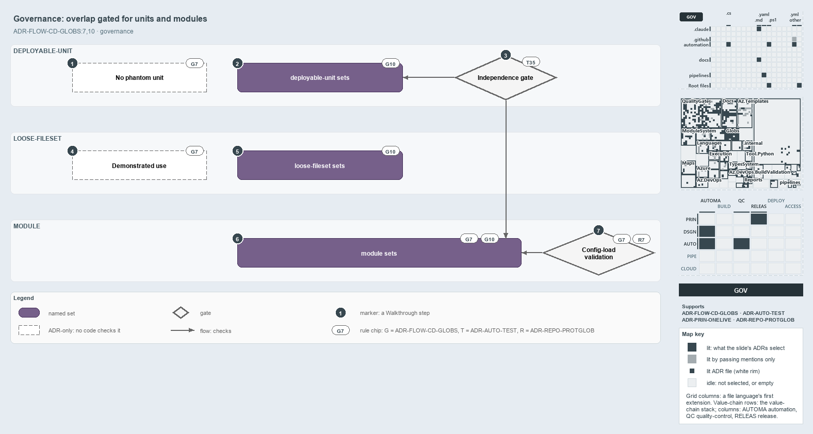

---
catzc:
  derived:
    path: docs/explanation/flow/overlap-gated-for-units-and-modules.md
    kind: explanation
    language: markdown
    filekind: md
    track: docs
    body_sha: "0c1d71f47fcd"
    adrs:
      - ADR-AUTO-TEST#35
      - ADR-FLOW-CD-GLOBS#{7,10}
      - ADR-REPO-PROTGLOB#7
    links:
      - docs/.assets/explanation/adr-flow-cd-globs--overlap-gated-for-units-and-modules--governance.drawio.md
      - docs/.assets/explanation/adr-flow-cd-globs--overlap-gated-for-units-and-modules--governance.drawio.png
      - docs/adr/automation/test-automation.md
      - docs/adr/flow/durable-sha-globs.md
      - docs/adr/principles/one-living-version.md
      - docs/adr/repository/protected-globs.md
      - docs/explanation/flow/declare-or-add-folder-gate-names-overlaps.md
      - docs/explanation/flow/independence-check-groups-by-layer.md
      - docs/explanation/flow/index.md
      - docs/explanation/flow/peers-in-a-layer-never-overlap.md
      - docs/explanation/flow/two-declared-layers-one-derived.md
      - docs/explanation/index.md#how-to-read-the-diagrams
---

# A gate checks overlap for units and modules, and loose-filesets are exempt

```text
A quality gate keeps units and modules disjoint; loose-filesets are exempt; two prohibitions are ADR-only.

1  No phantom unit           a unit neither composed nor pipeline-bound; no code checks it
2  deployable-unit sets      disjoint on their own contribution, compose ignored
3  Independence gate         Test-GlobSetIndependence, a quality gate; zero issues today
4  Demonstrated use          a loose-fileset must earn its place; no code checks it
5  loose-fileset sets        exempt from the independence rule; the gate skips them
6  module sets               derived-only, disjoint on their own contribution
7  Config-load validation    GlobsConfig rejects a declared module layer or reserved name

Supports ADR-FLOW-CD-GLOBS#7 and #10, ADR-AUTO-TEST#35 and ADR-REPO-PROTGLOB#7 (governance lens).
```

The per-layer independence rule says that peers in a layer never share a file on their own contribution. In cats a quality gate enforces it
for the `deployable-unit` and `module` layers, config-load validation keeps the `module` layer derived-only, and the `loose-fileset` layer
is exempt by design. Two prohibitions in the same ADR, the phantom unit and the loose-fileset without a demonstrated use, have no check
behind them: they hold only as ADR rules.



The diagram is described element by element in
[its asset description](../../.assets/explanation/adr-flow-cd-globs--overlap-gated-for-units-and-modules--governance.drawio.md).

## Walkthrough

1. **No phantom unit.** A deployable-unit that is neither composed nor pipeline-bound is phantom state, and one living version
   (`ADR-PRIN-ONELIVE`) forbids it. No code checks it; all five units in `globs.yml` today are composed or bound.
2. **deployable-unit sets.** No two units select a common file on their own contribution, with `compose` ignored, so a configured unit may
   contain the base it composes while the layer stays disjoint.
3. **`Independence gate`.** `Test-GlobSetIndependence` is a quality gate. It checks every layer but `loose-fileset`, and the integrity test
   `GlobSet-Independence.Tests.ps1` requires it to report zero issues. Today it reports zero issues over 102 sets.
4. **Demonstrated use.** A loose-fileset must earn its place by a pipeline it triggers, a scan whose scope it sets, or a protection it
   drives. No code checks it.
5. **loose-fileset sets.** The layer is exempt from the independence rule: its sets are cross-cutting surfaces that overlap the boundaries
   they cut across, and the gate skips them.
6. **module sets.** The layer is derived-only and never declared, and its sets are pairwise-disjoint on their own contribution. Its
   catch-all, `module-leftovers`, is disjoint by construction. The gate `Test-GlobSetIndependence` checks it.
7. **Config-load validation.** `GlobsConfig` rejects a declared `layer: module` and a declared reserved name (`internal`, `vendor`,
   `compiled`, `scriptanalyzer`) when `globs.yml` loads.

## Why it holds

- Every globset carries a layer, the `module` layer is derived-only, and a phantom unit or a loose-fileset without a demonstrated use is
  forbidden (ADR-FLOW-CD-GLOBS#7).
- Within a layer, no two globsets select a common file on their own contribution; validation is per layer, and the `loose-fileset` layer is
  exempt (ADR-FLOW-CD-GLOBS#10).
- A quality gate checks one property of the whole repository, writes its report and throws once listing every issue (ADR-AUTO-TEST#35).
- Module globsets are derived, never declared, and derived and declared sets share one name space (ADR-REPO-PROTGLOB#7).

## Where the code and the ADR differ

- The ADR's "How this is enforced" section names the schema check and the gates on the triggers but not `Test-GlobSetIndependence`, which is
  the gate that enforces the independence rule.
- No code checks the phantom-unit or the demonstrated-use prohibition. The declared loose-fileset `templates` binds no pipeline, sets no
  `verify:` scope and has no caller outside tests, so its demonstrated use is not visible in code.
- ADR-REPO-PROTGLOB says a shadowing declared name is rejected at load. Only the reserved names are; a declared name that shadows a module,
  aspect, internal or `module-leftovers` set throws later, in `Get-ModuleGlobSet`.

## See also

- [Globset triggers](../../adr/flow/durable-sha-globs.md) — the decision this article explains, with
  [test automation](../../adr/automation/test-automation.md), [one living version](../../adr/principles/one-living-version.md) and
  [protected globs](../../adr/repository/protected-globs.md).
- The other lenses on the same layers: [meta](peers-in-a-layer-never-overlap.md), [architecture](two-declared-layers-one-derived.md),
  [implementation](independence-check-groups-by-layer.md) and [operations](declare-or-add-folder-gate-names-overlaps.md).
- [The flow explanations](index.md) · [How to read the diagrams](../index.md#how-to-read-the-diagrams)
