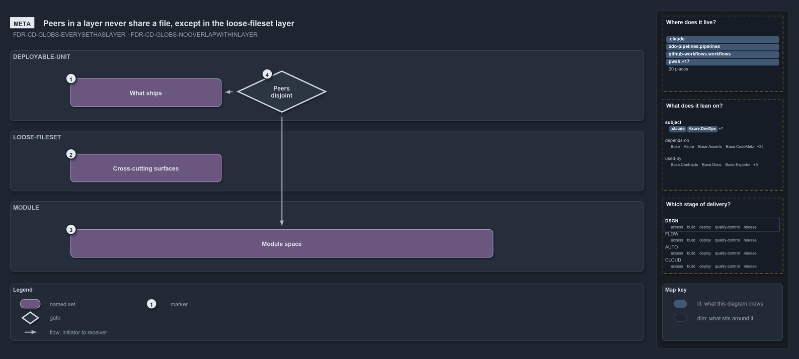

# Peers in a layer never share a file, except in the loose-fileset layer

```text
Peers in a layer never share a file on their own contribution; only loose-filesets may overlap.

1  What ships               the deployable-unit layer: one boundary per unit that ships
2  Cross-cutting surfaces   the loose-fileset layer: overlaps the other layers by design
3  Module space             the module layer: derived from the folders, never declared
4  Peers disjoint           the one rule, checked by a gate for the two boundary layers

Supports FDR-GLOBS-EVERYSETHASLAYER and FDR-GLOBS-NOOVERLAPWITHINLAYER (meta lens).
```

Every globset in cats belongs to one layer, and a layer is a set of peers that partition one concern into boundaries. Within a layer, no two
peers share a file on their own contribution, because overlap would mean one boundary consumes another's files. The `loose-fileset` layer,
which cuts across the others, is the only exemption, and across layers one file may sit in all three.

```yml drawio
description:
  "The three globset layers as bands: deployable-unit, loose-fileset and module sets, with one rule across them, peers in a layer are
  disjoint, which a gate checks for the two boundary layers and the loose-fileset layer is exempt from."
about:
  adrs: [FDR-GLOBS-EVERYSETHASLAYER, FDR-GLOBS-NOOVERLAPWITHINLAYER]
  lens: meta
content:
  title: Peers in a layer never share a file, except in the loose-fileset layer
  kind: explanation
  flow: top-to-bottom
  theme: dark
  bands:
    - { id: band-unit, label: DEPLOYABLE-UNIT }
    - { id: band-loose, label: LOOSE-FILESET }
    - { id: band-module, label: MODULE }
  glyphs:
    - { id: s-ships, kind: set, label: What ships, in: band-unit }
    - { id: g-peers-disjoint, kind: gate, label: Peers disjoint, in: band-unit }
    - { id: s-cross-cutting, kind: set, label: Cross-cutting surfaces, in: band-loose }
    - { id: s-module-space, kind: set, label: Module space, in: band-module }
  edges:
    - { from: g-peers-disjoint, to: s-ships, kind: flow, label: "" }
    - { from: g-peers-disjoint, to: s-module-space, kind: flow, label: "" }
  markers:
    - { at: s-ships, number: 1 }
    - { at: s-cross-cutting, number: 2 }
    - { at: s-module-space, number: 3 }
    - { at: g-peers-disjoint, number: 4 }
  legend: auto
  minimaps: [code-locations, module-neighbourhood, axis]
layout:
  band-unit: { x: 20, y: 84, w: 1260, h: 140 }
  band-loose: { x: 20, y: 244, w: 1260, h: 120 }
  band-module: { x: 20, y: 384, w: 1260, h: 140 }
  s-ships: { x: 140, y: 140, w: 300, h: 56 }
  g-peers-disjoint: { x: 470, y: 124, w: 180, h: 84 }
  s-cross-cutting: { x: 140, y: 290, w: 300, h: 56 }
  s-module-space: { x: 140, y: 440, w: 840, h: 56 }
```



## Walkthrough

1. **What ships.** The `deployable-unit` layer is declared: one boundary per unit that ships. A unit never consumes another unit's files.
2. **Cross-cutting surfaces.** The `loose-fileset` layer holds track roots, scan scopes and the reserved umbrellas. Its sets overlap the
   boundaries of the other two layers by design, so nothing checks its peers against each other, and it stands alone.
3. **Module space.** The `module` layer is derived from the folders and never declared: aspect sets per module folder, one set per internal
   shared module file, and a catch-all for module-space files no module owns. A module never consumes another module's files.
4. **Peers disjoint.** The one rule: peers in a layer are disjoint on their own files, with composition ignored, and a gate checks it for
   the `deployable-unit` and `module` layers. A file under `pwsh/Base.Globs/` still belongs to the `pwsh` track, to a module set and, if it
   ships, to a deployable-unit, because overlap across layers is expected.

## Why it holds

- Every globset carries a layer: two are declared, and `module` is derived-only (FDR-GLOBS-EVERYSETHASLAYER).
- Within a layer, no two globsets select a common file on their own contribution; the rule is per layer, never across, and the
  `loose-fileset` layer is exempt (FDR-GLOBS-NOOVERLAPWITHINLAYER).

## Where the code and the decision record differ

The FDR describes one module set per folder. The code derives two aspect sets per folder, `-live` and `-tests`, and no whole-module set.

## See also

- [Globset triggers](../../drs/flow/durable-sha-globs.md) — the decision this article explains.
- The other lenses on the same layers: [architecture](two-declared-layers-one-derived.md),
  [implementation](independence-check-groups-by-layer.md), [operations](declare-or-add-folder-gate-names-overlaps.md) and
  [governance](overlap-gated-for-units-and-modules.md).
- [The flow explanations](index.md) · [How to read the diagrams](../index.md#how-to-read-the-diagrams)
