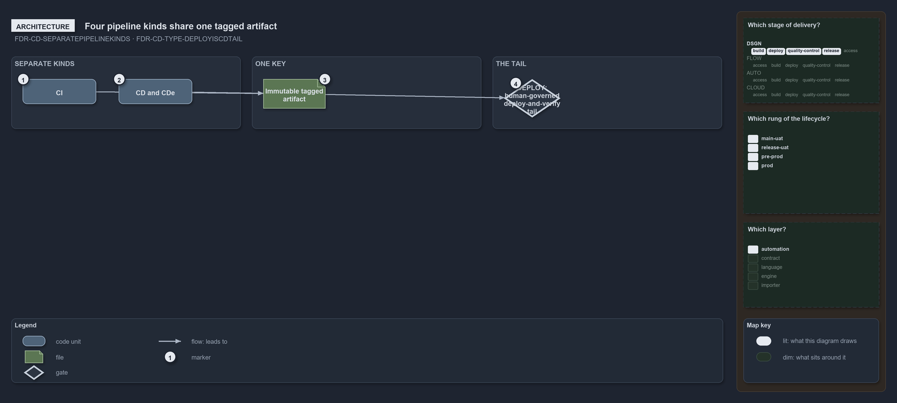

---
catzc:
  warning: "Experimental: this article merges two rules into one and holds nothing beyond what they say"
  edges:
    cites:
      - FDR-CD-SEPARATEPIPELINEKINDS
      - FDR-CD-TYPE-DEPLOYISCDTAIL
---

# Pipeline kinds are separate and deploy is the human governed tail of cd

This article is one rule:
[FDR-CD-SEPARATEPIPELINEKINDS](../../drs/flow/cd-discipline-and-promotion-flow.md#rule-fdr-cd-separatepipelinekinds) and
[FDR-CD-TYPE-DEPLOYISCDTAIL](../../drs/flow/pipeline-types.md#rule-fdr-cd-type-deployiscdtail) merged into one. It holds nothing beyond what
those two rules say.

CI, CD, CDe and DEPLOY are separate pipeline kinds keyed together by the tagged artifact. DEPLOY is the deploy-and-verify tail of CD,
extracted into its own human-governed pipeline: it consumes an immutable artifact built elsewhere, pinned to an explicit commit, trusts that
it has passed the AT gate, and drives it into an environment whose gate is manual.

