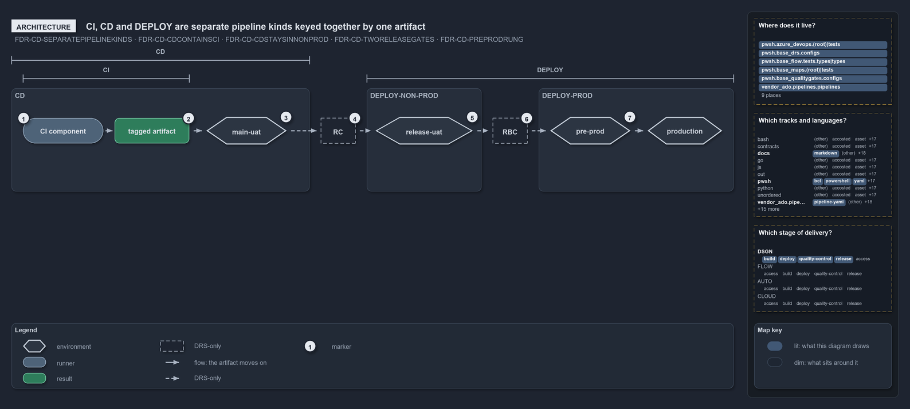

# CI, CD and DEPLOY are separate pipeline kinds keyed together by one artifact

```text
CI, CD and DEPLOY are separate pipeline kinds, keyed together by one artifact.

1  CI component          the one CI engine, the first stage of every CD
2  tagged artifact       built once, never rebuilt downstream
3  main-uat              the always-on environment that tracks the latest main
4  RC                    Release Certification: the human gate at main-uat
5  release-uat           where DEPLOY-Non-Prod drives the artifact for a release branch
6  RBC                   Release Branch Certification: the human gate at release-uat
7  pre-prod, production  DEPLOY-Prod stages the artifact inactive, then activates it live

Supports FDR-CD-SEPARATEPIPELINEKINDS, FDR-CD-CDCONTAINSCI, FDR-CD-CDSTAYSINNONPROD, FDR-CD-TWORELEASEGATES
and FDR-CD-PREPRODRUNG (architecture lens).
```

Cats does not build one giant pipeline from commit to production. CI, CD and DEPLOY are separate pipeline kinds, each with its own trigger,
governance and history, and they compose into one promotion flow because they share a single key: the immutable, tagged artifact that the CI
component builds once and every downstream kind consumes unchanged. Read from left to right, the flow puts the two release gates between the
kinds rather than inside them.

```yml drawio
description:
  CI, CD and DEPLOY are separate pipeline kinds keyed together by one tagged artifact that CI builds once; the two release gates sit between
  the kinds.
about:
  rules: [FDR-CD-SEPARATEPIPELINEKINDS, FDR-CD-CDCONTAINSCI, FDR-CD-CDSTAYSINNONPROD, FDR-CD-TWORELEASEGATES, FDR-CD-PREPRODRUNG]
  lens: architecture
content:
  title: CI, CD and DEPLOY are separate pipeline kinds keyed together by one artifact
  kind: explanation
  flow: left-to-right
  relation: the artifact moves on
  states: true
  theme: dark
  bands:
    - { id: band-cd, label: CD }
    - { id: band-non-prod, label: DEPLOY-NON-PROD }
    - { id: band-prod, label: DEPLOY-PROD }
  spans:
    - id: span-ci
      label: CI
      over: [g-ci, g-artifact]
    - id: span-cd
      label: CD
      over: [band-cd]
    - id: span-deploy
      label: DEPLOY
      over: [band-non-prod, band-prod]
  glyphs:
    - { id: g-main-uat, kind: env, label: main-uat, in: band-cd }
    - { id: g-ci, kind: runner, label: CI component, in: band-cd }
    - { id: g-artifact, kind: result, label: tagged artifact, in: band-cd }
    - { id: g-rc, kind: drsonly, label: RC, in: band-cd }
    - { id: g-rbc, kind: drsonly, label: RBC, in: band-non-prod }
    - { id: g-release-uat, kind: env, label: release-uat, in: band-non-prod }
    - { id: g-pre-prod, kind: env, label: pre-prod, in: band-prod }
    - { id: g-production, kind: env, label: production, in: band-prod }
  edges:
    - { from: g-ci, to: g-artifact, kind: flow, label: "" }
    - { from: g-artifact, to: g-main-uat, kind: flow, label: "" }
    - { from: g-main-uat, to: g-rc, kind: record, label: "" }
    - { from: g-rc, to: g-release-uat, kind: record, label: "" }
    - { from: g-release-uat, to: g-rbc, kind: record, label: "" }
    - { from: g-rbc, to: g-pre-prod, kind: record, label: "" }
    - { from: g-pre-prod, to: g-production, kind: record, label: "" }
  markers:
    - { at: g-ci, number: 1 }
    - { at: g-artifact, number: 2 }
    - { at: g-main-uat, number: 3 }
    - { at: g-rc, number: 4 }
    - { at: g-release-uat, number: 5 }
    - { at: g-rbc, number: 6 }
    - { at: g-pre-prod, number: 7 }
  legend: auto
  minimaps: [code-locations, grid, axis]
layout:
  band-cd: { x: 20, y: 138, w: 520, h: 180 }
  band-non-prod: { x: 640, y: 138, w: 200, h: 180 }
  band-prod: { x: 940, y: 138, w: 340, h: 180 }
  g-main-uat: { x: 360, y: 188, w: 140, h: 48 }
  g-ci: { x: 40, y: 190, w: 140, h: 44 }
  g-artifact: { x: 200, y: 190, w: 130, h: 44 }
  g-rc: { x: 560, y: 190, w: 60, h: 44 }
  g-rbc: { x: 860, y: 190, w: 60, h: 44 }
  g-release-uat: { x: 655, y: 188, w: 170, h: 48 }
  g-pre-prod: { x: 960, y: 188, w: 140, h: 48 }
  g-production: { x: 1130, y: 188, w: 130, h: 48 }
```



## Walkthrough

1. **CI component.** There is one CI engine, the same build-and-verify in a solo CI pipeline and at the front of every CD pipeline. In the
   customer CD pipelines it is the first stage, displayed as "CI engine — build & verify".
2. **Tagged artifact.** The CI component builds the artifact once, and nothing downstream rebuilds it, so what reaches production is
   byte-identical to what non-prod certified. The CD pipelines publish their artifacts and every deploy job downloads them, but no step tags
   them.
3. **main-uat.** CD's direction through non-prod ends on an always-on environment that tracks the latest main, whatever the organization
   calls it. In the repository it is the `dev` environment, and for the shared platform also `test`, that every merge to main redeploys. The
   on-demand environment with its L3 system tests, which the FDR places before it, has no pipeline yet.
4. **RC.** Release Certification is a manual gate at main-uat. It clears when main-AT, the acceptance testing against main-uat, is verified.
   A gate decides whether the artifact may proceed; it is not a pipeline.
5. **release-uat.** DEPLOY-Non-Prod drives the artifact into the non-prod acceptance environments, here the release-uat environment of a
   release branch. In the repository, the `release-uat` target of `deploy-apex.yaml` and `deploy-shared.yaml` is that path.
6. **RBC.** Release Branch Certification is the second manual gate, at release-uat, and it clears when release-AT is verified.
7. **Pre-prod and production.** DEPLOY-Prod drives the RBC-cleared artifact first into pre-prod, staged but not serving, and then activates
   the same bytes live in production.
   In the repository, `deploy-apex.yaml` and `deploy-shared.yaml` are the only pipelines that reach the prod subscription (`psub`,
   `preprod`, `prod`), by a `Target` of `prod` or `rollback`; the approval check on a prod-tier environment is the engine's, configured by
   the adopting team's apply of the shipped `environment-approvals.yml` through `Sync-AdoEnvironmentApprovals`
   (FDR-CD-PRODAPPROVALGATE).

## Why it holds

- CI, CD, CDe and DEPLOY are separate pipeline kinds keyed together by the tagged artifact, and nothing downstream rebuilds it
  (FDR-CD-SEPARATEPIPELINEKINDS).
- A CD pipeline always contains the CI component, and a solo CI pipeline contains only it (FDR-CD-CDCONTAINSCI).
- CD takes the artifact through an on-demand environment with L3 system tests and then onto the always-on environment that tracks main,
  entirely within non-prod (FDR-CD-CDSTAYSINNONPROD).
- RC and RBC are the two hands-on release gates, and each is a gate, not a pipeline (FDR-CD-TWORELEASEGATES).
- DEPLOY splits by target: DEPLOY-Non-Prod into the non-prod acceptance environments, DEPLOY-Prod through pre-prod into production
  (FDR-CD-PREPRODRUNG).
- CD is the delivery posture. CDe is the alternative, a CD that folds the DEPLOY step back in and rolls to production automatically; a unit
  is governed as one or the other, never both (FDR-CD-CDEINTERNALIZESPROMOTION).

## Where the code and the decision record differ

- The FDR gives a solo CI pipeline a tagged artifact as its output, while the pipeline-types FDR says a solo CI produces only a pass/fail
  signal; the solo CI pipelines in the repository publish no artifact.
- The artifact carries no tag, and no pipeline runs the on-demand L3 environment or certifies RC or RBC.

## See also

- [The CI discipline and the promotion flow](../../drs/flow/cd-discipline-and-promotion-flow.md) — the decision this article explains;
  [pipeline types](../../drs/flow/pipeline-types.md) — the taxonomy it builds on.
- The other lenses on the same flow: [meta](one-artifact-climbs-unchanged.md), [implementation](cd-builds-once-then-deploys-non-prod.md),
  [operations](a-merge-runs-cd-through-non-prod.md) and [governance](ci-budget-is-the-only-quality-gate.md).
- [The flow explanations](index.md) · [How to read the diagrams](../index.md#how-to-read-the-diagrams)
