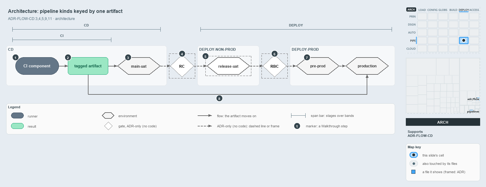

---
catzc:
  derived:
    path: docs/explanation/flow/pipeline-kinds-keyed-by-one-artifact.md
    kind: explanation
    body_sha: "3af8354b998e"
    adrs:
      - ADR-FLOW-CD#11
      - ADR-FLOW-CD#3
      - ADR-FLOW-CD#4
      - ADR-FLOW-CD#5
      - ADR-FLOW-CD#7
      - ADR-FLOW-CD#9
---

# CI, CD and DEPLOY are separate pipeline kinds keyed together by one artifact

```text
CI, CD and DEPLOY are separate pipeline kinds, keyed together by one artifact.

1  CI component          the one CI engine, the first stage of every CD
2  tagged artifact       built once, never rebuilt downstream
3  main-uat              the always-on environment that tracks the latest main
4  RC                    Release Certification: the human gate at main-uat
5  release-uat           where DEPLOY-Non-Prod drives the artifact for a release branch
6  RBC                   Release Branch Certification: the human gate at release-uat
7  pre-prod, production  DEPLOY-Prod stages the artifact inactive, then activates it live
8  the CD run's path     the apex and shared CD pipelines deploy the prod tier themselves today

Supports ADR-FLOW-CD#3, #4, #5, #9 and #11 (architecture lens).
```

Cats does not build one giant pipeline from commit to production. CI, CD and DEPLOY are separate pipeline kinds, each with its own trigger,
governance and history, and they compose into one promotion flow because they share a single key: the immutable, tagged artifact that the CI
component builds once and every downstream kind consumes unchanged. Read from left to right, the flow puts the two release gates between the
kinds rather than inside them, and it shows the path the CD pipelines in the repository take today.



The diagram is described element by element in
[its asset description](../../.assets/explanation/adr-flow-cd--pipeline-kinds-keyed-by-one-artifact--architecture.drawio.md).

## Walkthrough

1. **CI component.** There is one CI engine, the same build-and-verify in a solo CI pipeline and at the front of every CD pipeline. In the
   customer CD pipelines it is the first stage, displayed as "CI engine — build & verify".
2. **Tagged artifact.** The CI component builds the artifact once, and nothing downstream rebuilds it, so what reaches production is
   byte-identical to what non-prod certified. The CD pipelines publish their artifacts and every deploy job downloads them, but no step tags
   them.
3. **main-uat.** CD's direction through non-prod ends on an always-on environment that tracks the latest main, whatever the organization
   calls it. In the repository it is the `dev` environment, and for the shared platform also `test`, that every merge to main redeploys. The
   on-demand environment with its L3 system tests, which the ADR places before it, has no pipeline yet.
4. **RC.** Release Certification is a manual gate at main-uat. It clears when main-AT, the acceptance testing against main-uat, is verified.
   A gate decides whether the artifact may proceed; it is not a pipeline.
5. **release-uat.** DEPLOY-Non-Prod drives the artifact into the non-prod acceptance environments, here the release-uat environment of a
   release branch. No DEPLOY pipeline exists in the repository yet.
6. **RBC.** Release Branch Certification is the second manual gate, at release-uat, and it clears when release-AT is verified.
7. **Pre-prod and production.** DEPLOY-Prod drives the RBC-cleared artifact first into pre-prod, staged but not serving, and then activates
   the same bytes live in production.
8. **The CD run's own path to prod.** The apex and shared CD pipelines deploy the artifact to the prod tier themselves, in the same run as
   non-prod, with no gate and no DEPLOY in between: `psub` for both, and the expedition `prod` for apex. No CD pipeline deploys a pre-prod
   target, so the path ends on production.

## Why it holds

- CI, CD, CDe and DEPLOY are separate pipeline kinds keyed together by the tagged artifact, and nothing downstream rebuilds it
  (ADR-FLOW-CD#3).
- A CD pipeline always contains the CI component, and a solo CI pipeline contains only it (ADR-FLOW-CD#4).
- CD takes the artifact through an on-demand environment with L3 system tests and then onto the always-on environment that tracks main,
  entirely within non-prod (ADR-FLOW-CD#5).
- RC and RBC are the two hands-on release gates, and each is a gate, not a pipeline (ADR-FLOW-CD#9).
- DEPLOY splits by target: DEPLOY-Non-Prod into the non-prod acceptance environments, DEPLOY-Prod through pre-prod into production
  (ADR-FLOW-CD#11).
- CD is the delivery posture. CDe is the alternative, a CD that folds the DEPLOY step back in and rolls to production automatically; a unit
  is governed as one or the other, never both (ADR-FLOW-CD#7).

## Where the code and the ADR differ

- The ADR keeps CD entirely within non-prod, but the apex and shared CD pipelines deploy `psub`, and apex the expedition `prod`, in the same
  run, with no gate and no DEPLOY pipeline.
- The ADR gives a solo CI pipeline a tagged artifact as its output, while the pipeline-types ADR says a solo CI produces only a pass/fail
  signal; the solo CI pipelines in the repository publish no artifact.
- The artifact carries no tag, and no pipeline runs the on-demand L3 environment, release-uat, RC, RBC or DEPLOY.

## See also

- [The CI discipline and the promotion flow](../../adr/flow/cd-discipline-and-promotion-flow.md) — the decision this article explains;
  [pipeline types](../../adr/flow/pipeline-types.md) — the taxonomy it builds on.
- The other lenses on the same flow: [meta](one-artifact-climbs-unchanged.md), [implementation](cd-builds-once-then-deploys-prod-itself.md),
  [operations](a-merge-runs-cd-to-prod.md) and [governance](ci-budget-is-the-only-quality-gate.md).
- [The flow explanations](index.md) · [How to read the diagrams](../index.md#how-to-read-the-diagrams)
