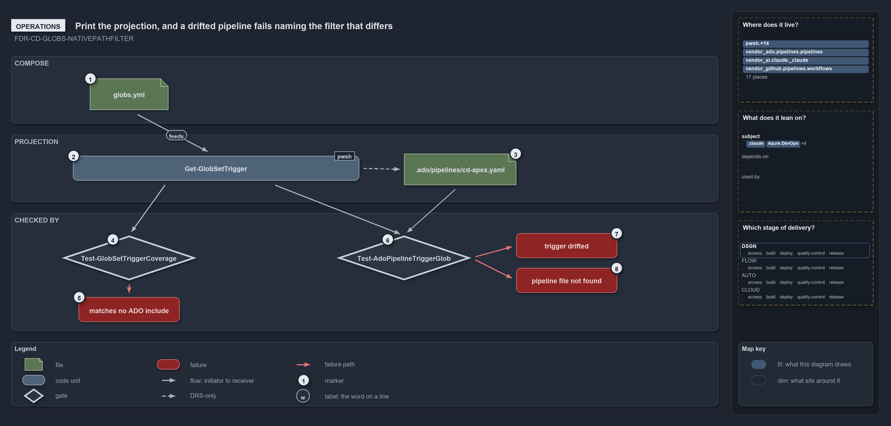

---
catzc:
  warning: "Header is generated by Format-FileMeta via Format-Code; do not change it"
  edges:
    cites:
      - FDR-CD-GLOBS-NATIVEPATHFILTER
    drs_total: 1
---

# Print the projection, and a drifted pipeline fails naming the filter that differs

```text
Print the projection, then a drifted pipeline fails naming the filter that differs.

1  globs.yml                    the file you edit to recompose a unit
2  Get-GlobSetTrigger           prints GitHub, AdoInclude and AdoExclude for a set
3  .ado/pipelines/cd-apex.yaml  where you paste the ADO lists, under trigger: and pr:
4  Test-GlobSetTriggerCoverage  every member of a pipeline-bound set hits an ADO include
5  matches no ADO include       the uncovered member, named in the issue
6  Test-AdoPipelineTriggerGlob  the file's four lists against the projection, as sets
7  trigger drifted              the issue names the filters that differ
8  pipeline file not found      the issue names the missing .ado/pipelines/<pipeline>.yaml

Supports FDR-CD-GLOBS-NATIVEPATHFILTER (operations lens).
```

Recomposing a deployable unit in cats is an edit to `globs.yml`, and a developer reads what the edit means for the triggers with one
command, `Get-GlobSetTrigger -Name <set>`. The Azure DevOps lists it prints go into the bound pipeline file by hand, and two quality gates
then say whether the registry and the pipelines agree: one names the pipeline and the path filter that drifted, or the file that is missing,
and the other names any member file an include pattern would miss.

```yml drawio
description:
  "The operator's path through a unit's triggers: edit globs.yml, print the projection with Get-GlobSetTrigger, paste the Azure DevOps lists
  into the pipeline file, and two gates fail naming the missing include, the drifted filter or the missing file."
about:
  adrs: [FDR-CD-GLOBS-NATIVEPATHFILTER]
  lens: operations
content:
  title: Print the projection, and a drifted pipeline fails naming the filter that differs
  kind: explanation
  flow: top-to-bottom
  relation: feeds
  theme: dark
  bands:
    - { id: band-compose, label: COMPOSE }
    - { id: band-projection, label: PROJECTION }
    - { id: band-checked, label: CHECKED BY }
  glyphs:
    - { id: f-globs-yml, kind: file, label: globs.yml, in: band-compose }
    - { id: c-trigger, kind: code, label: Get-GlobSetTrigger, in: band-projection }
    - { id: f-cd-apex, kind: file, label: .ado/pipelines/cd-apex.yaml, in: band-projection }
    - { id: g-coverage, kind: gate, label: Test-GlobSetTriggerCoverage, in: band-checked }
    - { id: x-no-include, kind: failure, label: matches no ADO include, in: band-checked }
    - { id: g-trigger-glob, kind: gate, label: Test-AdoPipelineTriggerGlob, in: band-checked }
    - { id: x-drifted, kind: failure, label: trigger drifted, in: band-checked }
    - { id: x-not-found, kind: failure, label: pipeline file not found, in: band-checked }
  edges:
    - { from: f-globs-yml, to: c-trigger, kind: flow, label: "" }
    - { from: c-trigger, to: f-cd-apex, kind: adr, label: "" }
    - { from: c-trigger, to: g-coverage, kind: flow, label: "" }
    - { from: c-trigger, to: g-trigger-glob, kind: flow, label: "" }
    - { from: f-cd-apex, to: g-trigger-glob, kind: flow, label: "" }
    - { from: g-coverage, to: x-no-include, kind: fail, label: "" }
    - { from: g-trigger-glob, to: x-drifted, kind: fail, label: "" }
    - { from: g-trigger-glob, to: x-not-found, kind: fail, label: "" }
  markers:
    - { at: f-globs-yml, number: 1 }
    - { at: c-trigger, number: 2 }
    - { at: f-cd-apex, number: 3 }
    - { at: g-coverage, number: 4 }
    - { at: x-no-include, number: 5 }
    - { at: g-trigger-glob, number: 6 }
    - { at: x-drifted, number: 7 }
    - { at: x-not-found, number: 8 }
  legend: auto
  minimaps:
    code-locations:
      - cell: .claude/.claude/.
        by: [.claude/CLAUDE.md, FDR-CD-GLOBS-NATIVEPATHFILTER]
      - cell: ado-pipelines/pipelines/.
        by:
          - .ado/pipelines/cd-apex.yaml
          - .ado/pipelines/cd-flux.yaml
          - .ado/pipelines/cd-nova.yaml
          - .ado/pipelines/cd-shared.yaml
          - .ado/pipelines/ci-infrastructure.yaml
          - .ado/pipelines/ci-pwsh.yaml
          - FDR-CD-GLOBS-NATIVEPATHFILTER
      - cell: docs/-/.
        by:
          - docs/drs/flow/dora-explains.md
          - docs/drs/flow/durable-sha-globs.md
          - docs/drs/index.md
          - docs/how-to/automation/apply-environment-approvals.md
          - docs/references/ado/pipelines/cd-apex.yaml.md
          - docs/references/ado/pipelines/cd-flux.yaml.md
          - docs/references/ado/pipelines/cd-nova.yaml.md
          - docs/references/ado/pipelines/cd-shared.yaml.md
          - docs/references/ado/pipelines/ci-infrastructure.yaml.md
          - docs/references/ado/pipelines/ci-pwsh.yaml.md
          - docs/references/github/workflows/ci-pwsh.yml.md
          - docs/references/pwsh/catzc-azure-dev-ops-build-validation/Get-AdoBuildValidations.ps1.md
          - docs/references/pwsh/catzc-azure-dev-ops-build-validation/Register-AdoBuildValidation.ps1.md
          - docs/references/pwsh/catzc-azure-dev-ops-build-validation/Unregister-AdoBuildValidation.ps1.md
          - docs/references/pwsh/catzc-azure-dev-ops-build-validation/configs/build-validation.yml.md
          - docs/references/pwsh/catzc-azure-dev-ops-build-validation/private/Get-BuildValidationPathFilter.ps1.md
          - docs/references/pwsh/catzc-azure-dev-ops/Sync-AdoEnvironmentApprovals.ps1.md
          - docs/references/pwsh/catzc-base-drs/types/DrsConfig.cs.md
          - docs/references/pwsh/catzc-base-globs/Get-GlobSetTrigger.ps1.md
          - docs/references/pwsh/catzc-base-globs/Test-AdoPipelineTriggerGlob.ps1.md
          - docs/references/pwsh/catzc-base-globs/Test-GitHubWorkflowTriggerGlob.ps1.md
          - docs/references/pwsh/catzc-base-globs/Test-GlobSetTriggerCoverage.ps1.md
          - docs/references/pwsh/catzc-base-globs/configs/globs.yml.md
          - docs/references/pwsh/catzc-base-globs/private/Get-PipelineTrigger.ps1.md
          - docs/references/pwsh/catzc-base-globs/types/DurableHash.cs.md
          - docs/references/pwsh/catzc-base-globs/types/GlobPattern.cs.md
          - docs/references/pwsh/catzc-base-globs/types/GlobSet.cs.md
          - docs/references/pwsh/catzc-base-globs/types/GlobsConfig.cs.md
          - docs/references/pwsh/catzc-base-maps/Get-LifecyclePositionMinimapData.ps1.md
          - docs/references/pwsh/catzc-base-maps/Get-ValueChainHighlight.ps1.md
          - docs/references/pwsh/catzc-base-maps/Get-WorldMapHighlight.ps1.md
          - FDR-CD-GLOBS-NATIVEPATHFILTER
      - cell: github-workflows/workflows/.
        by: [.github/workflows/ci-pwsh.yml, FDR-CD-GLOBS-NATIVEPATHFILTER]
      - cell: pwsh/Catzc.Azure.DevOps/.
        by: [pwsh/Catzc.Azure.DevOps/Sync-AdoEnvironmentApprovals.ps1, FDR-CD-GLOBS-NATIVEPATHFILTER]
      - cell: pwsh/Catzc.Azure.DevOps.BuildValidation/.
        by:
          - pwsh/Catzc.Azure.DevOps.BuildValidation/Get-AdoBuildValidations.ps1
          - pwsh/Catzc.Azure.DevOps.BuildValidation/Register-AdoBuildValidation.ps1
          - pwsh/Catzc.Azure.DevOps.BuildValidation/Unregister-AdoBuildValidation.ps1
          - FDR-CD-GLOBS-NATIVEPATHFILTER
      - cell: pwsh/Catzc.Azure.DevOps.BuildValidation/configs
        by: [pwsh/Catzc.Azure.DevOps.BuildValidation/configs/build-validation.yml, FDR-CD-GLOBS-NATIVEPATHFILTER]
      - cell: pwsh/Catzc.Azure.DevOps.BuildValidation/private
        by: [pwsh/Catzc.Azure.DevOps.BuildValidation/private/Get-BuildValidationPathFilter.ps1, FDR-CD-GLOBS-NATIVEPATHFILTER]
      - cell: pwsh/Catzc.Base.Drs/configs
        by: [pwsh/Catzc.Base.Drs/configs/drs.yml, FDR-CD-GLOBS-NATIVEPATHFILTER]
      - cell: pwsh/Catzc.Base.Drs/types
        by: [pwsh/Catzc.Base.Drs/types/DrsConfig.cs, FDR-CD-GLOBS-NATIVEPATHFILTER]
      - cell: pwsh/Catzc.Base.Globs/.
        by:
          - pwsh/Catzc.Base.Globs/Get-GlobSetTrigger.ps1
          - pwsh/Catzc.Base.Globs/Test-AdoPipelineTriggerGlob.ps1
          - pwsh/Catzc.Base.Globs/Test-GitHubWorkflowTriggerGlob.ps1
          - pwsh/Catzc.Base.Globs/Test-GlobSetTriggerCoverage.ps1
          - FDR-CD-GLOBS-NATIVEPATHFILTER
      - cell: pwsh/Catzc.Base.Globs/configs
        by: [pwsh/Catzc.Base.Globs/configs/globs.yml, FDR-CD-GLOBS-NATIVEPATHFILTER]
      - cell: pwsh/Catzc.Base.Globs/private
        by: [pwsh/Catzc.Base.Globs/private/Get-PipelineTrigger.ps1, FDR-CD-GLOBS-NATIVEPATHFILTER]
      - cell: pwsh/Catzc.Base.Globs/types
        by:
          - pwsh/Catzc.Base.Globs/types/DurableHash.cs
          - pwsh/Catzc.Base.Globs/types/GlobPattern.cs
          - pwsh/Catzc.Base.Globs/types/GlobSet.cs
          - pwsh/Catzc.Base.Globs/types/GlobsConfig.cs
          - FDR-CD-GLOBS-NATIVEPATHFILTER
      - cell: pwsh/Catzc.Base.Maps/.
        by:
          - pwsh/Catzc.Base.Maps/Get-LifecyclePositionMinimapData.ps1
          - pwsh/Catzc.Base.Maps/Get-ValueChainHighlight.ps1
          - pwsh/Catzc.Base.Maps/Get-WorldMapHighlight.ps1
          - FDR-CD-GLOBS-NATIVEPATHFILTER
      - cell: pwsh/Catzc.Base.Maps/tests
        by: [pwsh/Catzc.Base.Maps/tests/Get-WorldMapHighlight.Tests.ps1, FDR-CD-GLOBS-NATIVEPATHFILTER]
      - cell: pwsh/Catzc.Base.QualityGates/configs
        by: [pwsh/Catzc.Base.QualityGates/configs/terminology.yml, FDR-CD-GLOBS-NATIVEPATHFILTER]
    module-neighbourhood:
      - cell: subject/.claude
        by: [.claude/CLAUDE.md, FDR-CD-GLOBS-NATIVEPATHFILTER]
      - cell: subject/Catzc.Azure.DevOps
        by: [pwsh/Catzc.Azure.DevOps/Sync-AdoEnvironmentApprovals.ps1, FDR-CD-GLOBS-NATIVEPATHFILTER]
      - cell: subject/Catzc.Azure.DevOps.BuildValidation
        by:
          - pwsh/Catzc.Azure.DevOps.BuildValidation/Get-AdoBuildValidations.ps1
          - pwsh/Catzc.Azure.DevOps.BuildValidation/Register-AdoBuildValidation.ps1
          - pwsh/Catzc.Azure.DevOps.BuildValidation/Unregister-AdoBuildValidation.ps1
          - pwsh/Catzc.Azure.DevOps.BuildValidation/configs/build-validation.yml
          - pwsh/Catzc.Azure.DevOps.BuildValidation/private/Get-BuildValidationPathFilter.ps1
          - FDR-CD-GLOBS-NATIVEPATHFILTER
      - cell: subject/Catzc.Base.Drs
        by: [pwsh/Catzc.Base.Drs/configs/drs.yml, pwsh/Catzc.Base.Drs/types/DrsConfig.cs, FDR-CD-GLOBS-NATIVEPATHFILTER]
      - cell: subject/Catzc.Base.Globs
        by:
          - pwsh/Catzc.Base.Globs/Get-GlobSetTrigger.ps1
          - pwsh/Catzc.Base.Globs/Test-AdoPipelineTriggerGlob.ps1
          - pwsh/Catzc.Base.Globs/Test-GitHubWorkflowTriggerGlob.ps1
          - pwsh/Catzc.Base.Globs/Test-GlobSetTriggerCoverage.ps1
          - pwsh/Catzc.Base.Globs/configs/globs.yml
          - pwsh/Catzc.Base.Globs/private/Get-PipelineTrigger.ps1
          - pwsh/Catzc.Base.Globs/types/DurableHash.cs
          - pwsh/Catzc.Base.Globs/types/GlobPattern.cs
          - pwsh/Catzc.Base.Globs/types/GlobSet.cs
          - pwsh/Catzc.Base.Globs/types/GlobsConfig.cs
          - FDR-CD-GLOBS-NATIVEPATHFILTER
      - cell: subject/Catzc.Base.Maps
        by:
          - pwsh/Catzc.Base.Maps/Get-LifecyclePositionMinimapData.ps1
          - pwsh/Catzc.Base.Maps/Get-ValueChainHighlight.ps1
          - pwsh/Catzc.Base.Maps/Get-WorldMapHighlight.ps1
          - pwsh/Catzc.Base.Maps/tests/Get-WorldMapHighlight.Tests.ps1
          - FDR-CD-GLOBS-NATIVEPATHFILTER
      - cell: subject/Catzc.Base.QualityGates
        by: [pwsh/Catzc.Base.QualityGates/configs/terminology.yml, FDR-CD-GLOBS-NATIVEPATHFILTER]
      - cell: subject/pipelines
        by:
          - .ado/pipelines/cd-apex.yaml
          - .ado/pipelines/cd-flux.yaml
          - .ado/pipelines/cd-nova.yaml
          - .ado/pipelines/cd-shared.yaml
          - .ado/pipelines/ci-infrastructure.yaml
          - .ado/pipelines/ci-pwsh.yaml
          - FDR-CD-GLOBS-NATIVEPATHFILTER
      - cell: subject/workflows
        by: [.github/workflows/ci-pwsh.yml, FDR-CD-GLOBS-NATIVEPATHFILTER]
    axis:
      - cell: DSGN/*
        by: [FDR-CD-GLOBS-NATIVEPATHFILTER]
layout:
  band-compose: { x: 20, y: 84, w: 1260, h: 120 }
  band-projection: { x: 20, y: 224, w: 1260, h: 120 }
  band-checked: { x: 20, y: 364, w: 1260, h: 210 }
  f-globs-yml: { x: 160, y: 124, w: 140, h: 56 }
  c-trigger: { x: 130, y: 262, w: 200, h: 44 }
  f-cd-apex: { x: 620, y: 258, w: 200, h: 56 }
  g-coverage: { x: 110, y: 404, w: 240, h: 80 }
  x-no-include: { x: 140, y: 514, w: 180, h: 44 }
  g-trigger-glob: { x: 600, y: 404, w: 240, h: 80 }
  x-drifted: { x: 920, y: 400, w: 180, h: 44 }
  x-not-found: { x: 920, y: 462, w: 180, h: 44 }
```



## Walkthrough

1. **globs.yml.** Adding or removing files from a unit, or adding a whole customer, is an edit to this file: its `include:`, `exclude:` and
   `compose:` lists, and the `pipeline:` the unit binds.
2. **Get-GlobSetTrigger.** `Get-GlobSetTrigger -Name apex` prints one object: `Name`, the ordered `GitHub` list, and the `AdoInclude` and
   `AdoExclude` lists. The set name completes from the registry, and `-GlobSet` takes a set object instead.
3. **.ado/pipelines/cd-apex.yaml.** The ado pipeline bound by `pipeline: cd-apex` declares `AdoInclude` and `AdoExclude` under both
   `trigger.paths` and `pr.paths`. No command writes them: you paste the printed lists, and the gate below tells you when they fall out of
   step.
4. **Test-GlobSetTriggerCoverage.** Run on its own or by `Test-Automation` at level 2, this quality gate takes every pipeline-bound set,
   projects it, and matches each member file against the set's `AdoInclude` patterns.
5. **Matches no ADO include.** An uncovered member is one issue:
   `<set>: member <file> matches no ADO include pattern — the include-only trigger would miss it`. Today the gate reports 0 issues over 6
   sets.
6. **Test-AdoPipelineTriggerGlob.** For every pipeline-bound set, or the one given with `-Name`, this quality gate recomputes the
   projection, reads `.ado/pipelines/<pipeline>.yaml`, and compares the file's four lists with the projection as sets.
7. **Trigger drifted.** A mismatch is one issue naming the pipeline and the lists that differ:
   `<set>: .ado/pipelines/<pipeline>.yaml trigger drifted from the globset projection on <filters>`, where the filters are any of
   `trigger.paths.include`, `trigger.paths.exclude`, `pr.paths.include` and `pr.paths.exclude`. The fix is to regenerate the pipeline
   trigger from `globs.yml`.
8. **Pipeline file not found.** A bound pipeline whose file is absent is one issue:
   `<set>: pipeline file not found: .ado/pipelines/<pipeline>.yaml`. Either gate writes its report under `out/test-<subject>/` and throws
   once, `<gate> failed: N issue(s)`, listing every issue; with `-PassThru` it returns the result instead. Today both report 0 issues over 6
   pipelines.

The GitHub side has the same gate, `Test-GitHubWorkflowTriggerGlob`, which takes the pairing explicitly, for example
`-Name pwsh -WorkflowPath .github/workflows/ci-pwsh.yml`, and compares `on.push.paths` and `on.pull_request.paths` element by element, since
GitHub paths are ordered.

## Why it holds

- A pipeline, workflow or build-validation policy triggers on the globset's native projection, and the drift quality gates report one issue
  per pipeline whose declared trigger no longer equals its projection, or whose file is missing (FDR-CD-GLOBS-NATIVEPATHFILTER).
- An include-only projection is a safe superset that can never under-trigger, which the coverage check confirms for every member of a
  pipeline-bound set (FDR-CD-GLOBS, "How this is enforced").

## Where the code and the decision record differ

- The FDR says the projected filters are generated from `globs.yml` into the YAML and never hand-authored. No command writes them; the
  developer pastes the printed lists into the pipeline file, and the gate catches a mismatch.

## See also

- [Globset triggers](../../drs/flow/durable-sha-globs.md) — the decision this article explains.
- The other lenses on the same projection: [meta](one-program-two-vendor-dialects.md),
  [architecture](globs-projects-and-three-consumers-read.md), [implementation](apex-thirteen-rules-seven-includes-six-excludes.md) and
  [governance](drift-is-gated-generation-is-drs-only.md).
- [The flow explanations](index.md) · [How to read the diagrams](../index.md#how-to-read-the-diagrams)
