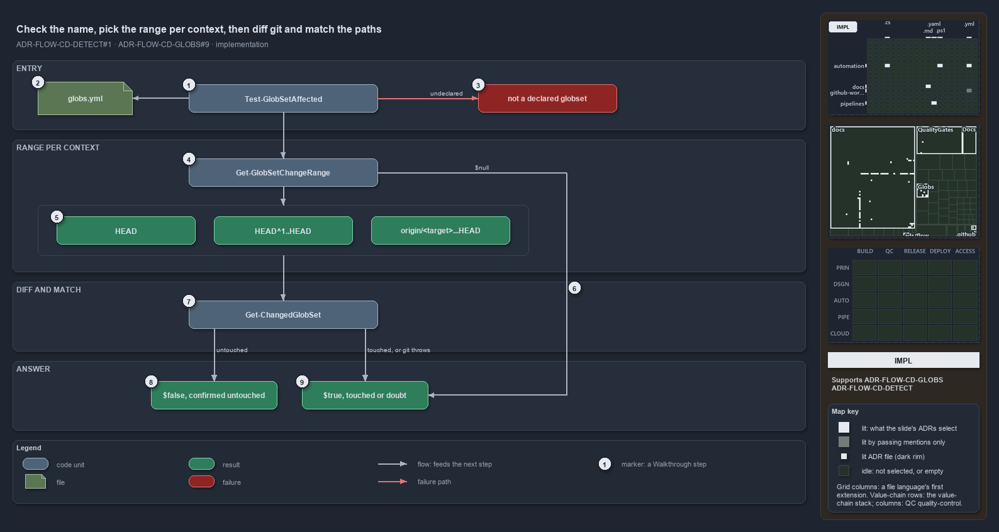

# Check the name, pick the range per context, then diff git and match the paths

```text
Test-GlobSetAffected checks the name, picks a git range per context, then diffs and matches; doubt returns true.

1  Test-GlobSetAffected     the entry: a globset name, one boolean out
2  globs.yml                the registry the name must be in, read through Get-Config
3  not a declared globset   the throw on an undeclared name
4  Get-GlobSetChangeRange   the reference-commit resolver, no parameters
5  the three ranges         HEAD locally, HEAD^1..HEAD post-commit, origin/<target>...HEAD in a pull request
6  $null                    a pull request with no resolvable target: the resolver's fail-open signal
7  Get-ChangedGlobSet       git diff over the range, then every globset that matches a changed path
8  $false                   the named set is not among the touched sets
9  $true                    the named set is touched, or the diff threw and was caught

Supports FDR-CD-GLOBS-CHANGECOMPUTEDFROMGIT and FDR-CD-DETECT-NODIRECTVARIABLECHECK (implementation lens).
```

`Test-GlobSetAffected` is a short function with a strict order. It refuses a name it does not know, asks the resolver for the git range the
current context measures a change against, diffs that range, matches the changed paths against the registry, and reports whether the named
globset is among the matches. Two places in that order can be in doubt, the range and the diff, and both resolve to true.



## Walkthrough

1. **Test-GlobSetAffected.** The entry takes one mandatory, positional `-Name`, tab-completed from the registry's names, and returns a
   boolean.
2. **globs.yml.** The function reads the registry with `Get-Config -Config globs` and asks whether it contains the name. This happens before
   any git work.
3. **Not a declared globset.** An unknown name throws `Test-GlobSetAffected: '<Name>' is not a declared globset (globs.yml).` A typo is a
   programming error, so it never becomes a silent skip.
4. **Get-GlobSetChangeRange.** The resolver takes no parameters. It asks `Test-IsRunningInPipeline`, which reads `TF_BUILD` and
   `GITHUB_ACTIONS` and nothing else, and then reads the pull-request variables.
5. **The three ranges.** Outside a pipeline the range is `HEAD`, the working tree against the last commit. In a pipeline that is not a pull
   request it is `HEAD^1..HEAD`: main advances only by squash merge, so the first parent is the prior mainline and the diff is exactly the
   push. In a pull request, detected by `SYSTEM_PULLREQUEST_PULLREQUESTID` or a `GITHUB_EVENT_NAME` of `pull_request`, it is
   `origin/<target>...HEAD`, the merge-base range, with the target from `SYSTEM_PULLREQUEST_TARGETBRANCH` (its `refs/heads/` prefix
   stripped) or `GITHUB_BASE_REF`.
6. **$null.** A pull request that names no target yields `$null`, and the function returns true at once: the range is unknown, so the unit
   is treated as affected.
7. **Get-ChangedGlobSet.** With a range, the function calls `Get-ChangedGlobSet -Range`, which resolves the changed paths through
   `Get-ChangedFile`, that is `git -c core.quotepath=off diff --name-only --no-renames <range>`, and returns every declared globset whose
   scan program selects at least one of them. `-IncludeModules` also matches the derived module sets, but the check does not pass it.
8. **$false.** The named set is not among the touched sets. This is the only false the function returns, and it is reached only after git
   answered.
9. **$true.** The named set is among the touched sets. The same answer is returned when git throws, for example on a shallow clone that
   cannot reach `HEAD^1`: `Invoke-Executable` asserts git's exit code, the function catches the error, writes one message naming the range
   and the reason, and proceeds.

## Why it holds

- The change is computed from git at real refs: `Get-ChangedGlobSet` diffs a commit range with `git diff --name-only --no-renames` and
  matches the paths against the registry; `Test-GlobSetAffected` resolves the reference commit per context and fails open on any doubt
  (FDR-CD-GLOBS-CHANGECOMPUTEDFROMGIT).
- The context is read through `Test-IsRunningInPipeline`, never from the detection variables directly
  (FDR-CD-DETECT-NODIRECTVARIABLECHECK).

## See also

- [Globset triggers](../../adr/flow/durable-sha-globs.md) — the decision this article explains.
- [Pipeline detection](../../adr/flow/pipeline-detection.md) — the one detection function the resolver asks.
- The other lenses on the same check: [meta](every-doubt-fails-open-to-proceed.md),
  [architecture](globs-asks-loader-for-context-and-git-for-diff.md), [operations](stop-only-on-false-everything-else-proceeds.md) and
  [governance](tests-pin-the-throw-and-fail-open-cd-calls-it.md).
- [The flow explanations](index.md) · [How to read the diagrams](../index.md#how-to-read-the-diagrams)
