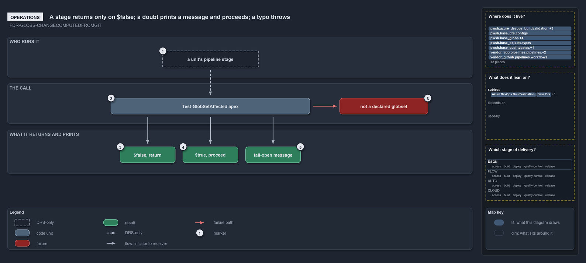

# A stage returns only on $false; a doubt prints a message and proceeds; a typo throws

```text
A stage stops only on $false; $true, a doubt and its message all proceed; an undeclared name throws.

1  a unit's pipeline stage      the caller the FDR describes; no pipeline makes the call
2  Test-GlobSetAffected apex    the command, with the unit's globset name
3  $false, return               confirmed untouched: the stage has nothing to process
4  $true, proceed               the unit is touched, or the range could not be resolved
5  fail-open message            the one line printed when git could not compute the diff
6  not a declared globset       the throw on a name that is not in globs.yml

Supports FDR-GLOBS-CHANGECOMPUTEDFROMGIT (operations lens).
```

A deployable unit's pipeline stage opens with one line: `if (-not (Test-GlobSetAffected -Name apex)) { return }`. Everything the stage can
observe from that line is a boolean, at most one printed message, and one possible throw. The boolean is asymmetric on purpose: false is a
positive confirmation that there is nothing to process, and every other outcome, touched or in doubt, proceeds.

```yml drawio
description:
  "What a pipeline stage sees from one call to Test-GlobSetAffected: a boolean, at most one printed message, and one possible throw; only
  false returns early, true and a doubt both proceed."
about:
  adrs: [FDR-GLOBS-CHANGECOMPUTEDFROMGIT]
  lens: operations
content:
  title: A stage returns only on $false; a doubt prints a message and proceeds; a typo throws
  kind: explanation
  flow: top-to-bottom
  theme: dark
  bands:
    - { id: band-who, label: WHO RUNS IT }
    - { id: band-call, label: THE CALL }
    - { id: band-returns, label: WHAT IT RETURNS AND PRINTS }
  glyphs:
    - { id: a-stage, kind: drsonly, label: a unit's pipeline stage, in: band-who }
    - { id: c-affected, kind: code, label: Test-GlobSetAffected apex, in: band-call }
    - { id: x-undeclared, kind: failure, label: not a declared globset, in: band-call }
    - { id: r-false, kind: result, label: "$false, return", in: band-returns }
    - { id: r-true, kind: result, label: "$true, proceed", in: band-returns }
    - { id: r-message, kind: result, label: fail-open message, in: band-returns }
  edges:
    - { from: a-stage, to: c-affected, kind: adr, label: "" }
    - { from: c-affected, to: r-false, kind: flow, label: "" }
    - { from: c-affected, to: r-true, kind: flow, label: "" }
    - { from: c-affected, to: r-message, kind: flow, label: "" }
    - { from: c-affected, to: x-undeclared, kind: fail, label: "" }
  markers:
    - { at: a-stage, number: 1 }
    - { at: c-affected, number: 2 }
    - { at: r-false, number: 3 }
    - { at: r-true, number: 4 }
    - { at: r-message, number: 5 }
    - { at: x-undeclared, number: 6 }
  legend: auto
  minimaps: [code-locations, module-neighbourhood, axis]
layout:
  band-who: { x: 20, y: 84, w: 1260, h: 110 }
  band-call: { x: 20, y: 210, w: 1260, h: 110 }
  band-returns: { x: 20, y: 336, w: 1260, h: 120 }
  a-stage: { x: 440, y: 122, w: 260, h: 44 }
  c-affected: { x: 300, y: 250, w: 540, h: 44 }
  x-undeclared: { x: 920, y: 250, w: 240, h: 44 }
  r-false: { x: 325, y: 382, w: 150, h: 44 }
  r-true: { x: 495, y: 382, w: 150, h: 44 }
  r-message: { x: 665, y: 382, w: 150, h: 44 }
```



## Walkthrough

1. **A unit's pipeline stage.** The decision describes the operator: a stage that runs the check first and returns early when its
   area-of-control is untouched. The CD pipelines make that call once, in their CI stage: a `Changes` step publishes the answer as
   `AFFECTED`, and the first `Deploy_*` stage runs only when it is true, so every deploy stage of an untouched unit skips. On a developer's
   machine the same command answers against the working tree.
2. **Test-GlobSetAffected apex.** The command takes the unit's globset name as its one mandatory, positional parameter, tab-completed from
   the registry. `apex` is a declared deployable unit bound to the `cd-apex` pipeline.
3. **$false, return.** The unit is confirmed untouched over a range git could diff. The stage returns without doing any work.
4. **$true, proceed.** The unit is touched, or the reference commit could not be resolved (a pull request with no resolvable target); both
   proceed. The unresolved range proceeds silently.
5. **Fail-open message.** When git cannot compute the diff, for example on a shallow clone, the check writes one line,
   `Test-GlobSetAffected: could not resolve change range '<range>' (<reason>); proceeding (fail-open).`, and then returns true. A run that
   proceeded on doubt is never indistinguishable from one that proceeded on a real change.
6. **Not a declared globset.** A name that is not in `globs.yml` throws
   `Test-GlobSetAffected: '<Name>' is not a declared globset (globs.yml).` The stage fails rather than skipping on a typo.

## Why it holds

- The check fails open on any doubt so a wrong skip can never drop a deploy, returns false only when it has positively confirmed the unit is
  untouched, and throws on an undeclared unit name so a typo never silently skips (FDR-GLOBS-CHANGECOMPUTEDFROMGIT).
- A pipeline must check out with sufficient depth (`fetchDepth: 0`) so the base ref is reachable (FDR-GLOBS-CHANGECOMPUTEDFROMGIT).

## See also

- [Globset triggers](../../drs/flow/durable-sha-globs.md) — the decision this article explains.
- The other lenses on the same check: [meta](every-doubt-fails-open-to-proceed.md),
  [architecture](globs-asks-loader-for-context-and-git-for-diff.md), [implementation](range-per-context-then-diff-and-match.md) and
  [governance](tests-pin-the-throw-and-fail-open-cd-calls-it.md).
- [The flow explanations](index.md) · [How to read the diagrams](../index.md#how-to-read-the-diagrams)
