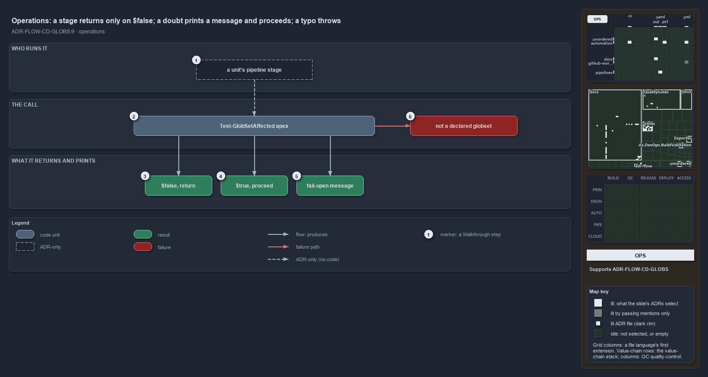

---
catzc:
  derived:
    path: docs/explanation/flow/stop-only-on-false-everything-else-proceeds.md
    kind: explanation
    body_sha: "4eb015514f04"
    adrs:
      - ADR-FLOW-CD-GLOBS#9
    links:
      - docs/.assets/explanation/adr-flow-cd-globs--stop-only-on-false-everything-else-proceeds--operations.drawio.md
      - docs/.assets/explanation/adr-flow-cd-globs--stop-only-on-false-everything-else-proceeds--operations.drawio.png
      - docs/adr/flow/durable-sha-globs.md
      - docs/explanation/flow/every-doubt-fails-open-to-proceed.md
      - docs/explanation/flow/globs-asks-loader-for-context-and-git-for-diff.md
      - docs/explanation/flow/index.md
      - docs/explanation/flow/range-per-context-then-diff-and-match.md
      - docs/explanation/flow/tests-pin-the-throw-and-fail-open-no-caller.md
      - docs/explanation/index.md#how-to-read-the-diagrams
---

# A stage returns only on $false; a doubt prints a message and proceeds; a typo throws

```text
A stage stops only on $false; $true, a doubt and its message all proceed; an undeclared name throws.

1  a unit's pipeline stage      the caller the ADR describes; no pipeline makes the call
2  Test-GlobSetAffected apex    the command, with the unit's globset name
3  $false, return               confirmed untouched: the stage has nothing to process
4  $true, proceed               the unit is touched, or the range could not be resolved
5  fail-open message            the one line printed when git could not compute the diff
6  not a declared globset       the throw on a name that is not in globs.yml

Supports ADR-FLOW-CD-GLOBS#9 (operations lens).
```

A deployable unit's pipeline stage opens with one line: `if (-not (Test-GlobSetAffected -Name apex)) { return }`. Everything the stage can
observe from that line is a boolean, at most one printed message, and one possible throw. The boolean is asymmetric on purpose: false is a
positive confirmation that there is nothing to process, and every other outcome, touched or in doubt, proceeds.



The diagram is described element by element in
[its asset description](../../.assets/explanation/adr-flow-cd-globs--stop-only-on-false-everything-else-proceeds--operations.drawio.md).

## Walkthrough

1. **A unit's pipeline stage.** The decision describes the operator: a stage that runs the check first and returns early when its
   area-of-control is untouched. No pipeline or workflow in the repository makes that call; the shared CD pipeline names the check in a
   comment as its exact backstop. On a developer's machine the same command answers against the working tree.
2. **Test-GlobSetAffected apex.** The command takes the unit's globset name as its one mandatory, positional parameter, tab-completed from
   the registry. `apex` is a declared deployable unit bound to the `cd-apex` pipeline.
3. **$false, return.** The unit is confirmed untouched over a range git could diff. The stage returns without doing any work.
4. **$true, proceed.** The unit is touched, or the reference commit could not be resolved (a pull request with no resolvable target); both
   proceed. The unresolved range proceeds silently.
5. **Fail-open message.** When git cannot compute the diff, for example on a shallow clone, the check writes one line,
   `Test-GlobSetAffected: could not resolve change range '<range>' (<reason>); proceeding (fail-open).`, and then returns true. A run that
   proceeded on doubt is never indistinguishable from one that proceeded on a real change.
6. **Not a declared globset.** A name that is not in `globs.yml` throws
   `Test-GlobSetAffected: '<Name>' is not a declared globset (globs.yml).` The stage fails rather than skipping on a typo.

## Why it holds

- The check fails open on any doubt so a wrong skip can never drop a deploy, returns false only when it has positively confirmed the unit is
  untouched, and throws on an undeclared unit name so a typo never silently skips (ADR-FLOW-CD-GLOBS#9).
- A pipeline must check out with sufficient depth (`fetchDepth: 0`) so the base ref is reachable (ADR-FLOW-CD-GLOBS#9).

## Where the code and the ADR differ

The decision describes a pipeline stage that runs the check first; no pipeline or workflow in the repository calls `Test-GlobSetAffected`.
The decision requires a checkout with `fetchDepth: 0`; the GitHub workflows set `fetch-depth: 0`, and no Azure DevOps pipeline sets
`fetchDepth`, so a post-commit diff on a shallow Azure DevOps clone proceeds with the message rather than skipping.

## See also

- [Globset triggers](../../adr/flow/durable-sha-globs.md) — the decision this article explains.
- The other lenses on the same check: [meta](every-doubt-fails-open-to-proceed.md),
  [architecture](globs-asks-loader-for-context-and-git-for-diff.md), [implementation](range-per-context-then-diff-and-match.md) and
  [governance](tests-pin-the-throw-and-fail-open-no-caller.md).
- [The flow explanations](index.md) · [How to read the diagrams](../index.md#how-to-read-the-diagrams)
