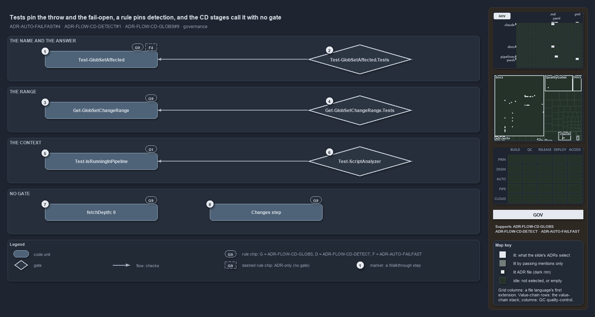

# Tests pin the throw and the fail-open, a rule pins detection, and the CD stages call it with no gate

```text
Logic tests pin the throw and the fail-open, an analyzer rule pins detection, and the CD stages call the check with no gate.

1  Test-GlobSetAffected           governed by GLOBS#9: throw on an undeclared name, fail open on doubt
2  Test-GlobSetAffected.Tests     the L0 logic test that pins both answers, both fail-open paths and the throw
3  Get-GlobSetChangeRange         governed by GLOBS#9: one range per context
4  Get-GlobSetChangeRange.Tests   the L0 logic test that pins all three ranges and the null signal
5  Test-IsRunningInPipeline       governed by DETECT#1: the one place that reads the detection variables
6  Test-ScriptAnalyzer            the quality gate that runs the NoRawPipelineDetection rule
7  fetchDepth: 0                  required by GLOBS#9; set on the CD checkouts that diff, no gate checks it
8  Changes step                   GLOBS#9's first step: the CD stages run the check, no gate requires it

Supports ADR-FLOW-CD-GLOBS-CHANGECOMPUTEDFROMGIT, ADR-FLOW-CD-DETECT-NODIRECTVARIABLECHECK and ADR-AUTO-FAILFAST-USEASSERTIONLIBRARY (governance lens).
```

Three rules constrain the touched-unit check, and they are enforced unevenly. The behaviour inside the module, the throw on an undeclared
name, the fail-open on an unresolved range or a failed diff, and the range chosen per context, is pinned by logic tests that run with every
test run. The context detection is pinned by a custom analyzer rule. What the decision asks of the pipeline side, a deep checkout and a
stage that runs the check first, is wired into the CD pipelines, and no gate checks it.



The diagram is described element by element in
[its asset description](.assets/tests-pin-the-throw-and-fail-open-cd-calls-it/diagram.drawio.md).

## Walkthrough

1. **Test-GlobSetAffected.** The check carries two rules. The globset-trigger rule says it throws on an undeclared unit name and fails open
   on any doubt. The fail-fast rule says an error like that throw is raised through the assertion library, and the function raises it with
   `Assert-True`.
2. **Test-GlobSetAffected.Tests.** An L0 logic test with neutral fixture names. It pins true when the set is touched, false when it is not,
   true when the resolver returns null without the diff being asked, true when the diff throws, and the throw on an undeclared name.
3. **Get-GlobSetChangeRange.** The resolver carries the same globset-trigger rule: post-commit first parent, pull-request merge base, local
   working tree.
4. **Get-GlobSetChangeRange.Tests.** An L0 logic test that pins the working-tree range outside a pipeline, the first-parent range for a
   post-commit push, the merge-base range for an Azure DevOps and for a GitHub pull request, and the null signal for a pull request with no
   resolvable target.
5. **Test-IsRunningInPipeline.** The pipeline-detection rule: the detection variables are read in one function only, and the resolver asks
   that function.
6. **Test-ScriptAnalyzer.** The quality gate that runs the custom `NoRawPipelineDetection` rule, which flags any read of `TF_BUILD` or
   `GITHUB_ACTIONS` outside `Test-IsRunningInPipeline`.
7. **fetchDepth: 0.** The decision requires a checkout deep enough to reach the base ref. The GitHub workflows set `fetch-depth: 0`, and the
   CI stage of `cd-shared.yaml` and of `extends/cd-customer.yaml` sets `fetchDepth: 0` on the checkout that diffs. No gate checks it. On a
   shallow clone the check fails open rather than skips.
8. **Changes step.** The CI stage of each CD pipeline runs `Test-GlobSetAffected` as step `Changes` and publishes `AFFECTED`; the deploy
   stages run only when it is true. No gate requires the step.

## Why it holds

- Whether a change touches a unit is computed from git at real refs, the reference commit is resolved per context, the check fails open on
  any doubt and throws on an undeclared name, and a pipeline checks out with `fetchDepth: 0` (ADR-FLOW-CD-GLOBS-CHANGECOMPUTEDFROMGIT).
- The detection variables are never read directly; `Test-IsRunningInPipeline` keeps the detection logic in one place
  (ADR-FLOW-CD-DETECT-NODIRECTVARIABLECHECK).
- An error is raised through the assertion library, never through an inline check that raises its own error
  (ADR-AUTO-FAILFAST-USEASSERTIONLIBRARY).

## Where the code and the ADR differ

The decision wants the check to gate a unit's stages; the CD pipelines run it, but no test or quality gate requires the `Changes` step or
`fetchDepth: 0`, so a pipeline that drops them is not caught.

## See also

- [Globset triggers](../../adr/flow/durable-sha-globs.md) — the decision this article explains.
- [Pipeline detection](../../adr/flow/pipeline-detection.md) and
  [Fail fast with inline assertions](../../adr/automation/fail-fast-with-asserts.md) — the two other decisions whose rules the check
  carries.
- The other lenses on the same check: [meta](every-doubt-fails-open-to-proceed.md),
  [architecture](globs-asks-loader-for-context-and-git-for-diff.md), [implementation](range-per-context-then-diff-and-match.md) and
  [operations](stop-only-on-false-everything-else-proceeds.md).
- [The flow explanations](index.md) · [How to read the diagrams](../index.md#how-to-read-the-diagrams)
