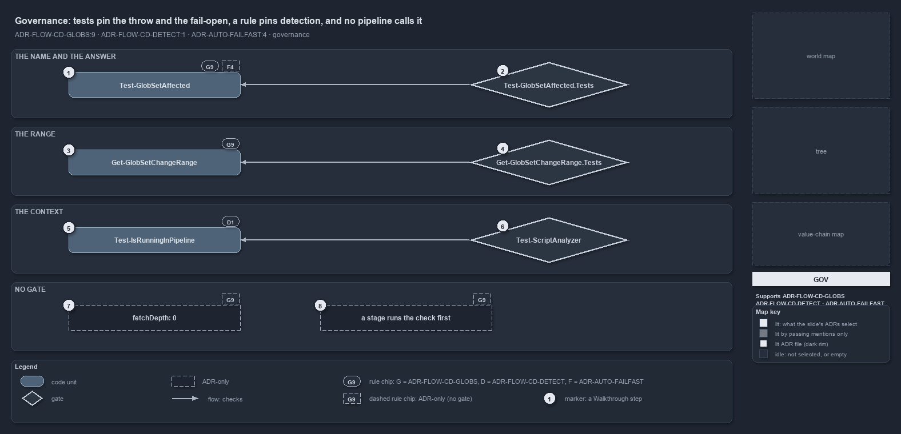

---
catzc:
  derived:
    path: docs/explanation/flow/tests-pin-the-throw-and-fail-open-no-caller.md
    folder: docs/explanation/flow
    name: tests-pin-the-throw-and-fail-open-no-caller
    filetype: md
    kind: explanation
    language: markdown
    track: docs
    body_sha: ffbbf6cf0962
    adrs:
      - ADR-AUTO-FAILFAST#4
      - ADR-FLOW-CD-DETECT#1
      - ADR-FLOW-CD-GLOBS#9
    links:
      - docs/.assets/explanation/adr-flow-cd-globs--tests-pin-the-throw-and-fail-open-no-caller--governance.drawio.md
      - docs/.assets/explanation/adr-flow-cd-globs--tests-pin-the-throw-and-fail-open-no-caller--governance.drawio.png
      - docs/adr/automation/fail-fast-with-asserts.md
      - docs/adr/flow/durable-sha-globs.md
      - docs/adr/flow/pipeline-detection.md
      - docs/explanation/flow/every-doubt-fails-open-to-proceed.md
      - docs/explanation/flow/globs-asks-loader-for-context-and-git-for-diff.md
      - docs/explanation/flow/index.md
      - docs/explanation/flow/range-per-context-then-diff-and-match.md
      - docs/explanation/flow/stop-only-on-false-everything-else-proceeds.md
      - docs/explanation/index.md#how-to-read-the-diagrams
---

# Tests pin the throw and the fail-open, a rule pins detection, and no pipeline calls it

```text
Logic tests pin the throw and the fail-open, an analyzer rule pins detection, and the pipeline-side rules have no gate.

1  Test-GlobSetAffected           governed by GLOBS#9: throw on an undeclared name, fail open on doubt
2  Test-GlobSetAffected.Tests     the L0 logic test that pins both answers, both fail-open paths and the throw
3  Get-GlobSetChangeRange         governed by GLOBS#9: one range per context
4  Get-GlobSetChangeRange.Tests   the L0 logic test that pins all three ranges and the null signal
5  Test-IsRunningInPipeline       governed by DETECT#1: the one place that reads the detection variables
6  Test-ScriptAnalyzer            the quality gate that runs the NoRawPipelineDetection rule
7  fetchDepth: 0                  required by GLOBS#9; no Azure DevOps pipeline sets it, no gate checks it
8  a stage runs the check first   described by GLOBS#9; no pipeline calls the check, no gate checks it

Supports ADR-FLOW-CD-GLOBS#9, ADR-FLOW-CD-DETECT#1 and ADR-AUTO-FAILFAST#4 (governance lens).
```

Three rules constrain the touched-unit check, and they are enforced unevenly. The behaviour inside the module, the throw on an undeclared
name, the fail-open on an unresolved range or a failed diff, and the range chosen per context, is pinned by logic tests that run with every
test run. The context detection is pinned by a custom analyzer rule. What the decision asks of the pipeline side, a deep checkout and a
stage that runs the check first, has no gate and no caller in the repository.



The diagram is described element by element in
[its asset description](../../.assets/explanation/adr-flow-cd-globs--tests-pin-the-throw-and-fail-open-no-caller--governance.drawio.md).

## Walkthrough

1. **Test-GlobSetAffected.** The check carries two rules. The globset-trigger rule says it throws on an undeclared unit name and fails open
   on any doubt. The fail-fast rule says an error like that throw is raised through the assertion library; the function raises it from an
   inline check instead, and no gate flags that.
2. **Test-GlobSetAffected.Tests.** An L0 logic test with neutral fixture names. It pins true when the set is touched, false when it is not,
   true when the resolver returns null without the diff being asked, true when the diff throws, and the throw on an undeclared name.
3. **Get-GlobSetChangeRange.** The resolver carries the same globset-trigger rule: post-commit first parent, pull-request merge base, local
   working tree.
4. **Get-GlobSetChangeRange.Tests.** An L0 logic test that pins the working-tree range outside a pipeline, the first-parent range for a
   post-commit push, the merge-base range for an Azure DevOps and for a GitHub pull request, and the null signal for a pull request with no
   resolvable target.
5. **Test-IsRunningInPipeline.** The pipeline-detection rule: the detection variables are read in one function only, and the resolver asks
   that function.
6. **Test-ScriptAnalyzer.** The quality gate that runs the custom `NoRawPipelineDetection` rule, which flags any read of `TF_BUILD` or
   `GITHUB_ACTIONS` outside `Test-IsRunningInPipeline`.
7. **fetchDepth: 0.** The decision requires a checkout deep enough to reach the base ref. The GitHub workflows set `fetch-depth: 0`; no
   Azure DevOps pipeline sets `fetchDepth`, and no gate checks it. On a shallow clone the check fails open rather than skips.
8. **A stage runs the check first.** The decision describes the check as the exact backstop a unit's stage runs first. No pipeline or
   workflow calls it, and no gate requires the call; the shared CD pipeline names it in a comment.

## Why it holds

- Whether a change touches a unit is computed from git at real refs, the reference commit is resolved per context, the check fails open on
  any doubt and throws on an undeclared name, and a pipeline checks out with `fetchDepth: 0` (ADR-FLOW-CD-GLOBS#9).
- The detection variables are never read directly; `Test-IsRunningInPipeline` keeps the detection logic in one place (ADR-FLOW-CD-DETECT#1).
- An error is raised through the assertion library, never through an inline check that raises its own error (ADR-AUTO-FAILFAST#4).

## Where the code and the ADR differ

The fail-fast rule says to use the assertion library; `Test-GlobSetAffected` raises its throw from an inline check, and its function help
cites the fail-fast decision for it. The function help of `Test-GlobSetAffected` and `Get-GlobSetChangeRange` cites the protected-globs rule
for the fail-open, while the rule that states the in-pipeline fail-open is the globset-trigger rule. No pipeline or workflow calls
`Test-GlobSetAffected`, and no Azure DevOps pipeline sets `fetchDepth: 0`.

## See also

- [Globset triggers](../../adr/flow/durable-sha-globs.md) — the decision this article explains.
- [Pipeline detection](../../adr/flow/pipeline-detection.md) and
  [Fail fast with inline assertions](../../adr/automation/fail-fast-with-asserts.md) — the two other decisions whose rules the check
  carries.
- The other lenses on the same check: [meta](every-doubt-fails-open-to-proceed.md),
  [architecture](globs-asks-loader-for-context-and-git-for-diff.md), [implementation](range-per-context-then-diff-and-match.md) and
  [operations](stop-only-on-false-everything-else-proceeds.md).
- [The flow explanations](index.md) · [How to read the diagrams](../index.md#how-to-read-the-diagrams)
