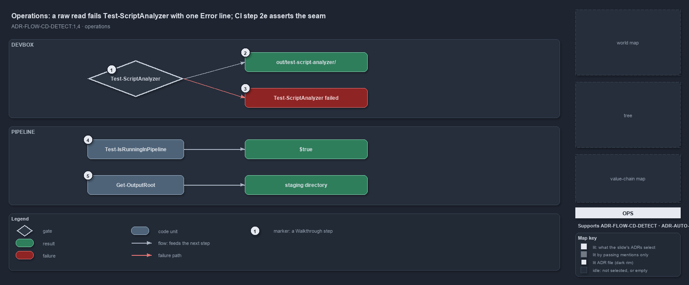

---
catzc:
  derived:
    path: docs/explanation/flow/the-analyzer-names-the-raw-read.md
    kind: explanation
    language: markdown
    track: docs
    body_sha: "3c30ffb9e17f"
    adrs:
      - ADR-AUTO-PARITY#2
      - ADR-FLOW-CD-DETECT#{1,4}
    links:
      - docs/.assets/explanation/adr-flow-cd-detect--the-analyzer-names-the-raw-read--operations.drawio.md
      - docs/.assets/explanation/adr-flow-cd-detect--the-analyzer-names-the-raw-read--operations.drawio.png
      - docs/adr/automation/devbox-pipeline-parity.md
      - docs/adr/flow/pipeline-detection.md
      - docs/explanation/flow/index.md
      - docs/explanation/flow/one-boolean-answer-from-one-function.md
      - docs/explanation/flow/one-gate-checks-the-raw-read-rule.md
      - docs/explanation/flow/the-loader-holds-the-one-detector.md
      - docs/explanation/flow/two-variables-read-in-one-place.md
      - docs/explanation/index.md#how-to-read-the-diagrams
---

# A raw read fails Test-ScriptAnalyzer with one Error line, and CI step 2e asserts the seam

```text
A raw read fails Test-ScriptAnalyzer with one Error line, and CI step 2e asserts the seam.

1  Test-ScriptAnalyzer         the gate a developer runs; the pipeline runs it as the L2 analyzer test
2  out/test-script-analyzer/   the report folder it writes on every run
3  Test-ScriptAnalyzer failed  the one throw, listing every issue line
4  Test-IsRunningInPipeline    CI step 2e asserts it is true on the agent
5  Get-OutputRoot              the same step prints the staging directory it resolves

Supports ADR-FLOW-CD-DETECT#1 and #4 (operations lens).
```

A developer who writes `if ($env:TF_BUILD)` finds out at the next analyzer run, not in a code review. `Test-ScriptAnalyzer` prints one line
that names the file, the position, the rule and the function to call instead, and then throws. On the agent side the CI pipeline proves the
seam itself: one step asserts that the detector answers true and prints where the output root landed.



The diagram is described element by element in
[its asset description](../../.assets/explanation/adr-flow-cd-detect--the-analyzer-names-the-raw-read--operations.drawio.md).

## Walkthrough

1. **Test-ScriptAnalyzer.** Run it from a session that has dot-sourced the importer. It analyzes the automation PowerShell with the one
   settings file, sharded across background processes with live progress. The same analysis runs in the pipeline as the L2
   `PSScriptAnalyzer` test inside `Test-Automation`, so devbox and pipeline see the same result.
2. **out/test-script-analyzer/.** The gate writes its report there on every run and prints every issue, each as
   `<path>:<line>:<col> <severity> <rule> <message>`, with the path relative to the repository root.
3. **Test-ScriptAnalyzer failed.** With issues it throws once, `Test-ScriptAnalyzer failed: N issue(s)`, followed by the folder and every
   line. A raw read produces an `Error` from `Measure-NoRawPipelineDetection` whose message opens with
   `Do not read the pipeline-detection variable '$env:TF_BUILD' directly.` and goes on to say: call `Test-IsRunningInPipeline` so detection
   stays in one place and both Azure DevOps and GitHub Actions are covered.
4. **Test-IsRunningInPipeline.** Step 2e of `pipelines/ci-automation.yaml`, named "Pipeline detection and output root", runs
   `Assert-True (Test-IsRunningInPipeline)` on the agent, where `TF_BUILD` is set.
5. **Get-OutputRoot.** The same step calls `Get-OutputRoot`, asserts that the folder exists, and prints `OutputRoot: <path>`. On the agent
   that path is the staging directory; on a devbox the same call returns `out/`. `Get-RunEnvironment` is the readable form of the same
   answer, `Pipeline` or `Devbox`.

## Why it holds

- Never check the detection variables directly; the analyzer rule turns a raw read into an error a developer sees at once
  (ADR-FLOW-CD-DETECT#1).
- Detection is boolean, so the pipeline can assert it with one `Assert-True` (ADR-FLOW-CD-DETECT#4).
- Both environments are checked equally: the analyzer runs on the devbox and in the pipeline, and the two must agree (ADR-AUTO-PARITY#2).

## See also

- [Pipeline detection](../../adr/flow/pipeline-detection.md) — the decision this article explains;
  [Devbox and pipeline parity](../../adr/automation/devbox-pipeline-parity.md) — the seam it keeps.
- The other lenses on the same detector: [meta](one-boolean-answer-from-one-function.md),
  [architecture](the-loader-holds-the-one-detector.md), [implementation](two-variables-read-in-one-place.md) and
  [governance](one-gate-checks-the-raw-read-rule.md).
- [The flow explanations](index.md) · [How to read the diagrams](../index.md#how-to-read-the-diagrams)
