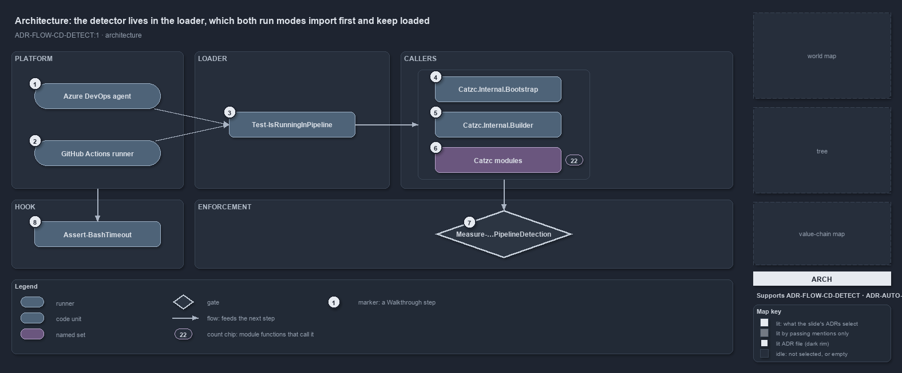

---
catzc:
  derived:
    path: docs/explanation/flow/the-loader-holds-the-one-detector.md
    folder: docs/explanation/flow
    name: the-loader-holds-the-one-detector
    filetype: md
    kind: explanation
    language: markdown
    track: docs
    body_sha: "8a2ef0492492"
    adrs:
      - ADR-AUTO-PARITY#3
      - ADR-FLOW-CD-DETECT#1
    links:
      - docs/.assets/explanation/adr-flow-cd-detect--the-loader-holds-the-one-detector--architecture.drawio.md
      - docs/.assets/explanation/adr-flow-cd-detect--the-loader-holds-the-one-detector--architecture.drawio.png
      - docs/adr/automation/devbox-pipeline-parity.md
      - docs/adr/flow/pipeline-detection.md
      - docs/explanation/flow/index.md
      - docs/explanation/flow/one-boolean-answer-from-one-function.md
      - docs/explanation/flow/one-gate-checks-the-raw-read-rule.md
      - docs/explanation/flow/the-analyzer-names-the-raw-read.md
      - docs/explanation/flow/two-variables-read-in-one-place.md
      - docs/explanation/index.md#how-to-read-the-diagrams
---

# The detector lives in the loader, which both run modes import first and keep loaded

```text
The detector lives in the loader, which both run modes import first and keep loaded.

1  Azure DevOps agent              sets TF_BUILD on every pipeline run
2  GitHub Actions runner           sets GITHUB_ACTIONS on every workflow run
3  Test-IsRunningInPipeline        the one reader, defined and exported by Catzc.Internal.Loader
4  Catzc.Internal.Bootstrap        the C#-types pre-pass asks it before any module loads
5  Catzc.Internal.Builder          the module build asks it before it bundles
6  Catzc modules                   22 module functions ask it; none reads the variables
7  Measure-NoRawPipelineDetection  the analyzer rule that bans a raw read in PowerShell
8  Assert-BashTimeout              the C# hook, outside the analyzer, repeats the same test

Supports ADR-FLOW-CD-DETECT#1 (architecture lens).
```

The detector has to exist before anything else, because the importer's own bootstrap asks it while it is still compiling types, before a
single cats module has loaded. So cats keeps `Test-IsRunningInPipeline` in `Catzc.Internal.Loader`, the one internal library that both run
modes import first and never remove. Everything above the loader calls that function. Only one piece of code outside PowerShell, the
time-safeguard hook, repeats the test on its own.



The diagram is described element by element in
[its asset description](../../.assets/explanation/adr-flow-cd-detect--the-loader-holds-the-one-detector--architecture.drawio.md).

## Walkthrough

1. **Azure DevOps agent.** Sets `TF_BUILD` on every pipeline run.
2. **GitHub Actions runner.** Sets `GITHUB_ACTIONS` on every workflow run. Neither variable exists on a devbox.
3. **Test-IsRunningInPipeline.** Defined and exported by `Catzc.Internal.Loader`, the one `.internal` module the importer loads
   unconditionally and keeps in the session. Because it loads first in both run modes, the bootstrap and every module ask the same function.
4. **Catzc.Internal.Bootstrap.** The C#-types pre-pass runs before any `Catzc` module loads. When the compiled types are stale it asks the
   detector: in a pipeline that is a hard failure, on a devbox a warning and a restart hint.
5. **Catzc.Internal.Builder.** The module build asks it too: a source tree that differs from its commit cannot be bundled in a pipeline,
   because a pipeline builds only a clean commit.
6. **Catzc modules.** Twenty-two module functions, from `Get-OutputRoot` to `Install-Dotnet`, branch on the detector. None of them reads the
   variables.
7. **Measure-NoRawPipelineDetection.** The analyzer rule, loaded through `CatzcRules.psm1` by the one settings file, flags a raw read of
   either variable in any PowerShell file outside the detector.
8. **Assert-BashTimeout.** The time-safeguard hook is a C# program the importer publishes. It runs outside the module system and outside the
   analyzer, so it reads `TF_BUILD` and `GITHUB_ACTIONS` itself, through `BashSafeguard.EnvironmentOf`, by the same test the detector
   applies.

## Why it holds

- Never check the detection variables directly; call `Test-IsRunningInPipeline`, so the logic lives in one place and both platforms are
  always covered (ADR-FLOW-CD-DETECT#1). Placing that one function in the loader is what lets the bootstrap honour the rule before any
  module exists.
- The function is the one seam between devbox and pipeline, so "where do the two diverge?" has a finite answer: the callers above the loader
  (ADR-AUTO-PARITY#3).

## Where the code and the ADR differ

The ADR says never to read the variables directly, and the analyzer enforces that for PowerShell. The C# hook `Assert-BashTimeout` reads
both variables itself, and no gate reaches C#.

## See also

- [Pipeline detection](../../adr/flow/pipeline-detection.md) — the decision this article explains;
  [Devbox and pipeline parity](../../adr/automation/devbox-pipeline-parity.md) — the seam it keeps.
- The other lenses on the same detector: [meta](one-boolean-answer-from-one-function.md),
  [implementation](two-variables-read-in-one-place.md), [operations](the-analyzer-names-the-raw-read.md) and
  [governance](one-gate-checks-the-raw-read-rule.md).
- [The flow explanations](index.md) · [How to read the diagrams](../index.md#how-to-read-the-diagrams)
