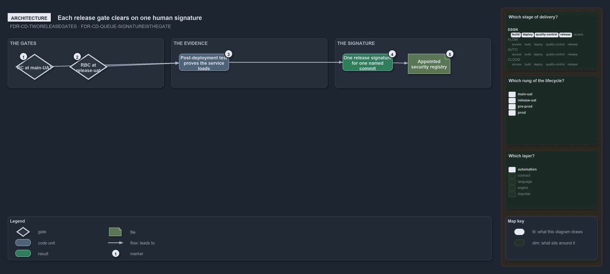

---
catzc:
  warning: "Experimental: this article merges two rules into one and holds nothing beyond what they say"
  edges:
    cites:
      - FDR-CD-TWORELEASEGATES
      - FDR-CD-QUEUE-SIGNATUREISTHEGATE
---

# The release gates are served by one human signature in the appointed registry

This article is one rule: [FDR-CD-TWORELEASEGATES](../../drs/flow/cd-discipline-and-promotion-flow.md#rule-fdr-cd-tworeleasegates) and
[FDR-CD-QUEUE-SIGNATUREISTHEGATE](../../drs/flow/manual-queues.md#rule-fdr-cd-queue-signatureisthegate) merged into one. It holds nothing
beyond what those two rules say.

RC and RBC are the two hands-on release gates, and each is a gate, not a pipeline. RC is the gate at main-UAT and RBC the gate at
release-uat; each clears when its acceptance testing is verified and a human certifies the environment's occupant. Each is served by one
release signature from a user with access, entered in the appointed security registry after the rung's post-deployment test proved the
service loads. The signature is one recorded act that this rung passed its check for one named commit; the test is the evidence and the
signature is the human's authentication of it, not a second test.

