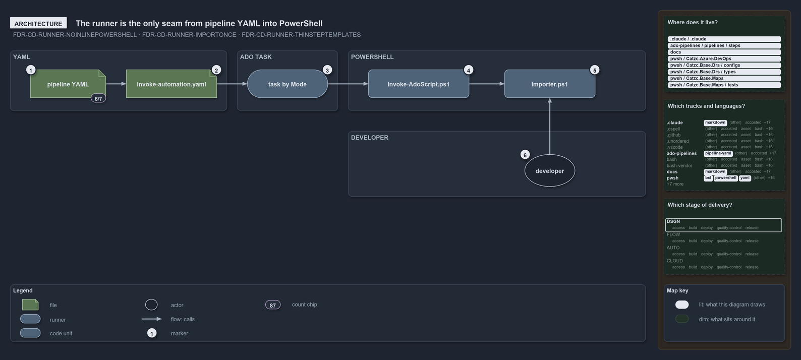

---
catzc:
  edges:
    cites:
      - FDR-CD-RUNNER-NOINLINEPOWERSHELL
      - FDR-CD-RUNNER-IMPORTONCE
      - FDR-CD-RUNNER-THINSTEPTEMPLATES
---

# The runner is the only seam from pipeline YAML into PowerShell

```text
The runner is the only seam from pipeline YAML into PowerShell.

1  pipeline YAML           the ci-* and cd-* root pipelines; 6 of 7 reach the template
2  invoke-automation.yaml  the one step template every step goes through
3  task by Mode            PowerShell@2, AzureCLI@2 or AzurePowerShell@5; owns the auth
4  Invoke-AdoScript.ps1    the runner: imports once, sanitizes, runs in the same scope
5  importer.ps1            loads the modules under pwsh/
6  developer               dot-sources the importer and types the same command

Supports FDR-CD-RUNNER-NOINLINEPOWERSHELL, FDR-CD-RUNNER-IMPORTONCE and FDR-CD-RUNNER-THINSTEPTEMPLATES (architecture lens).
```

Azure DevOps runs YAML steps, and cats keeps its automation in PowerShell modules. The bridge between the two is a critical boundary, so
cats gives it exactly one crossing: pipeline YAML calls one step template, the template selects one task, and the task calls one runner
script, which loads the module system. A developer reaches the same module system from a terminal without passing through the YAML, the
template or the task.

```yml drawio
description:
  "The one crossing from pipeline YAML into PowerShell: root pipelines call one step template, the template selects one task, the task calls
  one runner script that loads the importer, and a developer reaches the same importer from a terminal."
about:
  adrs: [FDR-CD-RUNNER-NOINLINEPOWERSHELL, FDR-CD-RUNNER-IMPORTONCE, FDR-CD-RUNNER-THINSTEPTEMPLATES]
  lens: architecture
content:
  title: The runner is the only seam from pipeline YAML into PowerShell
  kind: explanation
  flow: left-to-right
  relation: calls
  theme: dark
  bands:
    - { id: band-yaml, label: YAML }
    - { id: band-task, label: ADO TASK }
    - { id: band-powershell, label: POWERSHELL }
    - { id: band-developer, label: DEVELOPER }
  glyphs:
    - { id: f-pipeline-yaml, kind: file, label: pipeline YAML, in: band-yaml }
    - { id: f-template, kind: file, label: invoke-automation.yaml, in: band-yaml }
    - { id: r-task, kind: runner, label: task by Mode, in: band-task }
    - { id: c-runner, kind: code, label: Invoke-AdoScript.ps1, in: band-powershell }
    - { id: c-importer, kind: code, label: importer.ps1, in: band-powershell }
    - { id: a-developer, kind: actor, label: developer, in: band-developer }
  edges:
    - { from: f-pipeline-yaml, to: f-template, kind: flow, label: "" }
    - { from: f-template, to: r-task, kind: flow, label: "" }
    - { from: r-task, to: c-runner, kind: flow, label: "" }
    - { from: c-runner, to: c-importer, kind: flow, label: "" }
    - { from: a-developer, to: c-importer, kind: flow, label: "" }
  markers:
    - { at: f-pipeline-yaml, number: 1 }
    - { at: f-template, number: 2 }
    - { at: r-task, number: 3 }
    - { at: c-runner, number: 4 }
    - { at: c-importer, number: 5 }
    - { at: a-developer, number: 6 }
  chips:
    - { at: f-pipeline-yaml, kind: count, text: 6/7 }
  legend: auto
  minimaps:
    code-locations:
      - cell: .claude/.claude/.
        by: [.claude/CLAUDE.md, FDR-CD-RUNNER-IMPORTONCE, FDR-CD-RUNNER-NOINLINEPOWERSHELL, FDR-CD-RUNNER-THINSTEPTEMPLATES]
      - cell: ado-pipelines/pipelines/steps
        by:
          - .ado/pipelines/steps/invoke-automation.yaml
          - FDR-CD-RUNNER-IMPORTONCE
          - FDR-CD-RUNNER-NOINLINEPOWERSHELL
          - FDR-CD-RUNNER-THINSTEPTEMPLATES
      - cell: docs/-/.
        by:
          - docs/drs/flow/dora-explains.md
          - docs/drs/flow/pipeline-runner-pattern.md
          - docs/drs/index.md
          - docs/how-to/automation/apply-environment-approvals.md
          - docs/references/ado/pipelines/steps/invoke-automation.yaml.md
          - docs/references/pwsh/catzc-azure-dev-ops/Sync-AdoEnvironmentApprovals.ps1.md
          - docs/references/pwsh/catzc-base-drs/types/DrsConfig.cs.md
          - docs/references/pwsh/catzc-base-maps/Get-LifecyclePositionMinimapData.ps1.md
          - docs/references/pwsh/catzc-base-maps/Get-ValueChainHighlight.ps1.md
          - docs/references/pwsh/catzc-base-maps/Get-WorldMapHighlight.ps1.md
          - FDR-CD-RUNNER-IMPORTONCE
          - FDR-CD-RUNNER-NOINLINEPOWERSHELL
          - FDR-CD-RUNNER-THINSTEPTEMPLATES
      - cell: pwsh/Catzc.Azure.DevOps/.
        by:
          - pwsh/Catzc.Azure.DevOps/Sync-AdoEnvironmentApprovals.ps1
          - FDR-CD-RUNNER-IMPORTONCE
          - FDR-CD-RUNNER-NOINLINEPOWERSHELL
          - FDR-CD-RUNNER-THINSTEPTEMPLATES
      - cell: pwsh/Catzc.Base.Drs/configs
        by:
          - pwsh/Catzc.Base.Drs/configs/drs.yml
          - FDR-CD-RUNNER-IMPORTONCE
          - FDR-CD-RUNNER-NOINLINEPOWERSHELL
          - FDR-CD-RUNNER-THINSTEPTEMPLATES
      - cell: pwsh/Catzc.Base.Drs/types
        by:
          - pwsh/Catzc.Base.Drs/types/DrsConfig.cs
          - FDR-CD-RUNNER-IMPORTONCE
          - FDR-CD-RUNNER-NOINLINEPOWERSHELL
          - FDR-CD-RUNNER-THINSTEPTEMPLATES
      - cell: pwsh/Catzc.Base.Maps/.
        by:
          - pwsh/Catzc.Base.Maps/Get-LifecyclePositionMinimapData.ps1
          - pwsh/Catzc.Base.Maps/Get-ValueChainHighlight.ps1
          - pwsh/Catzc.Base.Maps/Get-WorldMapHighlight.ps1
          - FDR-CD-RUNNER-IMPORTONCE
          - FDR-CD-RUNNER-NOINLINEPOWERSHELL
          - FDR-CD-RUNNER-THINSTEPTEMPLATES
      - cell: pwsh/Catzc.Base.Maps/tests
        by:
          - pwsh/Catzc.Base.Maps/tests/Get-WorldMapHighlight.Tests.ps1
          - FDR-CD-RUNNER-IMPORTONCE
          - FDR-CD-RUNNER-NOINLINEPOWERSHELL
          - FDR-CD-RUNNER-THINSTEPTEMPLATES
    grid:
      - cell: .claude/markdown
        by: [.claude/CLAUDE.md, FDR-CD-RUNNER-IMPORTONCE, FDR-CD-RUNNER-NOINLINEPOWERSHELL, FDR-CD-RUNNER-THINSTEPTEMPLATES]
      - cell: ado-pipelines/pipeline-yaml
        by:
          - .ado/pipelines/steps/invoke-automation.yaml
          - FDR-CD-RUNNER-IMPORTONCE
          - FDR-CD-RUNNER-NOINLINEPOWERSHELL
          - FDR-CD-RUNNER-THINSTEPTEMPLATES
      - cell: docs/markdown
        by:
          - docs/drs/flow/dora-explains.md
          - docs/drs/flow/pipeline-runner-pattern.md
          - docs/drs/index.md
          - docs/how-to/automation/apply-environment-approvals.md
          - docs/references/ado/pipelines/steps/invoke-automation.yaml.md
          - docs/references/pwsh/catzc-azure-dev-ops/Sync-AdoEnvironmentApprovals.ps1.md
          - docs/references/pwsh/catzc-base-drs/types/DrsConfig.cs.md
          - docs/references/pwsh/catzc-base-maps/Get-LifecyclePositionMinimapData.ps1.md
          - docs/references/pwsh/catzc-base-maps/Get-ValueChainHighlight.ps1.md
          - docs/references/pwsh/catzc-base-maps/Get-WorldMapHighlight.ps1.md
          - FDR-CD-RUNNER-IMPORTONCE
          - FDR-CD-RUNNER-NOINLINEPOWERSHELL
          - FDR-CD-RUNNER-THINSTEPTEMPLATES
      - cell: pwsh/bcl
        by:
          - pwsh/Catzc.Base.Drs/types/DrsConfig.cs
          - FDR-CD-RUNNER-IMPORTONCE
          - FDR-CD-RUNNER-NOINLINEPOWERSHELL
          - FDR-CD-RUNNER-THINSTEPTEMPLATES
      - cell: pwsh/powershell
        by:
          - pwsh/Catzc.Azure.DevOps/Sync-AdoEnvironmentApprovals.ps1
          - pwsh/Catzc.Base.Maps/Get-LifecyclePositionMinimapData.ps1
          - pwsh/Catzc.Base.Maps/Get-ValueChainHighlight.ps1
          - pwsh/Catzc.Base.Maps/Get-WorldMapHighlight.ps1
          - pwsh/Catzc.Base.Maps/tests/Get-WorldMapHighlight.Tests.ps1
          - FDR-CD-RUNNER-IMPORTONCE
          - FDR-CD-RUNNER-NOINLINEPOWERSHELL
          - FDR-CD-RUNNER-THINSTEPTEMPLATES
      - cell: pwsh/yaml
        by:
          - pwsh/Catzc.Base.Drs/configs/drs.yml
          - FDR-CD-RUNNER-IMPORTONCE
          - FDR-CD-RUNNER-NOINLINEPOWERSHELL
          - FDR-CD-RUNNER-THINSTEPTEMPLATES
    axis:
      - cell: DSGN/*
        by: [FDR-CD-RUNNER-IMPORTONCE, FDR-CD-RUNNER-NOINLINEPOWERSHELL, FDR-CD-RUNNER-THINSTEPTEMPLATES]
layout:
  band-yaml: { x: 20, y: 84, w: 430, h: 120 }
  band-task: { x: 470, y: 84, w: 200, h: 120 }
  band-powershell: { x: 690, y: 84, w: 590, h: 120 }
  band-developer: { x: 690, y: 244, w: 590, h: 130 }
  f-pipeline-yaml: { x: 60, y: 122, w: 150, h: 56 }
  f-template: { x: 250, y: 122, w: 180, h: 56 }
  r-task: { x: 490, y: 122, w: 160, h: 56 }
  c-runner: { x: 730, y: 122, w: 200, h: 56 }
  c-importer: { x: 1000, y: 122, w: 180, h: 56 }
  a-developer: { x: 1040, y: 290, w: 100, h: 64 }
```



## Walkthrough

1. **Pipeline YAML.** The `ci-*` and `cd-*` root pipelines declare what to run and never hold PowerShell. Six of the seven root pipelines
   reach the step template: `ci-pwsh`, `ci-infrastructure` and `cd-shared` call it directly, and `cd-apex`, `cd-flux` and `cd-nova` extend
   `extends/cd-customer.yaml`, which calls it. The seventh, `ci-pwsh-expected-failures`, is the one sanctioned exception.
2. **invoke-automation.yaml.** The step template is the single file every step goes through. It takes the `RunCommand` and a `Mode`, and
   adds pipeline concerns: the service connection, the access token and the display name.
3. **Task by Mode.** The template expands into one task: `PowerShell@2`, `AzureCLI@2` or `AzurePowerShell@5`. The Azure tasks own the
   authentication, taking the service connection as their `azureSubscription`; the runner only logs which connection it ran under.
4. **Invoke-AdoScript.ps1.** The runner is the only seam between YAML and PowerShell. It imports the module system once, sanitizes the
   command string with `ConvertFrom-AdoPipelineCommand`, and runs it in the same scope as the import.
5. **importer.ps1.** The importer loads the modules under `pwsh/`, so every function a `RunCommand` names is available without
   qualification.
6. **Developer.** A developer dot-sources the importer in a terminal and types the same command, with no YAML, no task and no runner in
   between.

## Why it holds

- YAML steps never contain inline PowerShell; all PowerShell runs through the runner or the step template that calls it
  (FDR-CD-RUNNER-NOINLINEPOWERSHELL).
- The runner imports the module system once, at its start, and the command runs in that same scope (FDR-CD-RUNNER-IMPORTONCE).
- The step template is a thin wrapper that adds pipeline concerns but no logic (FDR-CD-RUNNER-THINSTEPTEMPLATES).

## Where the code and the decision record differ

The FDR says the step template holds no logic, but each of its three tasks runs a strict-mode guard that throws on a multiline `RunCommand`
without a `DisplayName` before it calls the runner.

## See also

- [Pipeline runner pattern](../../drs/flow/pipeline-runner-pattern.md) — the decision this article explains.
- The other lenses on the same runner: [meta](a-step-only-names-a-command.md), [implementation](three-tasks-one-guard-one-runner.md),
  [operations](the-step-is-named-after-its-command.md) and [governance](no-gate-checks-rules-one-and-four.md).
- [The flow explanations](index.md) · [How to read the diagrams](../index.md#how-to-read-the-diagrams)
