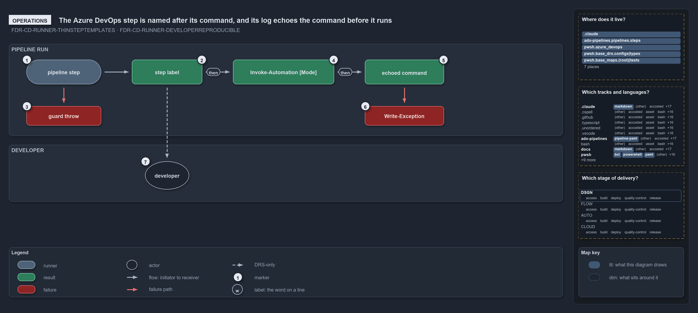

# The Azure DevOps step is named after its command, and its log echoes the command before it runs

```text
The Azure DevOps step is named after its command, and its log echoes the command before it runs.

1  pipeline step             the author writes a RunCommand, a Mode and a DisplayName
2  step label                the DisplayName, or else the RunCommand itself
3  guard throw               a multiline RunCommand without a DisplayName fails the step
4  Invoke-Automation [Mode]  the log's mode line, then connection, token and diagnostics
5  echoed command            the sanitized command, then its own output
6  Write-Exception           type, message, stack trace and inner exceptions; the run stops
7  developer                 runs .\importer.ps1 and pastes the RunCommand; no gate checks it

Supports FDR-CD-RUNNER-THINSTEPTEMPLATES and FDR-CD-RUNNER-DEVELOPERREPRODUCIBLE (operations lens).
```

What an author writes in a pipeline is what the Azure DevOps run shows. The step's label is its command, the log names the mode and then
echoes the command it is about to run, and a failure prints a full exception before the run stops. A developer who wants to reproduce a
failed step copies the command from the label and runs it after the importer.

```yml drawio
description:
  "What an Azure DevOps run shows of one step: the label is the command, the log names the mode and echoes the command, a failure prints a
  full exception, and a developer copies the command from the label with no gate checking that."
about:
  adrs: [FDR-CD-RUNNER-THINSTEPTEMPLATES, FDR-CD-RUNNER-DEVELOPERREPRODUCIBLE]
  lens: operations
content:
  title: The Azure DevOps step is named after its command, and its log echoes the command before it runs
  kind: explanation
  flow: left-to-right
  relation: run order
  theme: dark
  bands:
    - { id: band-run, label: PIPELINE RUN }
    - { id: band-developer, label: DEVELOPER }
  glyphs:
    - { id: r-step, kind: runner, label: pipeline step, in: band-run }
    - { id: r-label, kind: result, label: step label, in: band-run }
    - { id: r-invoke, kind: result, label: "Invoke-Automation [Mode]", in: band-run }
    - { id: r-echo, kind: result, label: echoed command, in: band-run }
    - { id: x-guard, kind: failure, label: guard throw, in: band-run }
    - { id: x-exception, kind: failure, label: Write-Exception, in: band-run }
    - { id: a-developer, kind: actor, label: developer, in: band-developer }
  edges:
    - { from: r-step, to: r-label, kind: flow, label: "" }
    - { from: r-label, to: r-invoke, kind: flow, label: "" }
    - { from: r-invoke, to: r-echo, kind: flow, label: "" }
    - { from: r-step, to: x-guard, kind: fail, label: "" }
    - { from: r-echo, to: x-exception, kind: fail, label: "" }
    - { from: r-label, to: a-developer, kind: adr, label: "" }
  markers:
    - { at: r-step, number: 1 }
    - { at: r-label, number: 2 }
    - { at: x-guard, number: 3 }
    - { at: r-invoke, number: 4 }
    - { at: r-echo, number: 5 }
    - { at: x-exception, number: 6 }
    - { at: a-developer, number: 7 }
  legend: auto
  minimaps: [code-locations, grid, axis]
layout:
  band-run: { x: 20, y: 84, w: 1260, h: 210 }
  band-developer: { x: 20, y: 314, w: 1260, h: 130 }
  r-step: { x: 60, y: 120, w: 170, h: 56 }
  r-label: { x: 300, y: 120, w: 160, h: 56 }
  r-invoke: { x: 530, y: 120, w: 230, h: 56 }
  r-echo: { x: 830, y: 120, w: 180, h: 56 }
  x-guard: { x: 60, y: 226, w: 170, h: 44 }
  x-exception: { x: 830, y: 226, w: 180, h: 44 }
  a-developer: { x: 330, y: 352, w: 100, h: 64 }
```



## Walkthrough

1. **Pipeline step.** The author writes a `RunCommand`, plus a `Mode` and a `DisplayName` when needed, in a step that uses the template.
2. **Step label.** The step's label is its `DisplayName`, or else the `RunCommand` itself, so the Azure DevOps UI shows exactly what ran
   rather than a generic "Run PowerShell script" label.
3. **Guard throw.** A multiline `RunCommand` without a `DisplayName` fails the step before the runner starts, with
   `Multiline RunCommand requires DisplayName parameter.`
4. **Invoke-Automation [Mode].** The log opens with the mode label, a bare `Invoke-Automation` when the mode is `none`. Then come
   `ServiceConnection: …` and `ExposeAccessToken: true` when they are set, and the environment diagnostics.
5. **Echoed command.** The log shows the sanitized command, then the command's own output.
6. **Write-Exception.** A command that throws prints the exception type, its message, the script stack trace and any inner exceptions, and
   the run stops.
7. **Developer.** To reproduce a step, a developer runs `.\importer.ps1` and pastes the `RunCommand`, copied from the step label or the
   echoed command. No gate checks this reproduction, so it holds by the FDR alone.

Set the pipeline variable `System.Debug` to `true` for verbose output and the full `Write-EnvironmentDiagnostic`; otherwise the log carries
the shorter `Write-AdoEnvironmentDiagnostic`. The `ci-pwsh-expected-failures.yaml` pipeline exercises the trap and a copy of the guard on
every `pwsh/**` change.

## Why it holds

- Step templates add pipeline concerns such as the display name, and never contain logic (FDR-CD-RUNNER-THINSTEPTEMPLATES).
- Whatever string appears in `RunCommand` can be pasted into a local terminal after running `.\importer.ps1`
  (FDR-CD-RUNNER-DEVELOPERREPRODUCIBLE).

## Where the code and the decision record differ

- No gate checks that a pasted `RunCommand` reproduces the step: nothing replays a command outside the runner.
- The FDR's runner listing leaves out the log lines and diagnostics that the run shows.
- The FDR says the step template holds no logic; the guard that throws on a multiline command without a display name lives in the template.

## See also

- [Pipeline runner pattern](../../drs/flow/pipeline-runner-pattern.md) — the decision this article explains.
- The other lenses on the same runner: [meta](a-step-only-names-a-command.md), [architecture](the-runner-is-the-only-seam.md),
  [implementation](three-tasks-one-guard-one-runner.md) and [governance](no-gate-checks-rules-one-and-four.md).
- [The flow explanations](index.md) · [How to read the diagrams](../index.md#how-to-read-the-diagrams)
