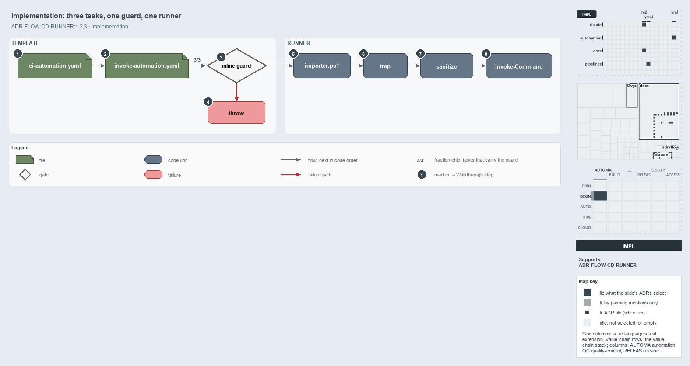

---
catzc:
  derived:
    path: docs/explanation/flow/three-tasks-one-guard-one-runner.md
    kind: explanation
    language: markdown
    filetype: md
    track: docs
    body_sha: ce8375725233
    adrs:
      - ADR-FLOW-CD-RUNNER#{1-3}
    links:
      - docs/.assets/explanation/adr-flow-cd-runner--three-tasks-one-guard-one-runner--implementation.drawio.md
      - docs/.assets/explanation/adr-flow-cd-runner--three-tasks-one-guard-one-runner--implementation.drawio.png
      - docs/adr/flow/pipeline-runner-pattern.md
      - docs/explanation/flow/a-step-only-names-a-command.md
      - docs/explanation/flow/index.md
      - docs/explanation/flow/no-gate-checks-rules-one-and-four.md
      - docs/explanation/flow/the-runner-is-the-only-seam.md
      - docs/explanation/flow/the-step-is-named-after-its-command.md
      - docs/explanation/index.md#how-to-read-the-diagrams
---

# Three tasks share one guard, and one runner imports, traps, sanitizes and invokes

```text
Three tasks share one guard, and one runner imports, traps, sanitizes and invokes.

1  ci-automation.yaml      a root pipeline names the template and passes a RunCommand
2  invoke-automation.yaml  six parameters; Mode picks one of three tasks
3  inline guard            Set-StrictMode, then a multiline RunCommand needs a DisplayName
4  throw                   stops the step before the runner starts
5  importer.ps1            dot-sourced once by the runner
6  trap                    reports failures through Write-Exception
7  sanitize                ConvertFrom-AdoPipelineCommand normalizes the string
8  Invoke-Command          runs the command with -NoNewScope

Supports ADR-FLOW-CD-RUNNER#1, #2 and #3 (implementation lens).
```

Every pipeline step in cats runs through two files: the step template `pipelines/steps/invoke-automation.yaml` and the runner
`pipelines/Invoke-AdoScript.ps1`. The template has three task variants, one per authentication mode, and all three carry the same inline
guard before they call the runner. The runner then does four things in a fixed order. Read in code order, the path from a pipeline's
`RunCommand` to the running command has no other stops.



The diagram is described element by element in
[its asset description](../../.assets/explanation/adr-flow-cd-runner--three-tasks-one-guard-one-runner--implementation.drawio.md).

## Walkthrough

1. **ci-automation.yaml.** A root pipeline names the template and passes a command, for example
   `RunCommand: "Test-Automation -Level 2 -EnforceTimings"`.
2. **invoke-automation.yaml.** The template takes six parameters: `RunCommand`, `Mode` (`none`, `azcli` or `azps`, default `none`),
   `ExposeAccessToken`, `ServiceConnection`, `AllowWarnings` and `DisplayName`. `Mode` picks one of three tasks, `PowerShell@2`,
   `AzureCLI@2` or `AzurePowerShell@5`; each task's `displayName` is `coalesce(DisplayName, RunCommand)`, and `ExposeAccessToken` maps
   `SYSTEM_ACCESSTOKEN` on any of them.
3. **Inline guard.** All three tasks run `Set-StrictMode -Version Latest`, then check that a multiline `RunCommand` has a `DisplayName`.
   When it passes, the task dot-sources the runner with `-Command`, `-Mode`, `-ExposeAccessToken`, `-ServiceConnection` and
   `-AllowWarnings`.
4. **Throw.** A multiline command without a display name stops the step with
   `Multiline RunCommand requires DisplayName parameter. Add: DisplayName: 'short description'`, before the runner starts.
5. **importer.ps1.** The runner dot-sources the importer with `-AllowWarnings:$AllowWarnings`, loading the module system once. When the
   pipeline variable `SYSTEM_DEBUG` is `true`, it then turns on verbose output.
6. **Trap.** `trap { Write-Exception $_; break }` is set after the import, so it reports failures in the sanitizer and the command, not in
   the import itself.
7. **Sanitize.** `ConvertFrom-AdoPipelineCommand` turns CRLF and stray CR into LF, trims the string, and trims the end of every line.
   Between sanitizing and invoking, the runner only logs: the mode label, the service connection, the token flag, the environment
   diagnostics, and the sanitized command.
8. **Invoke-Command.** `[ScriptBlock]::Create($sanitized)` runs with `Invoke-Command -NoNewScope`, in the importer's scope.

A developer reproduces the step by loading `.\importer.ps1` and typing the same `RunCommand`. That path has no guard, no sanitizer and no
trap, and no code runs it, so it is not drawn.

## Why it holds

- YAML never holds inline PowerShell beyond calling the runner; the template's tasks are the one place that calls it (ADR-FLOW-CD-RUNNER#1).
- The runner imports the module system once at its start, and the command runs in the same scope (ADR-FLOW-CD-RUNNER#2).
- The step template adds pipeline concerns, such as the service connection, the token and the display name (ADR-FLOW-CD-RUNNER#3).

## Where the code and the ADR differ

- The ADR lists four template parameters; the template has six, adding `AllowWarnings` and `DisplayName`.
- The ADR's runner listing leaves out the `SYSTEM_DEBUG` verbose switch, the logging and the diagnostics between sanitizing and invoking.
- The ADR says the step template holds no logic; the inline guard in each task is logic.

## See also

- [Pipeline runner pattern](../../adr/flow/pipeline-runner-pattern.md) — the decision this article explains.
- The other lenses on the same runner: [meta](a-step-only-names-a-command.md), [architecture](the-runner-is-the-only-seam.md),
  [operations](the-step-is-named-after-its-command.md) and [governance](no-gate-checks-rules-one-and-four.md).
- [The flow explanations](index.md) · [How to read the diagrams](../index.md#how-to-read-the-diagrams)
