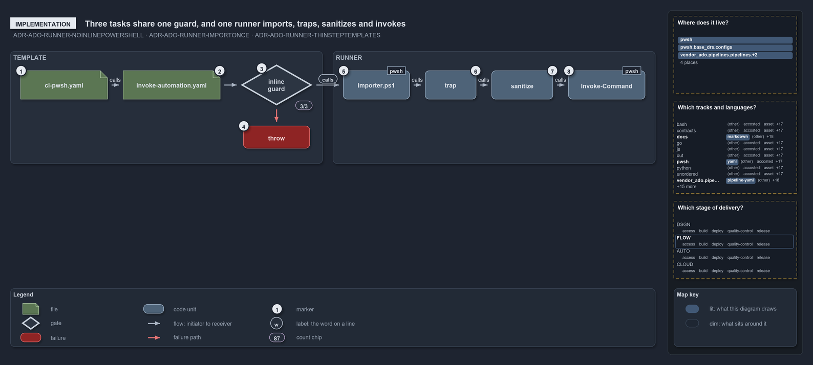

# What the three pipeline tasks share

```text
What the three pipeline tasks share.

1  ci-pwsh.yaml            a root pipeline names the template and passes a RunCommand
2  invoke-automation.yaml  seven parameters; Mode picks one of three tasks
3  inline guard            Set-StrictMode, then a multiline RunCommand needs a DisplayName
4  throw                   stops the step before the runner starts
5  importer.ps1            dot-sourced once by the runner
6  trap                    reports failures through Write-Exception
7  sanitize                ConvertFrom-AdoPipelineCommand normalizes the string
8  Invoke-Command          runs the command with -NoNewScope

Supports ADR-ADO-RUNNER-NOINLINEPOWERSHELL, ADR-ADO-RUNNER-IMPORTONCE and ADR-ADO-RUNNER-THINSTEPTEMPLATES (implementation lens).
```

Every ado pipeline step in cats runs through two files: the step template `.ado/pipelines/steps/invoke-automation.yaml` and the runner
`.ado/pipelines/Invoke-AdoScript.ps1`. The template has three task variants, one per authentication mode, and all three carry the same
inline guard before they call the runner. The runner then does four things in a fixed order. Read in code order, the path from a pipeline's
`RunCommand` to the running command has no other stops.

```yml drawio
description:
  "The path from a pipeline's RunCommand to the running command: the step template's three tasks carry one inline guard that can throw, then
  the runner imports, traps, sanitizes and invokes in a fixed order."
about:
  rules: [ADR-ADO-RUNNER-NOINLINEPOWERSHELL, ADR-ADO-RUNNER-IMPORTONCE, ADR-ADO-RUNNER-THINSTEPTEMPLATES]
  lens: implementation
content:
  title: What the three pipeline tasks share
  kind: explanation
  flow: left-to-right
  theme: dark
  bands:
    - { id: band-template, label: TEMPLATE }
    - { id: band-runner, label: RUNNER }
  glyphs:
    - { id: f-ci-automation, kind: file, label: ci-pwsh.yaml, in: band-template }
    - { id: f-template, kind: file, label: invoke-automation.yaml, in: band-template }
    - { id: g-inline-guard, kind: gate, label: inline guard, in: band-template }
    - { id: x-throw, kind: failure, label: throw, in: band-template }
    - { id: c-importer, kind: code, label: importer.ps1, in: band-runner }
    - { id: c-trap, kind: code, label: trap, in: band-runner }
    - { id: c-sanitize, kind: code, label: sanitize, in: band-runner }
    - { id: c-invoke-command, kind: code, label: Invoke-Command, in: band-runner }
  edges:
    - { from: f-ci-automation, to: f-template, kind: flow, label: calls }
    - { from: f-template, to: g-inline-guard, kind: flow, label: "" }
    - { from: g-inline-guard, to: x-throw, kind: fail, label: "" }
    - { from: g-inline-guard, to: c-importer, kind: flow, label: calls }
    - { from: c-importer, to: c-trap, kind: flow, label: calls }
    - { from: c-trap, to: c-sanitize, kind: flow, label: calls }
    - { from: c-sanitize, to: c-invoke-command, kind: flow, label: calls }
  markers:
    - { at: f-ci-automation, number: 1 }
    - { at: f-template, number: 2 }
    - { at: g-inline-guard, number: 3 }
    - { at: x-throw, number: 4 }
    - { at: c-importer, number: 5 }
    - { at: c-trap, number: 6 }
    - { at: c-sanitize, number: 7 }
    - { at: c-invoke-command, number: 8 }
  chips:
    - { at: g-inline-guard, kind: count, text: 3/3 }
  legend: auto
  minimaps: [code-locations, grid, axis]
layout:
  band-template: { x: 20, y: 84, w: 610, h: 220 }
  band-runner: { x: 650, y: 84, w: 630, h: 220 }
  f-ci-automation: { x: 40, y: 122, w: 170, h: 56 }
  f-template: { x: 240, y: 122, w: 190, h: 56 }
  g-inline-guard: { x: 470, y: 110, w: 140, h: 80 }
  x-throw: { x: 475, y: 230, w: 130, h: 44 }
  c-importer: { x: 670, y: 122, w: 130, h: 56 }
  c-trap: { x: 830, y: 122, w: 100, h: 56 }
  c-sanitize: { x: 960, y: 122, w: 120, h: 56 }
  c-invoke-command: { x: 1110, y: 122, w: 150, h: 56 }
```



## Walkthrough

1. **ci-pwsh.yaml.** A root pipeline names the template and passes a command, for example
   `RunCommand: "Test-Automation -Level 2 -EnforceTimings"`.
2. **invoke-automation.yaml.** The template takes seven parameters: `RunCommand`, `Mode` (`none`, `azcli` or `azps`, default `none`),
   `ExposeAccessToken`, `ServiceConnection`, `AllowWarnings`, `DisplayName` and `StepName`. `Mode` picks one of three tasks, `PowerShell@2`,
   `AzureCLI@2` or `AzurePowerShell@5`; each task's `displayName` is `coalesce(DisplayName, RunCommand)`, a set `StepName` names the task so
   a later stage can read its output variables, and `ExposeAccessToken` maps `SYSTEM_ACCESSTOKEN` on any of them.
3. **Inline guard.** All three tasks run `Set-StrictMode -Version Latest`, then check that a multiline `RunCommand` has a `DisplayName`.
   When it passes, the task dot-sources the runner with `-Command`, `-Mode`, `-ExposeAccessToken`, `-ServiceConnection` and
   `-AllowWarnings`.
4. **Throw.** A multiline command without a display name stops the step with
   `Multiline RunCommand requires DisplayName parameter. Add: DisplayName: 'short description'`, before the runner starts.
5. **importer.ps1.** The runner dot-sources the importer with `-AllowWarnings:$AllowWarnings`, loading the module system once. When the
   pipeline variable `SYSTEM_DEBUG` is `true`, it then turns on verbose output.
6. **Trap.** `trap { Write-Exception $_; break }` is set after the import, so it reports failures in the sanitizer and the command, not in
   the import itself.
7. **Sanitize.** `ConvertFrom-AdoPipelineCommand` turns CRLF and stray CR into LF, trims the string, and trims the end of every line.
   Between sanitizing and invoking, the runner only logs: the mode label, the service connection, the token flag, the environment
   diagnostics, and the sanitized command.
8. **Invoke-Command.** `[ScriptBlock]::Create($sanitized)` runs with `Invoke-Command -NoNewScope`, in the importer's scope.

A developer reproduces the step by loading `.\importer.ps1` and typing the same `RunCommand`. That path has no guard, no sanitizer and no
trap, and no code runs it, so it is not drawn.

## Why it holds

- YAML never holds inline PowerShell beyond calling the runner; the template's tasks are the one place that calls it
  (ADR-ADO-RUNNER-NOINLINEPOWERSHELL).
- The runner imports the module system once at its start, and the command runs in the same scope (ADR-ADO-RUNNER-IMPORTONCE).
- The step template adds pipeline concerns, such as the service connection, the token and the display name
  (ADR-ADO-RUNNER-THINSTEPTEMPLATES).

## Where the code and the decision record differ

- The FDR lists four template parameters; the template has seven, adding `AllowWarnings`, `DisplayName` and `StepName`.
- The FDR's runner listing leaves out the `SYSTEM_DEBUG` verbose switch, the logging and the diagnostics between sanitizing and invoking.
- The FDR says the step template holds no logic; the inline guard in each task is logic.

## See also

- [Pipeline runner pattern](../../drs/ado/pipeline-runner-pattern.md) — the decision this article explains.
- The other lenses on the same runner: [meta](how-a-pipeline-step-maps-to-a-local-command.md),
  [architecture](how-pipeline-yaml-enters-powershell.md), [operations](the-step-is-named-after-its-command.md) and
  [governance](no-gate-checks-rules-one-and-four.md).
- [The flow explanations](index.md) · [How to read the diagrams](../index.md#how-to-read-the-diagrams)
