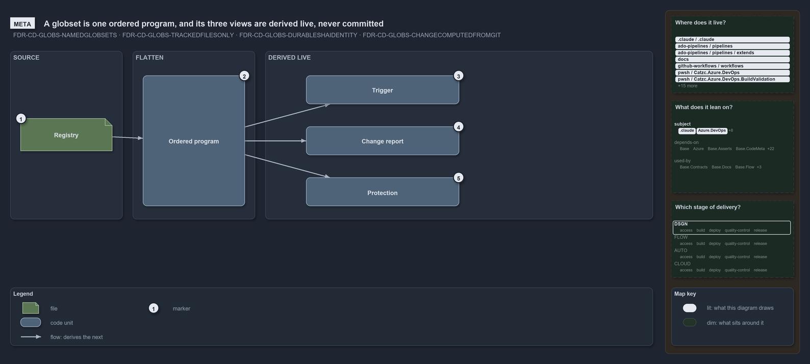

# How the three views of a globset are derived

```text
How the three views of a globset are derived.

1  Registry         the one place where named areas-of-control are declared
2  Ordered program  each set as + select and - drop rules over tracked files, last match wins
3  Trigger          the view that answers "when does a pipeline start?"
4  Change report    the view that answers "which areas did a change touch?"
5  Protection       the view that answers "did these inputs change?"

Supports FDR-GLOBS-NAMEDGLOBSETS, FDR-GLOBS-TRACKEDFILESONLY, FDR-GLOBS-DURABLESHAIDENTITY
and FDR-GLOBS-CHANGECOMPUTEDFROMGIT (meta lens).
```

A globset in cats names an area-of-control and maps it onto files under version control. Every question that asks whether a change concerns
that area reads the same flattened program. The registry is the only thing a person writes; the trigger, the change report and the
protection identity are read-outs of it, recomputed when asked, so nothing stored per set can go stale.

```yml drawio
description:
  A globset registry flattens into one ordered program, and the trigger, the change report and the protection identity are read-outs derived
  live from it, never committed.
about:
  rules: [FDR-GLOBS-NAMEDGLOBSETS, FDR-GLOBS-TRACKEDFILESONLY, FDR-GLOBS-DURABLESHAIDENTITY, FDR-GLOBS-CHANGECOMPUTEDFROMGIT]
  lens: meta
content:
  title: How the three views of a globset are derived
  kind: explanation
  flow: left-to-right
  theme: dark
  bands:
    - { id: band-source, label: SOURCE }
    - { id: band-flatten, label: FLATTEN }
    - { id: band-derived, label: DERIVED LIVE }
  glyphs:
    - { id: f-registry, kind: file, label: Registry, in: band-source }
    - { id: c-program, kind: code, label: Ordered program, in: band-flatten }
    - { id: c-trigger, kind: code, label: Trigger, in: band-derived }
    - { id: c-change-report, kind: code, label: Change report, in: band-derived }
    - { id: c-protection, kind: code, label: Protection, in: band-derived }
  edges:
    - { from: c-program, to: f-registry, kind: flow, label: reads }
    - { from: c-program, to: c-trigger, kind: flow, label: then }
    - { from: c-program, to: c-change-report, kind: flow, label: then }
    - { from: c-program, to: c-protection, kind: flow, label: then }
  markers:
    - { at: f-registry, number: 1 }
    - { at: c-program, number: 2 }
    - { at: c-trigger, number: 3 }
    - { at: c-change-report, number: 4 }
    - { at: c-protection, number: 5 }
  legend: auto
  minimaps: [code-locations, module-neighbourhood, axis]
layout:
  band-source: { x: 20, y: 84, w: 220, h: 330 }
  band-flatten: { x: 260, y: 84, w: 240, h: 330 }
  band-derived: { x: 520, y: 84, w: 760, h: 330 }
  f-registry: { x: 40, y: 216, w: 180, h: 64 }
  c-program: { x: 280, y: 132, w: 200, h: 256 }
  c-trigger: { x: 600, y: 132, w: 300, h: 56 }
  c-change-report: { x: 600, y: 232, w: 300, h: 56 }
  c-protection: { x: 600, y: 332, w: 300, h: 56 }
```



## Walkthrough

1. **Registry.** The one place where named areas-of-control are declared.
2. **Ordered program.** Each set becomes an ordered list of `+` select and `-` drop rules over the tracked files. The last matching rule
   wins, and a file that nothing matches belongs to no set.
3. **Trigger.** This view answers "when does a pipeline start?" by projecting the program into the vendor's own path filters.
4. **Change report.** This view answers "which areas did a change touch?" by matching the files git reports as changed.
5. **Protection.** This view answers "did these inputs change?" with an identity computed from the members' content.

## Why it holds

- One registry is the source of truth, and all three roles are derived from it, none committed per set (FDR-GLOBS-NAMEDGLOBSETS).
- Membership is decided by an ordered scan program over tracked files, last match wins, default not selected (FDR-GLOBS-TRACKEDFILESONLY).
- The identity is computed live and never committed (FDR-GLOBS-DURABLESHAIDENTITY).
- Whether a change touches a set is computed from git at the real refs, never from a stored hash (FDR-GLOBS-CHANGECOMPUTEDFROMGIT).

## See also

- [Globset triggers](../../drs/flow/durable-sha-globs.md) — the decision this article explains.
- The other lenses on the same globset roles: [architecture](globs-module-owns-config-and-types.md),
  [implementation](one-scan-program-feeds-three-roles.md), [operations](how-a-globs-yml-edit-shows-in-the-output.md) and
  [governance](what-the-globset-gates-check.md).
- [The flow explanations](index.md) · [How to read the diagrams](../index.md#how-to-read-the-diagrams)
