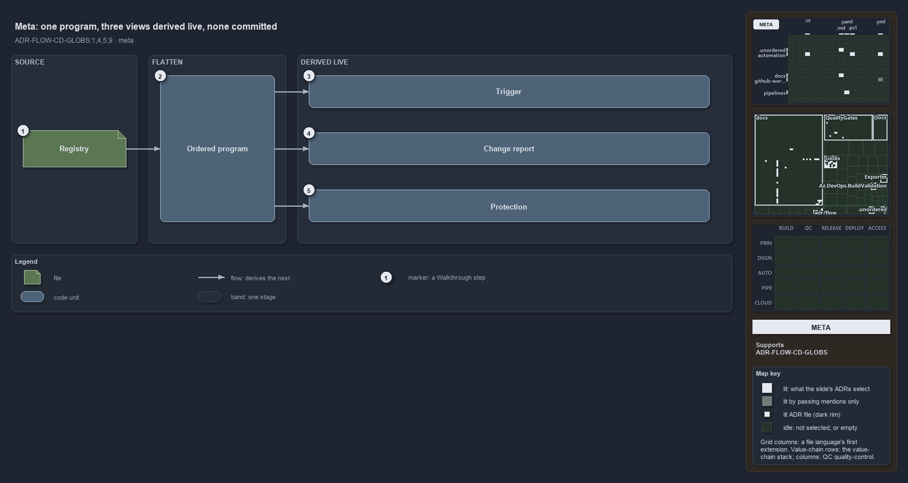

---
catzc:
  immutable:
    with_body_sha: "89279df0140d"
    repo_status: clean
    path: docs/explanation/flow/three-views-derived-live-from-one-program.md
    folder: docs/explanation/flow
    name: three-views-derived-live-from-one-program
    filetype: md
    kind: explanation
    language: markdown
    track: docs
    tracktype: documentation
  edges:
    cites:
      - ADR-FLOW-CD-GLOBS#{1,4,5,9}
    links:
      - docs/adr/flow/durable-sha-globs.md
      - docs/explanation/.assets/adr-flow-cd-globs--three-views-derived-live-from-one-program--meta.drawio.png
      - docs/explanation/flow/edit-globs-yml-then-read-the-output.md
      - docs/explanation/flow/gates-check-source-and-trigger.md
      - docs/explanation/flow/globs-module-owns-config-and-types.md
      - docs/explanation/flow/index.md
      - docs/explanation/flow/one-scan-program-feeds-three-roles.md
      - docs/explanation/flow/three-views-derived-live-from-one-program.drawio.md
      - docs/explanation/index.md#how-to-read-the-diagrams
---

# A globset is one ordered program, and its three views are derived live, never committed

```text
A globset is one ordered program, and its three views are derived live, never committed.

1  Registry         the one place where named areas-of-control are declared
2  Ordered program  each set as + select and - drop rules over tracked files, last match wins
3  Trigger          the view that answers "when does a pipeline start?"
4  Change report    the view that answers "which areas did a change touch?"
5  Protection       the view that answers "did these inputs change?"

Supports ADR-FLOW-CD-GLOBS#1, #4, #5 and #9 (meta lens).
```

A globset in cats names an area-of-control and maps it onto files under version control. Every question that asks whether a change concerns
that area reads the same flattened program. The registry is the only thing a person writes; the trigger, the change report and the
protection identity are read-outs of it, recomputed when asked, so nothing stored per set can go stale.



The diagram is described element by element in [its asset description](three-views-derived-live-from-one-program.drawio.md).

## Walkthrough

1. **Registry.** The one place where named areas-of-control are declared.
2. **Ordered program.** Each set becomes an ordered list of `+` select and `-` drop rules over the tracked files. The last matching rule
   wins, and a file that nothing matches belongs to no set.
3. **Trigger.** This view answers "when does a pipeline start?" by projecting the program into the vendor's own path filters.
4. **Change report.** This view answers "which areas did a change touch?" by matching the files git reports as changed.
5. **Protection.** This view answers "did these inputs change?" with an identity computed from the members' content.

## Why it holds

- One registry is the source of truth, and all three roles are derived from it, none committed per set (ADR-FLOW-CD-GLOBS#1).
- Membership is decided by an ordered scan program over tracked files, last match wins, default not selected (ADR-FLOW-CD-GLOBS#4).
- The identity is computed live and never committed (ADR-FLOW-CD-GLOBS#5).
- Whether a change touches a set is computed from git at the real refs, never from a stored hash (ADR-FLOW-CD-GLOBS#9).

## Where the code and the ADR differ

The ADR says nothing is committed per set, and the code commits nothing. The `globs.yml` header and the help text of the hash function still
speak of a per-set "marker" and its SHA.

## See also

- [Globset triggers](../../adr/flow/durable-sha-globs.md) — the decision this article explains.
- The other lenses on the same globset roles: [architecture](globs-module-owns-config-and-types.md),
  [implementation](one-scan-program-feeds-three-roles.md), [operations](edit-globs-yml-then-read-the-output.md) and
  [governance](gates-check-source-and-trigger.md).
- [The flow explanations](index.md) · [How to read the diagrams](../index.md#how-to-read-the-diagrams)
