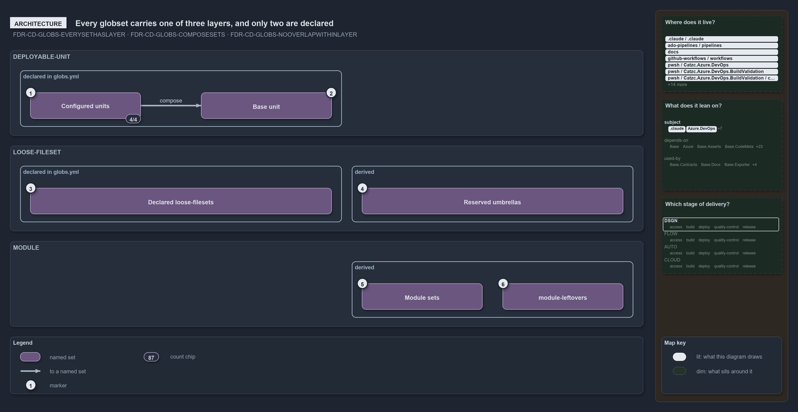

# Every globset carries one of three layers, and only two are declared

```text
Every globset carries one of three layers; two are declared in globs.yml, the third is derived.

1  Configured units         nova, apex, flux and shared: a base plus their own configuration
2  Base unit                template-azure-subscription-foundation, composed by all four
3  Declared loose-filesets  five cross-cutting surfaces declared in globs.yml
4  Reserved umbrellas       internal, vendor, compiled, scriptanalyzer: derived loose-filesets
5  Module sets              87 derived sets: two aspects per module folder, one per internal file
6  module-leftovers         the module layer's catch-all, empty in a clean tree

Supports FDR-GLOBS-EVERYSETHASLAYER, FDR-GLOBS-COMPOSESETS and FDR-GLOBS-NOOVERLAPWITHINLAYER (architecture lens).
```

Each globset in cats maps an area-of-control onto its tracked files, and every globset carries a layer that says what kind of thing it maps.
Two layers, `deployable-unit` and `loose-fileset`, are declared in `globs.yml`. The third, `module`, is derived from the folders under
`pwsh/` and is never declared. Knowing which layer a set sits in tells you where it comes from and whether its peers may overlap it.

```yml drawio
description:
  "Every globset carries one of three layers: deployable-unit and loose-fileset sets are declared in globs.yml, module sets are derived from
  the folders under pwsh; the reserved umbrellas are derived loose-filesets, and compose is the only edge between sets."
about:
  adrs: [FDR-GLOBS-EVERYSETHASLAYER, FDR-GLOBS-COMPOSESETS, FDR-GLOBS-NOOVERLAPWITHINLAYER]
  lens: architecture
content:
  title: Every globset carries one of three layers, and only two are declared
  kind: explanation
  flow: top-to-bottom
  theme: dark
  bands:
    - { id: band-unit, label: DEPLOYABLE-UNIT }
    - { id: band-loose, label: LOOSE-FILESET }
    - { id: band-module, label: MODULE }
  groups:
    - { id: grp-unit-declared, label: declared in globs.yml, in: band-unit }
    - { id: grp-loose-declared, label: declared in globs.yml, in: band-loose }
    - { id: grp-loose-derived, label: derived, in: band-loose }
    - { id: grp-module-derived, label: derived, in: band-module }
  glyphs:
    - { id: g-configured, kind: set, label: Configured units, in: grp-unit-declared }
    - { id: g-base, kind: set, label: Base unit, in: grp-unit-declared }
    - { id: g-declared-loose, kind: set, label: Declared loose-filesets, in: grp-loose-declared }
    - { id: g-umbrellas, kind: set, label: Reserved umbrellas, in: grp-loose-derived }
    - { id: g-modules, kind: set, label: Module sets, in: grp-module-derived }
    - { id: g-leftovers, kind: set, label: module-leftovers, in: grp-module-derived }
  edges:
    - { from: g-configured, to: g-base, kind: thick, label: composes }
  markers:
    - { at: g-configured, number: 1 }
    - { at: g-base, number: 2 }
    - { at: g-declared-loose, number: 3 }
    - { at: g-umbrellas, number: 4 }
    - { at: g-modules, number: 5 }
    - { at: g-leftovers, number: 6 }
  chips:
    - { at: g-configured, kind: count, text: 4/4 }
  legend: auto
  minimaps: [code-locations, module-neighbourhood, axis]
layout:
  band-unit: { x: 20, y: 84, w: 1260, h: 170 }
  band-loose: { x: 20, y: 274, w: 1260, h: 170 }
  band-module: { x: 20, y: 464, w: 1260, h: 170 }
  grp-unit-declared: { x: 40, y: 124, w: 640, h: 112 }
  grp-loose-declared: { x: 40, y: 314, w: 640, h: 112 }
  grp-loose-derived: { x: 700, y: 314, w: 560, h: 112 }
  grp-module-derived: { x: 700, y: 504, w: 560, h: 112 }
  g-configured: { x: 60, y: 168, w: 220, h: 52 }
  g-base: { x: 400, y: 168, w: 260, h: 52 }
  g-declared-loose: { x: 60, y: 358, w: 600, h: 52 }
  g-umbrellas: { x: 720, y: 358, w: 520, h: 52 }
  g-modules: { x: 720, y: 548, w: 240, h: 52 }
  g-leftovers: { x: 1000, y: 548, w: 240, h: 52 }
```



## Walkthrough

1. **Configured units.** Four deployable-units, `nova`, `apex`, `flux` and `shared`, are a base plus their own configuration. Each binds its
   own CD pipeline (`cd-nova`, `cd-apex`, `cd-flux`, `cd-shared`), and all four compose the base unit. `compose:` is the only reference
   between globsets, which is why it is the only edge here.
2. **Base unit.** `template-azure-subscription-foundation` is a shared, un-configured surface that exists only to be composed. It binds no
   pipeline, yet it still carries an area-of-control: a `verify:` scope over `Catzc.Azure.Templates` at level 2.
3. **Declared loose-filesets.** Five cross-cutting surfaces are declared in `globs.yml`: the track roots `pwsh` and `infrastructure`, the
   all-templates surface `templates`, and the scan scopes `markdown-scope` and `repository`. The two track roots bind `ci-pwsh` and
   `ci-infrastructure`, because `pipeline:` and `verify:` are valid on any layer.
4. **Reserved umbrellas.** `internal`, `vendor`, `compiled` and `scriptanalyzer` cover the dot-folders under `pwsh/`. `Get-ModuleGlobSet`
   builds them with the layer `loose-fileset`, so they sit in this layer although nobody declares them.
5. **Module sets.** Each of the 40 module folders derives two aspect sets, `<kebab>-live` and `<kebab>-tests`, and each of the 7 internal
   shared modules under `pwsh/.internal/` derives one single-file set: 87 sets in all. The folder, or the file, is the registration.
6. **module-leftovers.** The catch-all holds every tracked file under `pwsh/` that no module folder and no dot-folder owns. It is the
   complement of the explicit module sets, so it is disjoint from them by construction, and it holds no files in today's tree.

## Why it holds

- Every globset carries a layer. `deployable-unit` and `loose-fileset` are declared; `module` is derived-only, and declaring it is rejected
  (FDR-GLOBS-EVERYSETHASLAYER).
- A deployable unit is either configured or a base that exists only to be composed; `pipeline:` and `verify:` are orthogonal annotations
  valid on any layer (FDR-GLOBS-EVERYSETHASLAYER).
- A set composes other declared sets, its own rules last; references resolve to declared sets only and the graph must be acyclic
  (FDR-GLOBS-COMPOSESETS).
- Within the `deployable-unit` and `module` layers, no two sets select a common file on their own contribution; the `loose-fileset` layer is
  exempt (FDR-GLOBS-NOOVERLAPWITHINLAYER).

## Where the code and the decision record differ

- The FDR lists a reserved umbrella among the kinds of declared loose-fileset; the code derives the four umbrellas and rejects them as
  declared names.
- The FDR describes one module set per folder (`catzc-base-globs`, include `pwsh/<Module>/**`); the code derives two aspect sets per folder
  and no whole-module set.

## See also

- [Globset triggers](../../drs/flow/durable-sha-globs.md) — the decision this article explains.
- The other lenses on the same layers: [meta](peers-in-a-layer-never-overlap.md), [implementation](independence-check-groups-by-layer.md),
  [operations](declare-or-add-folder-gate-names-overlaps.md) and [governance](overlap-gated-for-units-and-modules.md).
- [The flow explanations](index.md) · [How to read the diagrams](../index.md#how-to-read-the-diagrams)
