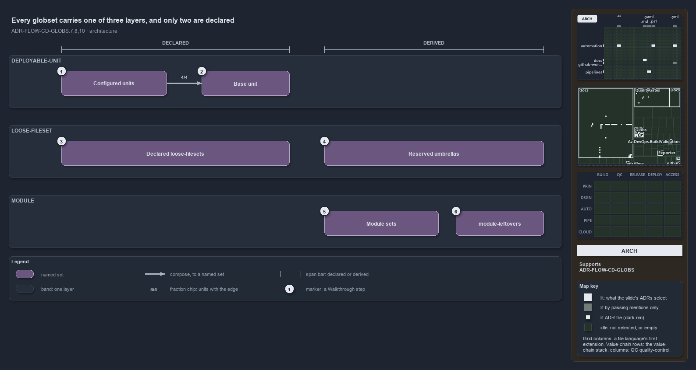

---
catzc:
  immutable:
    repo_status: clean
    path: docs/explanation/flow/two-declared-layers-one-derived.md
    folder: docs/explanation/flow
    name: two-declared-layers-one-derived
    filetype: md
    kind: explanation
    language: markdown
    track: docs
    tracktype: documentation
  edges:
    cites:
      - ADR-FLOW-CD-GLOBS#{7,8,10}
    links:
      - docs/adr/flow/durable-sha-globs.md
      - docs/explanation/.assets/adr-flow-cd-globs--two-declared-layers-one-derived--architecture.drawio.png
      - docs/explanation/flow/declare-or-add-folder-gate-names-overlaps.md
      - docs/explanation/flow/independence-check-groups-by-layer.md
      - docs/explanation/flow/index.md
      - docs/explanation/flow/overlap-gated-for-units-and-modules.md
      - docs/explanation/flow/peers-in-a-layer-never-overlap.md
      - docs/explanation/flow/two-declared-layers-one-derived.drawio.md
      - docs/explanation/index.md#how-to-read-the-diagrams
---

# Every globset carries one of three layers, and only two are declared

```text
Every globset carries one of three layers; two are declared in globs.yml, the third is derived.

1  Configured units         nova, apex, flux and shared: a base plus their own configuration
2  Base unit                template-azure-subscription-foundation, composed by all four
3  Declared loose-filesets  five cross-cutting surfaces declared in globs.yml
4  Reserved umbrellas       internal, vendor, compiled, scriptanalyzer: derived loose-filesets
5  Module sets              87 derived sets: two aspects per module folder, one per internal file
6  module-leftovers         the module layer's catch-all, empty in a clean tree

Supports ADR-FLOW-CD-GLOBS#7, #8 and #10 (architecture lens).
```

Each globset in cats maps an area-of-control onto its tracked files, and every globset carries a layer that says what kind of thing it maps.
Two layers, `deployable-unit` and `loose-fileset`, are declared in `globs.yml`. The third, `module`, is derived from the folders under
`automation/` and is never declared. Knowing which layer a set sits in tells you where it comes from and whether its peers may overlap it.



The diagram is described element by element in [its asset description](two-declared-layers-one-derived.drawio.md).

## Walkthrough

1. **Configured units.** Four deployable-units, `nova`, `apex`, `flux` and `shared`, are a base plus their own configuration. Each binds its
   own CD pipeline (`cd-nova`, `cd-apex`, `cd-flux`, `cd-shared`), and all four compose the base unit. `compose:` is the only reference
   between globsets, which is why it is the only edge here.
2. **Base unit.** `template-azure-subscription-foundation` is a shared, un-configured surface that exists only to be composed. It binds no
   pipeline, yet it still carries an area-of-control: a `verify:` scope over `Catzc.Azure.Templates` at level 2.
3. **Declared loose-filesets.** Five cross-cutting surfaces are declared in `globs.yml`: the track roots `automation` and `infrastructure`,
   the all-templates surface `templates`, and the scan scopes `markdown-scope` and `repository`. The two track roots bind `ci-automation`
   and `ci-infrastructure`, because `pipeline:` and `verify:` are valid on any layer.
4. **Reserved umbrellas.** `internal`, `vendor`, `compiled` and `scriptanalyzer` cover the dot-folders under `automation/`.
   `Get-ModuleGlobSet` builds them with the layer `loose-fileset`, so they sit in this layer although nobody declares them.
5. **Module sets.** Each of the 40 module folders derives two aspect sets, `<kebab>-live` and `<kebab>-tests`, and each of the 7 internal
   shared modules under `automation/.internal/` derives one single-file set: 87 sets in all. The folder, or the file, is the registration.
6. **module-leftovers.** The catch-all holds every tracked file under `automation/` that no module folder and no dot-folder owns. It is the
   complement of the explicit module sets, so it is disjoint from them by construction, and it holds no files in today's tree.

## Why it holds

- Every globset carries a layer. `deployable-unit` and `loose-fileset` are declared; `module` is derived-only, and declaring it is rejected
  (ADR-FLOW-CD-GLOBS#7).
- A deployable unit is either configured or a base that exists only to be composed; `pipeline:` and `verify:` are orthogonal annotations
  valid on any layer (ADR-FLOW-CD-GLOBS#7).
- A set composes other declared sets, its own rules last; references resolve to declared sets only and the graph must be acyclic
  (ADR-FLOW-CD-GLOBS#8).
- Within the `deployable-unit` and `module` layers, no two sets select a common file on their own contribution; the `loose-fileset` layer is
  exempt (ADR-FLOW-CD-GLOBS#10).

## Where the code and the ADR differ

- The ADR lists a reserved umbrella among the kinds of declared loose-fileset; the code derives the four umbrellas and rejects them as
  declared names.
- The ADR describes one module set per folder (`catzc-base-globs`, include `automation/<Module>/**`); the code derives two aspect sets per
  folder and no whole-module set.

## See also

- [Globset triggers](../../adr/flow/durable-sha-globs.md) — the decision this article explains.
- The other lenses on the same layers: [meta](peers-in-a-layer-never-overlap.md), [implementation](independence-check-groups-by-layer.md),
  [operations](declare-or-add-folder-gate-names-overlaps.md) and [governance](overlap-gated-for-units-and-modules.md).
- [The flow explanations](index.md) · [How to read the diagrams](../index.md#how-to-read-the-diagrams)
