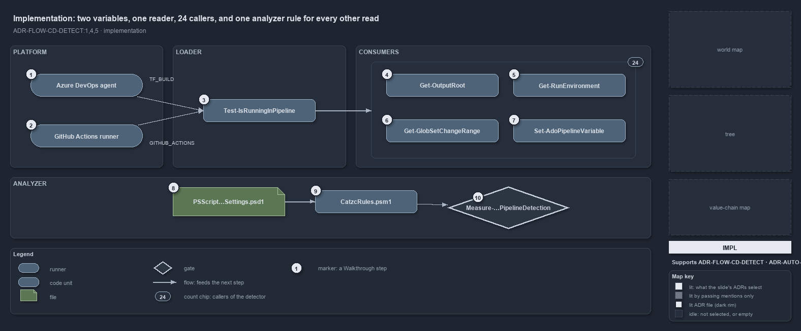

---
catzc:
  derived:
    path: docs/explanation/flow/two-variables-read-in-one-place.md
    kind: explanation
    language: markdown
    filekind: md
    track: docs
    body_sha: "08911525b4a7"
    adrs:
      - ADR-FLOW-CD-DETECT#{1,4,5}
    links:
      - docs/.assets/explanation/adr-flow-cd-detect--two-variables-read-in-one-place--implementation.drawio.md
      - docs/.assets/explanation/adr-flow-cd-detect--two-variables-read-in-one-place--implementation.drawio.png
      - docs/adr/automation/devbox-pipeline-parity.md
      - docs/adr/flow/pipeline-detection.md
      - docs/explanation/flow/index.md
      - docs/explanation/flow/one-boolean-answer-from-one-function.md
      - docs/explanation/flow/one-gate-checks-the-raw-read-rule.md
      - docs/explanation/flow/the-analyzer-names-the-raw-read.md
      - docs/explanation/flow/the-loader-holds-the-one-detector.md
      - docs/explanation/index.md#how-to-read-the-diagrams
---

# Two variables, one reader, 24 callers, and one analyzer rule for every other read

```text
Two variables are read in one place, 24 callers ask it, and one analyzer rule bans every other read.

1   Azure DevOps agent              sets TF_BUILD
2   GitHub Actions runner           sets GITHUB_ACTIONS
3   Test-IsRunningInPipeline        [bool]$env:TF_BUILD -or [bool]$env:GITHUB_ACTIONS
4   Get-OutputRoot                  the staging directory in a pipeline, else out/
5   Get-RunEnvironment              'Pipeline' or 'Devbox'
6   Get-GlobSetChangeRange          'HEAD' when not in a pipeline
7   Set-AdoPipelineVariable         skips the ##vso command when not in a pipeline
8   PSScriptAnalyzerSettings.psd1   loads CatzcRules.psm1 through CustomRulePath
9   CatzcRules.psm1                 runs every check once per file; NoRawPipelineDetection is listed
10  Measure-NoRawPipelineDetection  flags $env:TF_BUILD or $env:GITHUB_ACTIONS outside the detector

Supports ADR-FLOW-CD-DETECT#1, #4 and #5 (implementation lens).
```

`Test-IsRunningInPipeline` is one expression: it casts two environment variables to booleans and ors them. Everything else in cats that
cares about the pipeline calls it, 24 call sites in all, and a custom PSScriptAnalyzer rule, loaded by the one settings file, turns any
other read of those two variables into an error.



The diagram is described element by element in
[its asset description](../../.assets/explanation/adr-flow-cd-detect--two-variables-read-in-one-place--implementation.drawio.md).

## Walkthrough

1. **Azure DevOps agent.** Sets `TF_BUILD` to `True` on every pipeline run.
2. **GitHub Actions runner.** Sets `GITHUB_ACTIONS` to `true` on every workflow run.
3. **Test-IsRunningInPipeline.** In `Catzc.Internal.Loader`, it returns `[bool]$env:TF_BUILD -or [bool]$env:GITHUB_ACTIONS`. It declares
   `[OutputType([bool])]`, takes no parameters and touches nothing else: no file, no network, no computation. An L0 test sets each variable
   in turn, then neither, and asserts the three answers.
4. **Get-OutputRoot.** Asks the detector first, and only then reads `BUILD_ARTIFACTSTAGINGDIRECTORY`: in a pipeline the staging directory,
   otherwise `out/` under the repository root. That second variable is a location, not a signal, and it is read nowhere else.
5. **Get-RunEnvironment.** Turns the boolean into the environment axis, `Pipeline` or `Devbox`, that environment-dependent settings such as
   the time-safeguard limits key on.
6. **Get-GlobSetChangeRange.** Returns `HEAD` when not in a pipeline; in one, it derives the git range from the pull-request variables.
7. **Set-AdoPipelineVariable.** Writes a `##vso` logging command in a pipeline and, on a devbox, only a verbose line saying it skipped it.
   Twenty more call sites follow the same shape, among them `Get-SessionActor`, `Deploy-Bicep`, `Sync-SessionTools`, `Protect-GlobSet` and
   `Install-Python`, plus the bootstrap's types pre-pass and the module builder.
8. **PSScriptAnalyzerSettings.psd1.** The single analyzer rule set. Its `CustomRulePath` names `automation/.scriptanalyzer/CatzcRules.psm1`
   and nothing else.
9. **CatzcRules.psm1.** The one entry rule: it runs every repository check once per file, and `NoRawPipelineDetection` is on its list.
10. **Measure-NoRawPipelineDetection.** Walks every variable expression in the file. A `$env:TF_BUILD` or `$env:GITHUB_ACTIONS` whose
    ancestors include no function named `Test-IsRunningInPipeline` is reported as an error that names the variable and the function to call
    instead. `*.Tests.ps1` files are exempt, because they set and restore the variables to drive the detector through both contexts.

## Why it holds

- Never check the detection variables directly; call `Test-IsRunningInPipeline`, and the analyzer rule makes the check mechanical
  (ADR-FLOW-CD-DETECT#1).
- Detection is boolean, not modal: either variable set means a pipeline, otherwise not (ADR-FLOW-CD-DETECT#4).
- The function stays fast: it is called often, so it reads two variables and does no I/O, network or computation (ADR-FLOW-CD-DETECT#5).

## Where the code and the ADR differ

- The ADR's `Get-OutputRoot` listing carries `[CmdletBinding()]`; the function in the tree has none. The logic is identical.
- The ADR lists the detector's `[OutputType([bool])]` before `[CmdletBinding()]`; the code has the reverse order.
- The ADR says the rule flags raw reads anywhere outside `Test-IsRunningInPipeline`; the rule also exempts `*.Tests.ps1` files.

## See also

- [Pipeline detection](../../adr/flow/pipeline-detection.md) — the decision this article explains;
  [Devbox and pipeline parity](../../adr/automation/devbox-pipeline-parity.md) — the seam it keeps.
- The other lenses on the same detector: [meta](one-boolean-answer-from-one-function.md),
  [architecture](the-loader-holds-the-one-detector.md), [operations](the-analyzer-names-the-raw-read.md) and
  [governance](one-gate-checks-the-raw-read-rule.md).
- [The flow explanations](index.md) · [How to read the diagrams](../index.md#how-to-read-the-diagrams)
