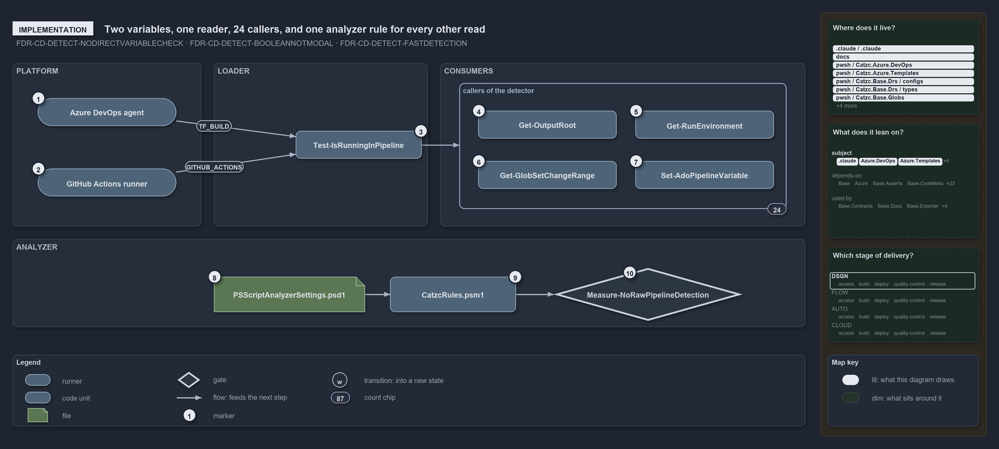

# Two variables, one reader, 24 callers, and one analyzer rule for every other read

```text
Two variables are read in one place, 24 callers ask it, and one analyzer rule bans every other read.

1   Azure DevOps agent              sets TF_BUILD
2   GitHub Actions runner           sets GITHUB_ACTIONS
3   Test-IsRunningInPipeline        [bool]$env:TF_BUILD -or [bool]$env:GITHUB_ACTIONS
4   Get-OutputRoot                  the staging directory in a pipeline, else out/
5   Get-RunEnvironment              'Pipeline' or 'Devbox'
6   Get-GlobSetChangeRange          'HEAD' when not in a pipeline
7   Set-AdoPipelineVariable         skips the ##vso command when not in a pipeline
8   PSScriptAnalyzerSettings.psd1   loads EntryRule.psm1 through CustomRulePath
9   EntryRule.psm1                  runs every check once per file; NoRawPipelineDetection is listed
10  Measure-NoRawPipelineDetection  flags $env:TF_BUILD or $env:GITHUB_ACTIONS outside the detector

Supports ADR-PWSH-DETECT-NODIRECTVARIABLECHECK, ADR-PWSH-DETECT-BOOLEANNOTMODAL and ADR-PWSH-DETECT-FASTDETECTION (implementation lens).
```

`Test-IsRunningInPipeline` is one expression: it casts two environment variables to booleans and ors them. Everything else in cats that
cares about the pipeline calls it, 24 call sites in all, and a custom PSScriptAnalyzer rule, loaded by the one settings file, turns any
other read of those two variables into an error.

```yml drawio
description:
  Two environment variables are read in one function, Test-IsRunningInPipeline; callers ask it, and one analyzer rule, loaded through the
  one settings file, turns any other read of those variables into an error.
about:
  rules: [ADR-PWSH-DETECT-NODIRECTVARIABLECHECK, ADR-PWSH-DETECT-BOOLEANNOTMODAL, ADR-PWSH-DETECT-FASTDETECTION]
  lens: implementation
content:
  title: Two variables, one reader, 24 callers, and one analyzer rule for every other read
  kind: explanation
  flow: left-to-right
  theme: dark
  bands:
    - { id: band-platform, label: PLATFORM }
    - { id: band-loader, label: LOADER }
    - { id: band-consumers, label: CONSUMERS }
    - { id: band-analyzer, label: ANALYZER }
  groups:
    - { id: grp-callers, label: callers of the detector, in: band-consumers }
  glyphs:
    - { id: r-azure-agent, kind: runner, label: "Azure DevOps agent, TF_BUILD", in: band-platform }
    - { id: r-github-runner, kind: runner, label: "GitHub Actions runner, GITHUB_ACTIONS", in: band-platform }
    - { id: c-detector, kind: code, label: Test-IsRunningInPipeline, in: band-loader }
    - { id: c-output-root, kind: code, label: Get-OutputRoot, in: grp-callers }
    - { id: c-run-environment, kind: code, label: Get-RunEnvironment, in: grp-callers }
    - { id: c-change-range, kind: code, label: Get-GlobSetChangeRange, in: grp-callers }
    - { id: c-set-variable, kind: code, label: Set-AdoPipelineVariable, in: grp-callers }
    - { id: f-settings, kind: file, label: PSScriptAnalyzerSettings.psd1, in: band-analyzer }
    - { id: c-rules, kind: code, label: EntryRule.psm1, in: band-analyzer }
    - { id: g-rule, kind: gate, label: Measure-NoRawPipelineDetection, in: band-analyzer }
  edges:
    - { from: r-azure-agent, to: c-detector, kind: flow, label: feeds }
    - { from: r-github-runner, to: c-detector, kind: flow, label: feeds }
    - { from: c-detector, to: grp-callers, kind: flow, label: "" }
    - { from: f-settings, to: c-rules, kind: flow, label: feeds }
    - { from: c-rules, to: g-rule, kind: flow, label: "" }
  markers:
    - { at: r-azure-agent, number: 1 }
    - { at: r-github-runner, number: 2 }
    - { at: c-detector, number: 3 }
    - { at: c-output-root, number: 4 }
    - { at: c-run-environment, number: 5 }
    - { at: c-change-range, number: 6 }
    - { at: c-set-variable, number: 7 }
    - { at: f-settings, number: 8 }
    - { at: c-rules, number: 9 }
    - { at: g-rule, number: 10 }
  chips:
    - { at: grp-callers, kind: count, text: "24" }
  legend: auto
  minimaps: [code-locations, module-neighbourhood, axis]
layout:
  band-platform: { x: 20, y: 84, w: 300, h: 260 }
  band-loader: { x: 340, y: 84, w: 340, h: 260 }
  band-consumers: { x: 700, y: 84, w: 580, h: 260 }
  band-analyzer: { x: 20, y: 364, w: 1260, h: 140 }
  r-azure-agent: { x: 60, y: 140, w: 220, h: 44 }
  r-github-runner: { x: 60, y: 252, w: 220, h: 44 }
  c-detector: { x: 470, y: 192, w: 200, h: 44 }
  grp-callers: { x: 730, y: 116, w: 520, h: 200 }
  c-output-root: { x: 760, y: 160, w: 220, h: 44 }
  c-run-environment: { x: 1010, y: 160, w: 220, h: 44 }
  c-change-range: { x: 760, y: 240, w: 220, h: 44 }
  c-set-variable: { x: 1010, y: 240, w: 220, h: 44 }
  f-settings: { x: 340, y: 424, w: 240, h: 56 }
  c-rules: { x: 620, y: 424, w: 200, h: 56 }
  g-rule: { x: 880, y: 410, w: 300, h: 84 }
```



## Walkthrough

1. **Azure DevOps agent.** Sets `TF_BUILD` to `True` on every pipeline run.
2. **GitHub Actions runner.** Sets `GITHUB_ACTIONS` to `true` on every workflow run.
3. **Test-IsRunningInPipeline.** In `Catzc.Internal.Loader`, it returns `[bool]$env:TF_BUILD -or [bool]$env:GITHUB_ACTIONS`. It declares
   `[OutputType([bool])]`, takes no parameters and touches nothing else: no file, no network, no computation. An L0 test sets each variable
   in turn, then neither, and asserts the three answers.
4. **Get-OutputRoot.** Asks the detector first, and only then reads `BUILD_ARTIFACTSTAGINGDIRECTORY`: in a pipeline the staging directory,
   otherwise `out/` under the repository root. That second variable is a location, not a signal, and it is read nowhere else.
5. **Get-RunEnvironment.** Turns the boolean into the environment axis, `Pipeline` or `Devbox`, that environment-dependent settings such as
   the time-safeguard limits key on.
6. **Get-GlobSetChangeRange.** Returns `HEAD` when not in a pipeline; in one, it derives the git range from the pull-request variables.
7. **Set-AdoPipelineVariable.** Writes a `##vso` logging command in a pipeline and, on a devbox, only a verbose line saying it skipped it.
   Twenty more call sites follow the same shape, among them `Get-SessionActor`, `Deploy-Bicep`, `Sync-SessionTools`, `Protect-GlobSet` and
   `Install-Python`, plus the bootstrap's types pre-pass and the module builder.
8. **PSScriptAnalyzerSettings.psd1.** The single analyzer rule set. Its `CustomRulePath` names `pwsh/.scriptanalyzer/EntryRule.psm1` beside
   the spelling pass's own entry rule.
9. **EntryRule.psm1.** The entry rule of every check but spelling: it runs every repository check once per file, and
   `NoRawPipelineDetection` is on its list.
10. **Measure-NoRawPipelineDetection.** Walks every variable expression in the file. A `$env:TF_BUILD` or `$env:GITHUB_ACTIONS` whose
    ancestors include no function named `Test-IsRunningInPipeline` is reported as an error that names the variable and the function to call
    instead. `*.Tests.ps1` files are exempt, because they set and restore the variables to drive the detector through both contexts.

## Why it holds

- Never check the detection variables directly; call `Test-IsRunningInPipeline`, and the analyzer rule makes the check mechanical
  (ADR-PWSH-DETECT-NODIRECTVARIABLECHECK).
- Detection is boolean, not modal: either variable set means a pipeline, otherwise not (ADR-PWSH-DETECT-BOOLEANNOTMODAL).
- The function stays fast: it is called often, so it reads two variables and does no I/O, network or computation
  (ADR-PWSH-DETECT-FASTDETECTION).

## Where the code and the decision record differ

- The FDR's `Get-OutputRoot` listing carries `[CmdletBinding()]`; the function in the tree has none. The logic is identical.
- The FDR lists the detector's `[OutputType([bool])]` before `[CmdletBinding()]`; the code has the reverse order.
- The FDR says the rule flags raw reads anywhere outside `Test-IsRunningInPipeline`; the rule also exempts `*.Tests.ps1` files.

## See also

- [Pipeline detection](../../drs/automation/pwsh/pipeline-detection.md) — the decision this article explains;
  [Devbox and pipeline parity](../../drs/automation/devbox-pipeline-parity.md) — the seam it keeps.
- The other lenses on the same detector: [meta](one-boolean-answer-from-one-function.md),
  [architecture](the-loader-holds-the-one-detector.md), [operations](the-analyzer-names-the-raw-read.md) and
  [governance](one-gate-checks-the-raw-read-rule.md).
- [The flow explanations](index.md) · [How to read the diagrams](../index.md#how-to-read-the-diagrams)
