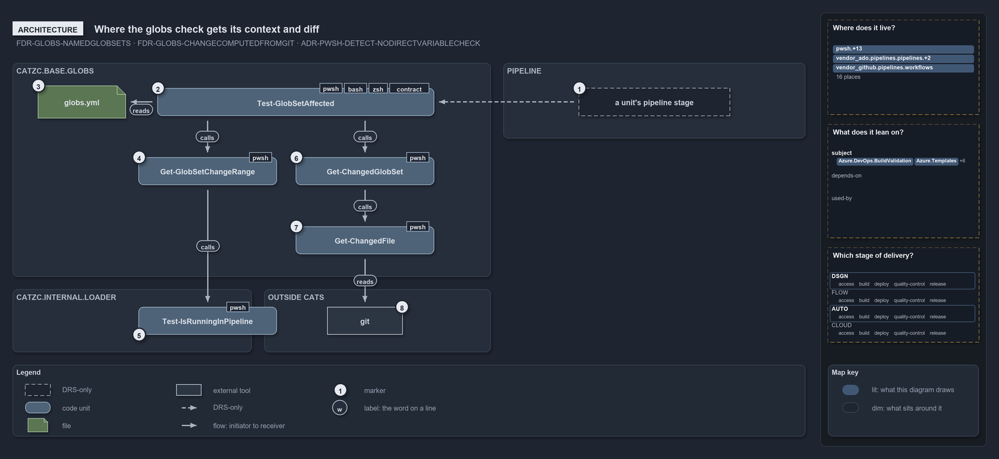

# Where the globs check gets its context and diff

```text
Where the globs check gets its context and diff.

1  a unit's pipeline stage     the caller the FDR describes; no pipeline calls the check
2  Test-GlobSetAffected        the public check: is the named unit among the globsets the change touches?
3  globs.yml                   the globset registry the name must be declared in
4  Get-GlobSetChangeRange      the reference-commit resolver: which two commits, per context
5  Test-IsRunningInPipeline    the one pipeline-detection function, in Catzc.Internal.Loader
6  Get-ChangedGlobSet          the globsets whose scan program selects a changed path
7  Get-ChangedFile             the private diff: the changed paths over the range
8  git                         the vendor tool that answers the diff

Supports FDR-GLOBS-NAMEDGLOBSETS, FDR-GLOBS-CHANGECOMPUTEDFROMGIT and ADR-PWSH-DETECT-NODIRECTVARIABLECHECK (architecture lens).
```

One module, `Catzc.Base.Globs`, owns everything about globsets: the registry file, the dialect, the native projection and the git-reflection
query that answers whether a change touches a unit. The query itself depends on two things outside the module. It asks the loader which
execution context it runs in, because the reference commit differs between a developer's machine, a post-commit build and a pull request.
And it asks git for the diff, because the changed paths are read from the repository at real refs, never from a committed marker.

```yml drawio
description:
  The touched-unit check of the globs module asks the loader which context it runs in, to pick the reference commit, and asks git for the
  changed paths; the pipeline stage that should call it is drawn dashed because no pipeline does.
about:
  rules: [FDR-GLOBS-NAMEDGLOBSETS, FDR-GLOBS-CHANGECOMPUTEDFROMGIT, ADR-PWSH-DETECT-NODIRECTVARIABLECHECK]
  lens: architecture
content:
  title: Where the globs check gets its context and diff
  kind: explanation
  flow: left-to-right
  theme: dark
  bands:
    - { id: band-globs, label: CATZC.BASE.GLOBS }
    - { id: band-pipeline, label: PIPELINE }
    - { id: band-loader, label: CATZC.INTERNAL.LOADER }
    - { id: band-outside, label: OUTSIDE CATS }
  glyphs:
    - { id: a-stage, kind: drsonly, label: a unit's pipeline stage, in: band-pipeline }
    - { id: g-affected, kind: code, label: Test-GlobSetAffected, in: band-globs }
    - { id: f-globs, kind: file, label: globs.yml, in: band-globs }
    - { id: g-change-range, kind: code, label: Get-GlobSetChangeRange, in: band-globs }
    - { id: g-changed-globset, kind: code, label: Get-ChangedGlobSet, in: band-globs }
    - { id: g-changed-file, kind: code, label: Get-ChangedFile, in: band-globs }
    - { id: g-running, kind: code, label: Test-IsRunningInPipeline, in: band-loader }
    - { id: x-git, kind: external, label: git, in: band-outside }
  edges:
    - { from: a-stage, to: g-affected, kind: record, label: "" }
    - { from: g-affected, to: f-globs, kind: flow, label: "" }
    - { from: g-affected, to: g-change-range, kind: flow, label: calls }
    - { from: g-affected, to: g-changed-globset, kind: flow, label: calls }
    - { from: g-change-range, to: g-running, kind: flow, label: calls }
    - { from: g-changed-globset, to: g-changed-file, kind: flow, label: calls }
    - { from: g-changed-file, to: x-git, kind: flow, label: "" }
  markers:
    - { at: a-stage, number: 1 }
    - { at: g-affected, number: 2 }
    - { at: f-globs, number: 3 }
    - { at: g-change-range, number: 4 }
    - { at: g-running, number: 5 }
    - { at: g-changed-globset, number: 6 }
    - { at: g-changed-file, number: 7 }
    - { at: x-git, number: 8 }
  legend: auto
  minimaps: [code-locations, module-neighbourhood, axis]
layout:
  band-globs: { x: 20, y: 84, w: 760, h: 340 }
  band-pipeline: { x: 800, y: 84, w: 480, h: 120 }
  band-loader: { x: 20, y: 444, w: 380, h: 100 }
  band-outside: { x: 420, y: 444, w: 360, h: 100 }
  a-stage: { x: 920, y: 124, w: 240, h: 44 }
  g-affected: { x: 250, y: 124, w: 440, h: 44 }
  f-globs: { x: 60, y: 120, w: 140, h: 52 }
  g-change-range: { x: 220, y: 234, w: 220, h: 44 }
  g-changed-globset: { x: 470, y: 234, w: 220, h: 44 }
  g-changed-file: { x: 470, y: 344, w: 220, h: 44 }
  g-running: { x: 220, y: 472, w: 220, h: 44 }
  x-git: { x: 520, y: 472, w: 120, h: 44 }
```



## Walkthrough

1. **A unit's pipeline stage.** The decision describes the caller: a deployable unit's stage runs the check first and returns when there is
   nothing for it to process. No pipeline or workflow in the repository makes that call; the shared CD pipeline names the check in a comment
   as its exact backstop.
2. **Test-GlobSetAffected.** The public entry of the query. It takes a globset name, typically a deployable unit, and answers one boolean:
   true when the unit is touched or the range is in doubt, false only when the unit is confirmed untouched.
3. **globs.yml.** The one configuration point for every globset. The check reads the registry through `Get-Config` and throws when the name
   is not declared in it.
4. **Get-GlobSetChangeRange.** The reference-commit resolver. It names the git range the context measures a change against, and it is the
   only place that decides between the working tree, the first parent of a squash commit and a pull request's merge base.
5. **Test-IsRunningInPipeline.** The resolver asks the loader's detection function whether it runs in a pipeline. The function lives in
   `Catzc.Internal.Loader`, which both run modes import first and keep loaded, so every module asks the same one.
6. **Get-ChangedGlobSet.** Given the range, it returns every declared globset whose scan program selects at least one changed path. It is
   the same computation that produces the pull-request area-of-control report.
7. **Get-ChangedFile.** The module's private diff. It is the diff counterpart of the tracked-file universe: repo-relative, `/`-separated
   paths, with a rename split into both of its paths.
8. **git.** The diff is delegated to git over the resolved range. A git failure surfaces as a thrown error, which the public check catches
   and turns into a fail-open proceed.

## Why it holds

- The globset is the mechanism and its roles are derived, never committed per set; the area-of-control report is computed from git by
  `Get-ChangedGlobSet` (FDR-GLOBS-NAMEDGLOBSETS).
- Whether a change touches a unit is computed from git at real refs, with `Test-GlobSetAffected` resolving the reference commit per context
  through `Get-GlobSetChangeRange` and failing open on any doubt (FDR-GLOBS-CHANGECOMPUTEDFROMGIT).
- Nothing checks the pipeline-detection variables directly; context detection goes through `Test-IsRunningInPipeline` so the logic stays in
  one place (ADR-PWSH-DETECT-NODIRECTVARIABLECHECK).

## Where the code and the decision record differ

The decision describes a pipeline stage that runs `Test-GlobSetAffected` first; no pipeline or workflow in the repository calls it.

## See also

- [Globset triggers](../../drs/flow/durable-sha-globs.md) — the decision this article explains.
- [Pipeline detection](../../drs/automation/pwsh/pipeline-detection.md) — the one detection function the resolver asks.
- The other lenses on the same check: [meta](how-the-touched-unit-check-fails-open.md),
  [implementation](how-the-touched-unit-check-picks-its-git-range.md), [operations](when-a-pipeline-stage-stops.md) and
  [governance](what-tests-pin-the-fail-open-check.md).
- [The flow explanations](index.md) · [How to read the diagrams](../index.md#how-to-read-the-diagrams)
