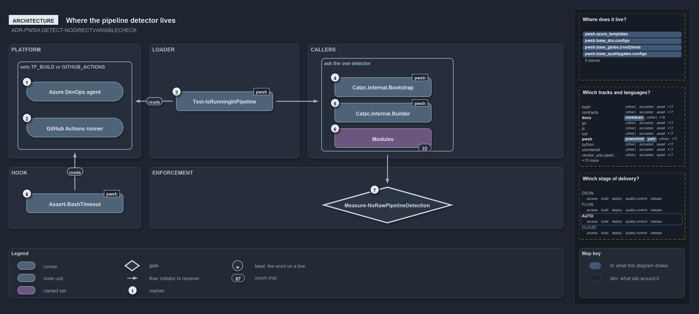

# Where the pipeline detector lives

```text
Where the pipeline detector lives.

1  Azure DevOps agent              sets TF_BUILD on every pipeline run
2  GitHub Actions runner           sets GITHUB_ACTIONS on every workflow run
3  Test-IsRunningInPipeline        the one reader, defined and exported by Catzc.Internal.Loader
4  Catzc.Internal.Bootstrap        the C#-types pre-pass asks it before any module loads
5  Catzc.Internal.Builder          the module build asks it before it bundles
6  Modules                         22 module functions ask it; none reads the variables
7  Measure-NoRawPipelineDetection  the analyzer rule that bans a raw read in PowerShell
8  Assert-BashTimeout              the C# hook, outside the analyzer, repeats the same test

Supports ADR-PWSH-DETECT-NODIRECTVARIABLECHECK (architecture lens).
```

The detector has to exist before anything else, because the importer's own bootstrap asks it while it is still compiling types, before a
single cats module has loaded. So cats keeps `Test-IsRunningInPipeline` in `Catzc.Internal.Loader`, the one internal library that both run
modes import first and never remove. Everything above the loader calls that function. Only one piece of code outside PowerShell, the
time-safeguard hook, repeats the test on its own.

```yml drawio
description:
  "Where the pipeline detector lives: the CI platforms set the variables, one loader function reads them, the bootstrap, the builder and the
  modules ask that function, an analyzer rule bans a raw read, and only the C# hook repeats the test."
about:
  rules: [ADR-PWSH-DETECT-NODIRECTVARIABLECHECK]
  lens: architecture
content:
  title: Where the pipeline detector lives
  kind: explanation
  flow: left-to-right
  theme: dark
  bands:
    - { id: band-platform, label: PLATFORM }
    - { id: band-loader, label: LOADER }
    - { id: band-callers, label: CALLERS }
    - { id: band-hook, label: HOOK }
    - { id: band-enforcement, label: ENFORCEMENT }
  groups:
    - { id: grp-platforms, label: sets TF_BUILD or GITHUB_ACTIONS, in: band-platform }
    - { id: grp-callers, label: ask the one detector, in: band-callers }
  glyphs:
    - { id: r-azure-agent, kind: runner, label: Azure DevOps agent, in: grp-platforms }
    - { id: r-github-runner, kind: runner, label: GitHub Actions runner, in: grp-platforms }
    - { id: c-detector, kind: code, label: Test-IsRunningInPipeline, in: band-loader }
    - { id: c-bootstrap, kind: code, label: Catzc.Internal.Bootstrap, in: grp-callers }
    - { id: c-builder, kind: code, label: Catzc.Internal.Builder, in: grp-callers }
    - { id: s-modules, kind: set, label: Modules, in: grp-callers }
    - { id: c-hook, kind: code, label: Assert-BashTimeout, in: band-hook }
    - { id: g-analyzer-rule, kind: gate, label: Measure-NoRawPipelineDetection, in: band-enforcement }
  edges:
    - { from: c-detector, to: grp-platforms, kind: flow, label: reads }
    - { from: c-detector, to: grp-callers, kind: flow, label: "" }
    - { from: c-hook, to: grp-platforms, kind: flow, label: reads }
    - { from: grp-callers, to: g-analyzer-rule, kind: flow, label: "" }
  markers:
    - { at: r-azure-agent, number: 1 }
    - { at: r-github-runner, number: 2 }
    - { at: c-detector, number: 3 }
    - { at: c-bootstrap, number: 4 }
    - { at: c-builder, number: 5 }
    - { at: s-modules, number: 6 }
    - { at: g-analyzer-rule, number: 7 }
    - { at: c-hook, number: 8 }
  chips:
    - { at: s-modules, kind: count, text: "22" }
  legend: auto
  minimaps: [code-locations, grid, axis]
layout:
  band-platform: { x: 20, y: 84, w: 300, h: 260 }
  band-loader: { x: 340, y: 84, w: 340, h: 260 }
  band-callers: { x: 700, y: 84, w: 580, h: 260 }
  band-hook: { x: 20, y: 364, w: 300, h: 140 }
  band-enforcement: { x: 340, y: 364, w: 940, h: 140 }
  grp-platforms: { x: 40, y: 124, w: 260, h: 200 }
  r-azure-agent: { x: 60, y: 170, w: 220, h: 44 }
  r-github-runner: { x: 60, y: 252, w: 220, h: 44 }
  c-detector: { x: 400, y: 192, w: 220, h: 44 }
  grp-callers: { x: 730, y: 116, w: 300, h: 212 }
  c-bootstrap: { x: 760, y: 160, w: 220, h: 44 }
  c-builder: { x: 760, y: 218, w: 220, h: 44 }
  s-modules: { x: 760, y: 276, w: 220, h: 44 }
  c-hook: { x: 60, y: 424, w: 220, h: 44 }
  g-analyzer-rule: { x: 730, y: 408, w: 300, h: 84 }
```



## Walkthrough

1. **Azure DevOps agent.** Sets `TF_BUILD` on every pipeline run.
2. **GitHub Actions runner.** Sets `GITHUB_ACTIONS` on every workflow run. Neither variable exists on a devbox.
3. **Test-IsRunningInPipeline.** Defined and exported by `Catzc.Internal.Loader`, the one `.internal` module the importer loads
   unconditionally and keeps in the session. Because it loads first in both run modes, the bootstrap and every module ask the same function.
4. **Catzc.Internal.Bootstrap.** The C#-types pre-pass runs before any `Catzc` module loads. When the compiled types are stale it asks the
   detector: in a pipeline that is a hard failure, on a devbox a warning and a restart hint.
5. **Catzc.Internal.Builder.** The module build asks it too: a source tree that differs from its commit cannot be bundled in a pipeline,
   because a pipeline builds only a clean commit.
6. **Modules.** Twenty-two module functions, from `Get-OutputRoot` to `Install-Dotnet`, branch on the detector. None of them reads the
   variables.
7. **Measure-NoRawPipelineDetection.** The analyzer rule, loaded through `EntryRule.psm1` by the one settings file, flags a raw read of
   either variable in any PowerShell file outside the detector.
8. **Assert-BashTimeout.** The time-safeguard hook is a C# program the importer publishes. It runs outside the module system and outside the
   analyzer, so it reads `TF_BUILD` and `GITHUB_ACTIONS` itself, through `BashSafeguard.EnvironmentOf`, by the same test the detector
   applies.

## Why it holds

- Never check the detection variables directly; call `Test-IsRunningInPipeline`, so the logic lives in one place and both platforms are
  always covered (ADR-PWSH-DETECT-NODIRECTVARIABLECHECK). Placing that one function in the loader is what lets the bootstrap honour the rule
  before any module exists.
- The function is the one seam between devbox and pipeline, so "where do the two diverge?" has a finite answer: the callers above the loader
  (ADR-AUTO-PARITY-PARITYSEAM).

## Where the code and the decision record differ

The FDR says never to read the variables directly, and the analyzer enforces that for PowerShell. The C# hook `Assert-BashTimeout` reads
both variables itself, and no gate reaches C#.

## See also

- [Pipeline detection](../../drs/automation/pwsh/pipeline-detection.md) — the decision this article explains;
  [Devbox and pipeline parity](../../drs/automation/devbox-pipeline-parity.md) — the seam it keeps.
- The other lenses on the same detector: [meta](how-code-knows-it-runs-in-a-pipeline.md),
  [implementation](where-the-pipeline-variables-are-read.md), [operations](how-the-analyzer-reports-a-raw-read.md) and
  [governance](which-gates-check-the-raw-read-rule.md).
- [The flow explanations](index.md) · [How to read the diagrams](../index.md#how-to-read-the-diagrams)
