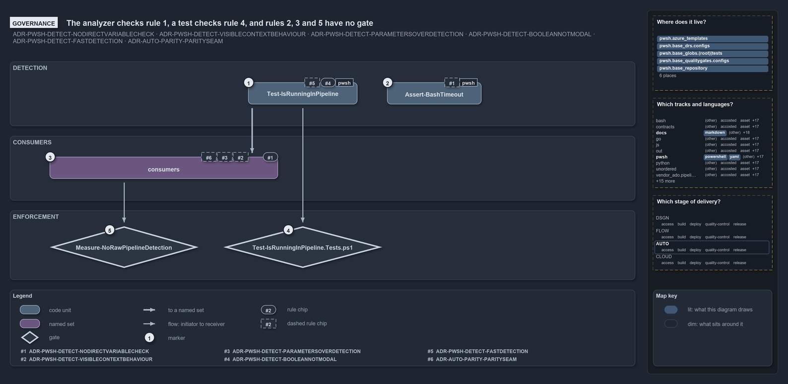

# Which gates check the raw-read rule

```text
Which gates check the raw-read rule.

1  Test-IsRunningInPipeline            the detector: rule 4 tested (D4), rule 5 unchecked (D5)
2  Assert-BashTimeout                  the C# hook: rule 1 unchecked there (dashed D1)
3  consumers                           24 call sites: rule 1 checked (D1); rules 2, 3 and P3 unchecked
4  Test-IsRunningInPipeline.Tests.ps1  the L0 test that proves the boolean's three cases
5  Measure-NoRawPipelineDetection      the analyzer rule, mapped to rule 1 in analyzer-drs-map.yml

Supports ADR-PWSH-DETECT-NODIRECTVARIABLECHECK, ADR-PWSH-DETECT-VISIBLECONTEXTBEHAVIOUR, ADR-PWSH-DETECT-PARAMETERSOVERDETECTION,
ADR-PWSH-DETECT-BOOLEANNOTMODAL, ADR-PWSH-DETECT-FASTDETECTION and ADR-AUTO-PARITY-PARITYSEAM (governance lens).
```

Five rules govern pipeline detection in cats, and one gate carries most of the weight. The analyzer rule enforces the first, never read the
variables directly, on every PowerShell file; an L0 test pins the fourth, that the answer is a plain boolean. The other three rules, and the
one reader outside PowerShell, rest on the FDR alone.

```yml drawio
description:
  "Five rules govern pipeline detection: the analyzer rule checks the raw-read rule over every PowerShell file, a test pins that the answer
  is a plain boolean, and the other rules, and the one reader outside PowerShell, rest on the FDR alone, drawn dashed."
about:
  rules:
    - ADR-PWSH-DETECT-NODIRECTVARIABLECHECK
    - ADR-PWSH-DETECT-VISIBLECONTEXTBEHAVIOUR
    - ADR-PWSH-DETECT-PARAMETERSOVERDETECTION
    - ADR-PWSH-DETECT-BOOLEANNOTMODAL
    - ADR-PWSH-DETECT-FASTDETECTION
    - ADR-AUTO-PARITY-PARITYSEAM
  lens: governance
content:
  title: Which gates check the raw-read rule
  kind: explanation
  flow: top-to-bottom
  theme: dark
  bands:
    - { id: band-detection, label: DETECTION }
    - { id: band-consumers, label: CONSUMERS }
    - { id: band-enforcement, label: ENFORCEMENT }
  glyphs:
    - { id: g-detector, kind: code, label: Test-IsRunningInPipeline, in: band-detection }
    - { id: g-hook, kind: code, label: Assert-BashTimeout, in: band-detection }
    - { id: s-consumers, kind: set, label: consumers, in: band-consumers }
    - { id: g-test, kind: gate, label: Test-IsRunningInPipeline.Tests.ps1, in: band-enforcement }
    - { id: g-analyzer, kind: gate, label: Measure-NoRawPipelineDetection, in: band-enforcement }
  edges:
    - { from: g-detector, to: s-consumers, kind: thick, label: "" }
    - { from: g-detector, to: g-test, kind: flow, label: "" }
    - { from: s-consumers, to: g-analyzer, kind: flow, label: "" }
  markers:
    - { at: g-detector, number: 1 }
    - { at: g-hook, number: 2 }
    - { at: s-consumers, number: 3 }
    - { at: g-test, number: 4 }
    - { at: g-analyzer, number: 5 }
  chips:
    - { at: g-detector, kind: rule, rule: ADR-PWSH-DETECT-BOOLEANNOTMODAL }
    - { at: g-detector, kind: rule, rule: ADR-PWSH-DETECT-FASTDETECTION, gated: false }
    - { at: g-hook, kind: rule, rule: ADR-PWSH-DETECT-NODIRECTVARIABLECHECK, gated: false }
    - { at: s-consumers, kind: rule, rule: ADR-PWSH-DETECT-NODIRECTVARIABLECHECK }
    - { at: s-consumers, kind: rule, rule: ADR-PWSH-DETECT-VISIBLECONTEXTBEHAVIOUR, gated: false }
    - { at: s-consumers, kind: rule, rule: ADR-PWSH-DETECT-PARAMETERSOVERDETECTION, gated: false }
    - { at: s-consumers, kind: rule, rule: ADR-AUTO-PARITY-PARITYSEAM, gated: false }
  legend: auto
  minimaps: [code-locations, grid, axis]
layout:
  band-detection: { x: 20, y: 108, w: 1260, h: 130 }
  band-consumers: { x: 20, y: 258, w: 1260, h: 130 }
  band-enforcement: { x: 20, y: 408, w: 1260, h: 140 }
  g-detector: { x: 500, y: 150, w: 220, h: 44 }
  g-hook: { x: 780, y: 150, w: 190, h: 44 }
  s-consumers: { x: 100, y: 300, w: 460, h: 44 }
  g-analyzer: { x: 100, y: 440, w: 300, h: 84 }
  g-test: { x: 450, y: 440, w: 320, h: 84 }
```



## Walkthrough

1. **Test-IsRunningInPipeline.** Rule 4, detection is boolean, is tested, so its chip is solid. Rule 5, only two variable reads and no I/O,
   is checked by nothing: a dashed chip.
2. **Assert-BashTimeout.** The C# hook reads both variables itself. The analyzer checks PowerShell files only, so rule 1 is unchecked there:
   a dashed chip. The hook stands alone on the diagram because nothing feeds it and nothing checks it.
3. **consumers.** The 24 call sites. Rule 1 is checked on them by the analyzer, so that chip is solid. Rule 2, context-dependent behavior
   must be intentional and visible, rule 3, prefer a parameter over detection, and ADR-AUTO-PARITY-PARITYSEAM, branch on the seam only where
   the environments genuinely differ, have no gate: dashed chips.
4. **Test-IsRunningInPipeline.Tests.ps1.** An L0 logic test. It sets `TF_BUILD`, then `GITHUB_ACTIONS`, then neither, and asserts true, true
   and false.
5. **Measure-NoRawPipelineDetection.** The analyzer rule. `analyzer-drs-map.yml` maps it to ADR-PWSH-DETECT-NODIRECTVARIABLECHECK, and
   `Test-AnalyzerDrsMap` fails when a custom rule is unmapped or cites a rule that does not exist, so the credit the rule-coverage report
   gives to this rule is itself checked.

## Why it holds

- Never check the detection variables directly; one analyzer rule checks it on every PowerShell file
  (ADR-PWSH-DETECT-NODIRECTVARIABLECHECK).
- Context-dependent behavior must be intentional and visible, through the detector or a parameter; the FDR alone states it
  (ADR-PWSH-DETECT-VISIBLECONTEXTBEHAVIOUR).
- Prefer a parameter over detection; detection is the fallback; the FDR alone states it (ADR-PWSH-DETECT-PARAMETERSOVERDETECTION).
- Detection is boolean, not modal; the L0 test proves all three cases (ADR-PWSH-DETECT-BOOLEANNOTMODAL).
- The function stays fast, reading two variables and nothing else; the FDR alone states it (ADR-PWSH-DETECT-FASTDETECTION).
- A command branches on the seam only where the environments genuinely differ, never to change what it does; the FDR alone states it
  (ADR-AUTO-PARITY-PARITYSEAM).

## Where the code and the decision record differ

- The FDR forbids every direct read of the variables, and the analyzer enforces that for PowerShell; the C# hook `Assert-BashTimeout` reads
  both, and no gate reaches it.
- The FDR says the analyzer rule flags raw reads anywhere outside `Test-IsRunningInPipeline`; the rule also exempts `*.Tests.ps1` files.

## See also

- [Pipeline detection](../../drs/automation/pwsh/pipeline-detection.md) — the decision this article explains;
  [Devbox and pipeline parity](../../drs/automation/devbox-pipeline-parity.md) — the seam it keeps.
- The other lenses on the same detector: [meta](how-code-knows-it-runs-in-a-pipeline.md),
  [architecture](where-the-pipeline-detector-lives.md), [implementation](where-the-pipeline-variables-are-read.md) and
  [operations](how-the-analyzer-reports-a-raw-read.md).
- [The flow explanations](index.md) · [How to read the diagrams](../index.md#how-to-read-the-diagrams)
