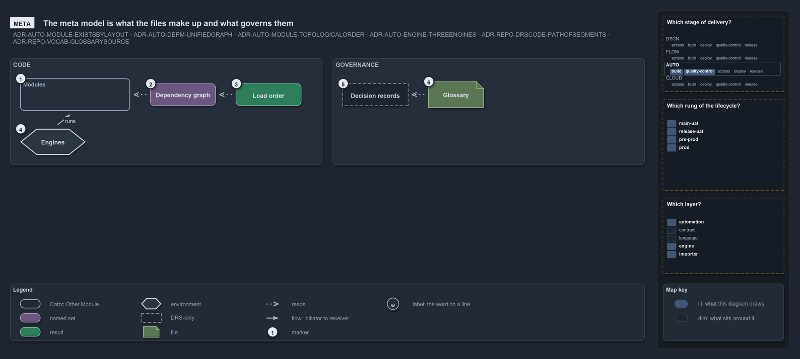

# The meta model: modules, engines, decisions and the words for them

```text
Over the files sits a second model: the modules they make up, the engines that run them, the decisions that govern them, and their words.

1  Modules        a module exists by its layout, on a track, in one or more languages
2  Dependencies   one graph of the calls the code makes and the edges it may make
3  Order          the modules load in the topological order of that graph
4  Engines        the engines a module runs on, their differences declared once
5  Decisions      every rule has a code: its kind, its domain, its decision, its name
6  The glossary   every defined term has one source and one rule that bolds it

Supports ADR-AUTO-MODULE-EXISTSBYLAYOUT, ADR-AUTO-DEPM-UNIFIEDGRAPH, ADR-AUTO-MODULE-TOPOLOGICALORDER, ADR-AUTO-ENGINE-THREEENGINES,
ADR-REPO-DRSCODE-PATHOFSEGMENTS and ADR-REPO-VOCAB-GLOSSARYSOURCE (meta lens).
```



The [physical model](the-physical-model.md) says where each file is; the meta model says what the files make up and what governs them. Like
the physical model, each part is declared once and read through a query.

## Modules

A **module** exists by its layout: a folder of a track whose files fall into the rows its language's layout names
([ADR-AUTO-MODULE-EXISTSBYLAYOUT](../../drs/automation/module-model.md#rule-adr-auto-module-existsbylayout)), with no registration step. Its
languages come from its files
([ADR-AUTO-MODULE-LANGUAGESFROMFILES](../../drs/automation/module-model.md#rule-adr-auto-module-languagesfromfiles)), and `Get-CatzcModule`
lists the modules with their track and root. `Get-ModuleProfile` says what one module holds.

## Dependencies and their order

The dependencies between modules are one graph
([ADR-AUTO-DEPM-UNIFIEDGRAPH](../../drs/automation/controlling-module-dependencies.md#rule-adr-auto-depm-unifiedgraph)), in two sections:
the edges a module may make, declared, and the calls the code makes, measured
([ADR-AUTO-DEPM-TWOSECTIONS](../../drs/automation/controlling-module-dependencies.md#rule-adr-auto-depm-twosections)).
`Get-ModuleDependency` and `Get-ModuleDependencyEdges` answer the graph, `Test-FunctionDependency` refuses a call no edge allows, and
`Get-ModuleOrder` gives the topological order the modules load in
([ADR-AUTO-MODULE-TOPOLOGICALORDER](../../drs/automation/module-model.md#rule-adr-auto-module-topologicalorder)). One container's modules
and their edges are the C3 level of the [zoom ladder](the-zoom-ladder.md).

## Engines

A module runs on one or more of the execution engines
([ADR-AUTO-ENGINE-THREEENGINES](../../drs/automation/execution-engines.md#rule-adr-auto-engine-threeengines)), a subset it names
([ADR-AUTO-MODULE-ENGINESUBSET](../../drs/automation/module-model.md#rule-adr-auto-module-enginesubset)), and every difference between the
engines is declared once
([ADR-AUTO-ENGINE-DIFFERENCESDECLAREDONCE](../../drs/automation/execution-engines.md#rule-adr-auto-engine-differencesdeclaredonce)).

## Decisions: kinds and domains

Every rule has a code that is a path of segments
([ADR-REPO-DRSCODE-PATHOFSEGMENTS](../../drs/repository/drs-code-language.md#rule-adr-repo-drscode-pathofsegments)): the decision kind
first, then its domain ([ADR-REPO-DRSCODE-DOMAINSEGMENT](../../drs/repository/drs-code-language.md#rule-adr-repo-drscode-domainsegment)),
its decision and the rule's name, named and never numbered. The [index](../../drs/index.md) lists the domains; `Get-DrsDomainEdges` answers
how they depend on each other, `Get-DrsUsage` where each rule is cited, and `Test-DrsRegistry` keeps the registry true.

## The glossary

Every defined term has one source, the glossary entry beside the rule that bolds it
([ADR-REPO-VOCAB-GLOSSARYSOURCE](../../drs/repository/controlled-vocabulary.md#rule-adr-repo-vocab-glossarysource)), and the
[glossary](../../drs/glossary.md) is built from those entries. `Test-Glossary` reports a term used without its entry or an entry without its
rule.
