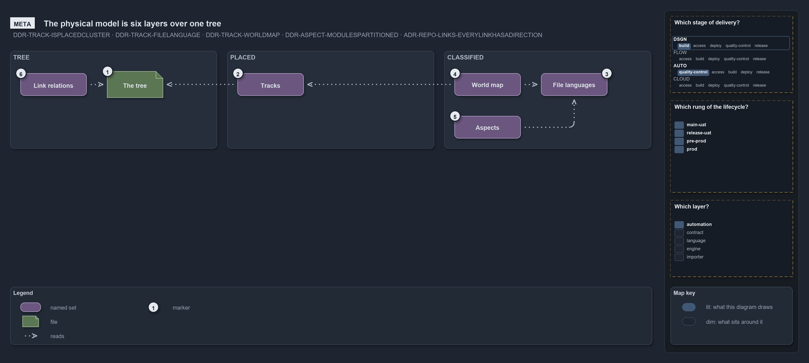

# The physical model: the tree, its tracks, its languages, its aspects and its links

```text
The repository's files form one model: where each file is, what it is written in, which part of its module it is, and what it points at.

1  The tree         every file at one path, under one root
2  Tracks           a track is a placed cluster of folders of one type
3  File languages   a file's extension names its language, and the language its checks
4  The world map    the tracks crossed with the file languages
5  Aspects          a module's files split into aspects, each a derived glob set
6  Link relations   every link between two files has a direction, and the direction is a row

Supports DDR-TRACK-ISPLACEDCLUSTER, DDR-TRACK-FILELANGUAGE, DDR-TRACK-WORLDMAP, DDR-ASPECT-MODULESPARTITIONED and
ADR-REPO-LINKS-EVERYLINKHASADIRECTION (meta lens).
```



The physical model is what the repository knows about its files: where each one sits, what it is written in, which part of its module it
belongs to, and which other files it points at. Each layer is declared once and answered by a query, so the model is read by asking it,
never by walking the tree by hand.

## The tree

Every file has one path from the repository root. The tree is conventional and semantic: each folder name is a setting with the conventional
name as its default, and the tooling acts on what each name means
([ADR-REPO-FOLDERS-NAMESARESETTINGS](../../drs/repository/conventional-folders.md#rule-adr-repo-folders-namesaresettings)).

## Tracks and their places

A **track** is a placed cluster of folders of one track type
([DDR-TRACK-ISPLACEDCLUSTER](../../drs/design/tracks.md#rule-ddr-track-isplacedcluster)), and its places are the folders it claims.
`Get-Track` lists the tracks and `Get-TrackPlace` answers which track a path belongs to; a reader subscribes to a track, never to a path
([DDR-TRACK-SUBSCRIBABLENOTPATH](../../drs/design/tracks.md#rule-ddr-track-subscribablenotpath)).

## File languages

A file's extension names its **file language**, and the language names the checks that hold it
([DDR-TRACK-FILELANGUAGE](../../drs/design/tracks.md#rule-ddr-track-filelanguage)). A track has a primary language
([DDR-TRACK-PRIMARYLANGUAGE](../../drs/design/tracks.md#rule-ddr-track-primarylanguage)), and the language's layout names the folders a
module of it holds.

## The world map

Crossing the tracks with the file languages gives the **world map**
([DDR-TRACK-WORLDMAP](../../drs/design/tracks.md#rule-ddr-track-worldmap)): every file falls into one cell, and `Get-WorldMap` draws it. It
is the C2 level of the [zoom ladder](the-zoom-ladder.md).

## Aspects

Every file of a module is in exactly one **aspect**
([DDR-ASPECT-MODULESPARTITIONED](../../drs/design/module-aspects.md#rule-ddr-aspect-modulespartitioned)), and the aspects are derived from
the layout, never listed by hand ([DDR-ASPECT-ASPECTSAREDERIVED](../../drs/design/module-aspects.md#rule-ddr-aspect-aspectsarederived)).
`Get-Aspect` answers them, each as a glob set ([DDR-ASPECT-ISAGLOBSET](../../drs/design/module-aspects.md#rule-ddr-aspect-isaglobset)).

## Link relations

A link between two files always has a direction
([ADR-REPO-LINKS-EVERYLINKHASADIRECTION](../../drs/repository/links-in-repository.md#rule-adr-repo-links-everylinkhasadirection)), the
directions are rows of one table
([ADR-REPO-LINKS-DIRECTIONSAREROWS](../../drs/repository/links-in-repository.md#rule-adr-repo-links-directionsarerows)), and the links that
follow a convention are derived, not written
([ADR-REPO-LINKS-CONVENTIONSAREDERIVED](../../drs/repository/links-in-repository.md#rule-adr-repo-links-conventionsarederived)).
`Get-LinkEdge` answers the edges into a file, and `Test-LinkDirections` is the one gate that checks them
([ADR-REPO-LINKS-CHECKEDBYONEGATE](../../drs/repository/links-in-repository.md#rule-adr-repo-links-checkedbyonegate)). The edges inside one
module are the C4 level of the ladder.
