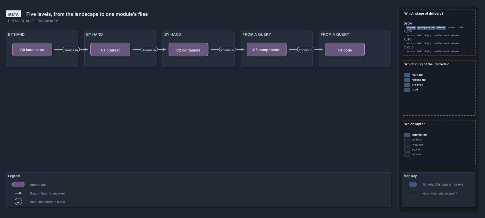

# The zoom ladder: how far out a diagram stands, from the landscape to one module's files

```text
A diagram has a lens, what it shows, and a zoom, how far out it stands; any lens can be drawn at any level.

C0  landscape    the truth stores around the repository
C1  context      the repository as one system, with its actors
C2  containers   the tracks crossed with the engines and languages
C3  components   one container's modules or units, and their dependency edges
C4  code         one module's files, and their link edges

Supports DDR-VISUAL-ZOOMISANAXIS (meta lens).
```



Every diagram is drawn through a **lens**, the closed list the renderer declares (`about.lens`): meta, architecture, implementation,
operations, governance, source, action and proof. The lens says what a diagram shows. A diagram may also name a **zoom**, how far out it
stands, from a second closed list declared beside the lenses (`about.zoom`)
([DDR-VISUAL-ZOOMISANAXIS](../../drs/design/visual-design.md#rule-ddr-visual-zoomisanaxis)). The two cross: a C2 slide can be an
architecture slide or a governance slide, and both stand equally far out.

## The five levels

- **C0 landscape** — the truth stores the repository sits among: the fact sources, the state machines and the adjacent stores
  ([TDR-STORES-THREESTOREKINDS](../../drs/thesis/truth-stores.md#rule-tdr-stores-threestorekinds)).
- **C1 context** — the repository as one system, with the actors around it: the engineer, the devbox, the pipelines, Azure DevOps and Azure.
- **C2 containers** — the tracks crossed with the engines and the languages: the
  [world map](what-layers-sit-over-the-tree.md#the-world-map), drawn as boxes.
- **C3 components** — one container's modules or units, with the dependency edges between them
  ([the meta model](what-makes-up-the-meta-model.md#dependencies-and-their-order)).
- **C4 code** — one module's files and the link edges between them ([the physical model](what-layers-sit-over-the-tree.md#link-relations)).

The ladder is Simon Brown's C4 model, with C0 added under it: a repository is never the whole landscape.

## Reading a slide's level

A slide with a zoom carries a zoom badge printing its level beside its lens badge; the badge alone carries the level, and the subtitle stays
the diagram's decision codes. A diagram without a zoom is drawn as before.

## The deep levels are generated

A C3 or C4 slide is never placed by hand. Its declaration stores only its inputs: the level and the point of the tree (`about.point`).
`Build-Diagrams` asks the level's query for that point, `Get-ModuleDependencyEdges` for C3 and `Get-LinkEdge` for C4, and hands the rows to
the renderer, which writes them out as cells the source never holds. Up to 45 cells, they stand in one column with every edge in a lane of
its own beside it; a larger slide gives each cell a count chip of its edges in and out instead, since its edges live one zoom down. When the
tree changes, the next build draws the change.
