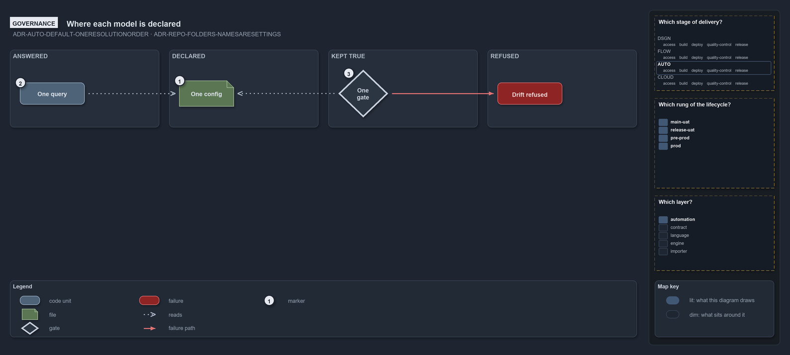

# Where each model is declared: its config, its query, and the gate that keeps it true

```text
Each model is declared once, answered by one query, and kept true by one gate.

Supports ADR-AUTO-DEFAULT-ONERESOLUTIONORDER and ADR-REPO-FOLDERS-NAMESARESETTINGS (governance lens).
```



A model that lives in more than one place drifts, so each one is declared once
([ADR-AUTO-DEFAULT-ONERESOLUTIONORDER](../../drs/automation/sensible-defaults.md#rule-adr-auto-default-oneresolutionorder)). The table
names, for each part of the [physical model](the-physical-model.md) and the [meta model](the-meta-model.md), the one config that declares
it, the query that answers it, and the gate that refuses a tree that disagrees with it.

- **Folder names**
  - Declared in: `pwsh/Base.Languages/configs/languages.yml` (layout)
  - Query: `LanguagesConfig.FolderOf`
  - Gate: `Test-FolderConventions`
- **Tracks and places**
  - Declared in: `pwsh/Base.Variants/configs/variants.yml`
  - Query: `Get-Track`, `Get-TrackPlace`
  - Gate: `Test-TrackDeclaration`
- **Track types**
  - Declared in: `pwsh/Base.Variants/configs/module-types.yml`
  - Query: `Get-Track`
  - Gate: `Test-TrackDeclaration`
- **File languages**
  - Declared in: `pwsh/Base.Languages/configs/languages.yml`
  - Query: `LanguagesConfig.PlaceOf`
  - Gate: the config's validation on read
- **The world map**
  - Declared in: the tracks and the file languages above
  - Query: `Get-WorldMap`
  - Gate: `Test-WorldMap`
- **Aspects**
  - Declared in: the layout rows of `languages.yml`
  - Query: `Get-Aspect`
  - Gate: `Test-AspectDeclaration`
- **Link relations**
  - Declared in: the links in the files, and the convention rows
  - Query: `Get-LinkEdge`
  - Gate: `Test-LinkDirections`
- **Modules**
  - Declared in: the layout, by placement
  - Query: `Get-CatzcModule`, `Get-ModuleProfile`
  - Gate: `Test-FolderConventions`
- **Dependencies and order**
  - Declared in: `pwsh/Base.ModuleSystem/configs/dependencies.yml`
  - Query: `Get-ModuleDependencyEdges`, `Get-ModuleOrder`
  - Gate: `Test-FunctionDependency`
- **Record domains**
  - Declared in: `pwsh/Base.Drs/configs/drs.yml` and the decision records
  - Query: `Get-DrsDomainEdges`, `Get-DrsUsage`
  - Gate: `Test-DrsRegistry`
- **The glossary**
  - Declared in: each module's `configs/glossary.yml`
  - Query: `docs/drs/glossary.md`, built by `Build-Glossary`
  - Gate: `Test-Glossary`

A folder name in this table is itself a setting with the conventional name as its default
([ADR-REPO-FOLDERS-NAMESARESETTINGS](../../drs/repository/conventional-folders.md#rule-adr-repo-folders-namesaresettings)), so the table
names the defaults; a repository that overrides one keeps the same model under its own name.
