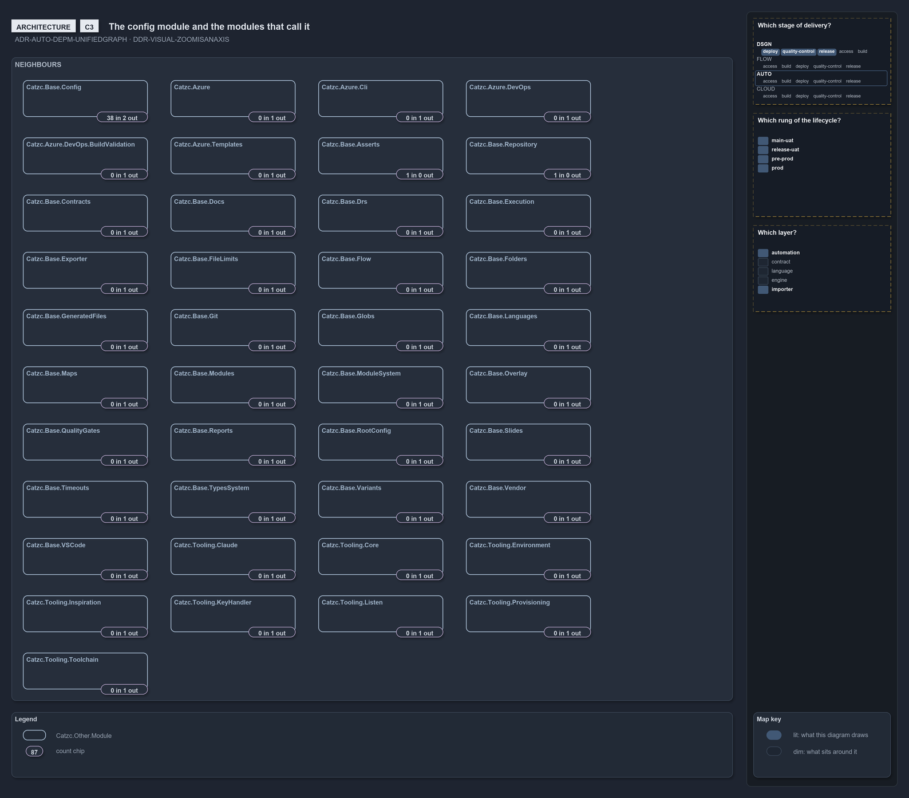
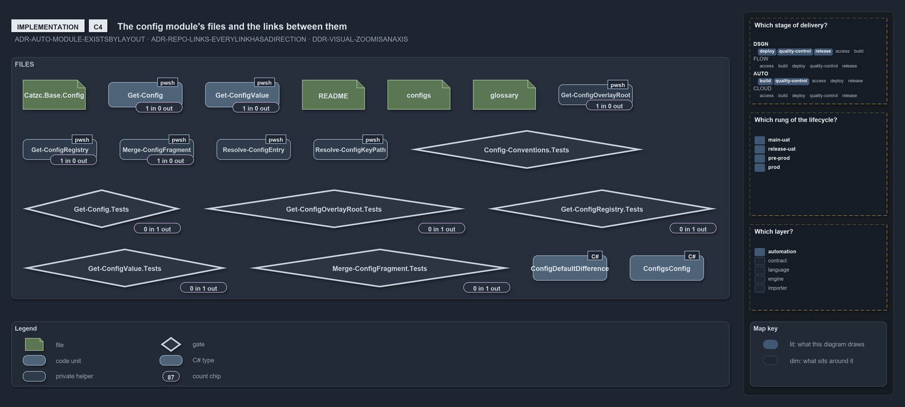

# Zooming in on Catzc.Base.Config: one module among its neighbours, and its files

```text
One module at C3 and C4: among the modules it calls and that call it, and as its own files with the links between them.

C3  components   Catzc.Base.Config and its neighbours, from the dependency query
C4  code         the module's files and the links between them, from the link graph

Supports DDR-VISUAL-ZOOMISANAXIS, ADR-AUTO-DEPM-UNIFIEDGRAPH and ADR-AUTO-MODULE-EXISTSBYLAYOUT.
```

The fourth ladder stands at `pwsh/Catzc.Base.Config/`, one module of the [pwsh ladder](zoom-pwsh.md).

## C3: the module among its neighbours



The slide holds only the modules an edge joins to this one, the modules it calls and the many that call it, each with a chip counting its
calls, from `Get-ModuleDependencyEdges`
([ADR-AUTO-DEPM-UNIFIEDGRAPH](../../drs/automation/controlling-module-dependencies.md#rule-adr-auto-depm-unifiedgraph)).

## C4: the module's files



Each file is drawn in the kind its layout row gives it
([ADR-AUTO-MODULE-EXISTSBYLAYOUT](../../drs/automation/module-model.md#rule-adr-auto-module-existsbylayout)), and its chip counts the links
between it and the other files, from `Get-LinkEdge`.
