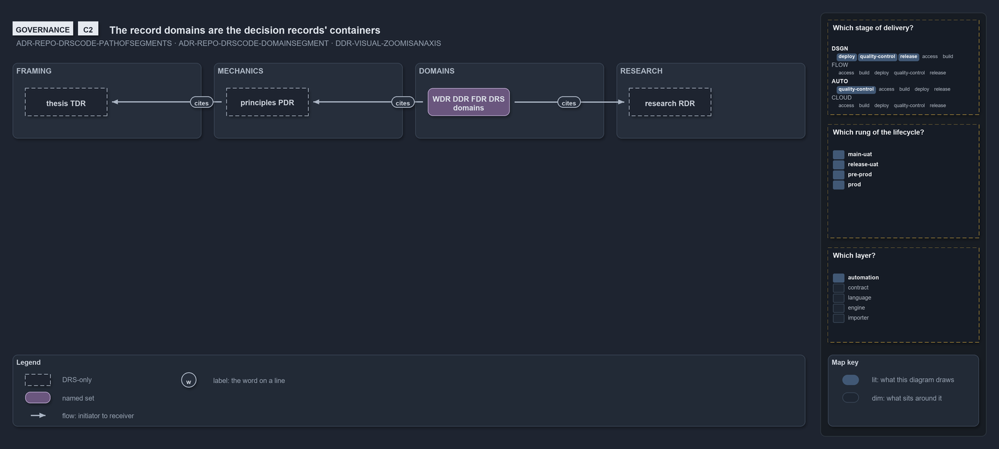
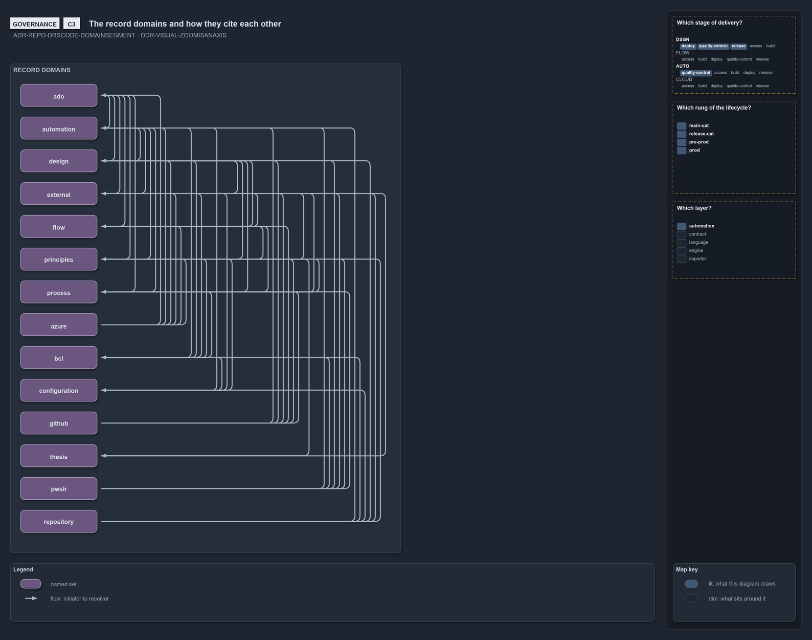
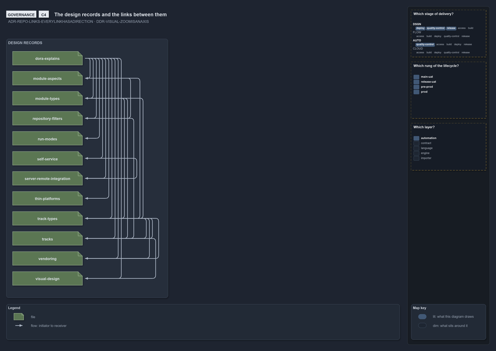

# Zooming in on docs/drs: the record domains, their citations, and one domain's records

```text
The decision records at C2, C3 and C4: the domains as containers, the citations between them, and one domain's records.

C2  containers   the record domains, each of one decision kind
C3  components   every domain and the citations between them, from the domain query
C4  code         the design domain's records and the links between them, from the link graph

Supports DDR-VISUAL-ZOOMISANAXIS, ADR-REPO-DRSCODE-DOMAINSEGMENT and ADR-REPO-LINKS-EVERYLINKHASADIRECTION.
```

The fifth ladder stands at `docs/drs/`, where the decision records live, with the record domains as its containers.

## C2: the domains



Every rule's code names its domain
([ADR-REPO-DRSCODE-DOMAINSEGMENT](../../drs/repository/drs-code-language.md#rule-adr-repo-drscode-domainsegment)), and each domain is of one
decision kind; the thesis frames them all, and the other domains cite it through the principles.

## C3: the domains and their citations



This slide is drawn from `Get-DrsDomainEdges` at every build: one glyph per domain in a column, and every citation an arrow in a lane of its own.

## C4: one domain's records



The deepest slide stands in one domain, `docs/drs/design/`: each record is a glyph in a column, and each link between two of them an
arrow in a lane of its own, from `Get-LinkEdge`
([ADR-REPO-LINKS-EVERYLINKHASADIRECTION](../../drs/repository/links-in-repository.md#rule-adr-repo-links-everylinkhasadirection)).
