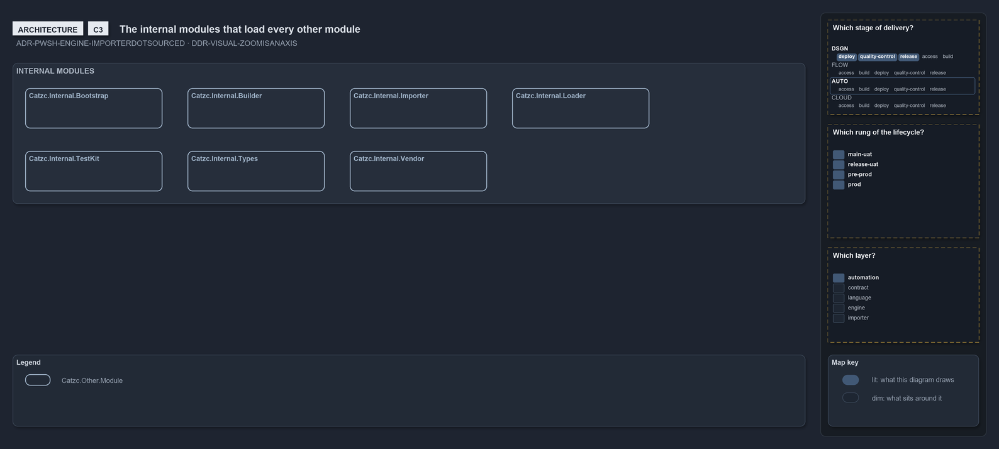
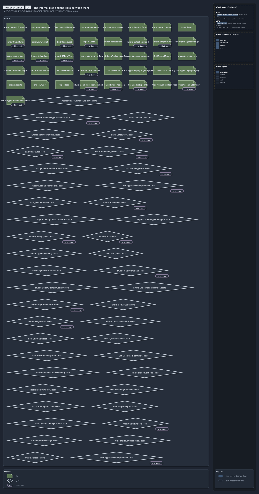

# Zooming in on pwsh/.internal: the internal modules and their files

```text
The internal folder at C3 and C4: its modules, and its files with the links between them, both drawn from the tree at every build.

C3  components   the internal modules the importer loads before any catzc module
C4  code         every file of the folder, and the links between two of them

Supports DDR-VISUAL-ZOOMISANAXIS, ADR-PWSH-ENGINE-IMPORTERDOTSOURCED and ADR-REPO-LINKS-EVERYLINKHASADIRECTION.
```

The third ladder stands at `pwsh/.internal/`, the infrastructure that loads every module of the [pwsh ladder](zoom-pwsh.md).

## C3: the internal modules



The importer, always dot-sourced ([ADR-PWSH-ENGINE-IMPORTERDOTSOURCED](../../drs/automation/pwsh/pwsh-engine.md#rule-adr-pwsh-engine-importerdotsourced)),
loads these modules first. No dependency query covers them, so the slide draws the modules alone, read from the folder.

## C4: the files and their links



This slide is drawn from `Get-LinkEdge` at every build: one glyph per file, its chip counting the links between it and the other files
([ADR-REPO-LINKS-EVERYLINKHASADIRECTION](../../drs/repository/links-in-repository.md#rule-adr-repo-links-everylinkhasadirection)).
