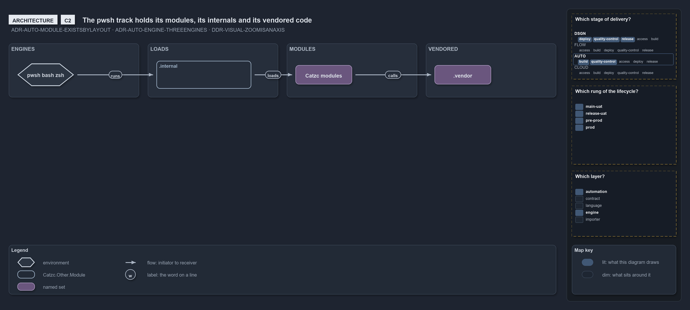
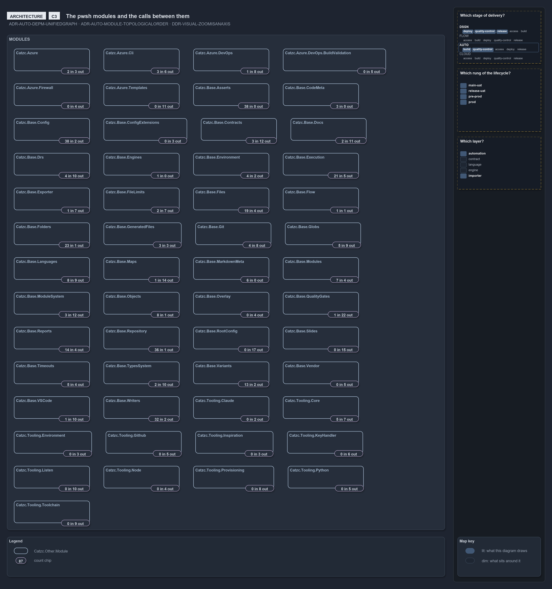

# Zooming in on pwsh: the track and its modules

```text
The pwsh track at C2 and C3: as one container, and as its modules with the calls between them.

C2  containers   the catzc modules, the internal modules and the vendored modules, run by the three engines
C3  components   every module and every call the code makes between two of them, from the dependency query

Supports DDR-VISUAL-ZOOMISANAXIS, ADR-AUTO-MODULE-EXISTSBYLAYOUT and ADR-AUTO-DEPM-UNIFIEDGRAPH.
```

The second ladder stands at `pwsh/`, one container of the [root ladder](zoom-root.md).

## C2: the track as a container



A module exists by its layout ([ADR-AUTO-MODULE-EXISTSBYLAYOUT](../../drs/automation/module-model.md#rule-adr-auto-module-existsbylayout)).
The internal modules load the catzc modules, which call the vendored ones, and the three engines run them
([ADR-AUTO-ENGINE-THREEENGINES](../../drs/automation/execution-engines.md#rule-adr-auto-engine-threeengines)).

## C3: the modules and their calls



This slide is drawn from `Get-ModuleDependencyEdges` at every build: one glyph per module, its chip counting the calls the code really makes
into it and out of it ([ADR-AUTO-DEPM-UNIFIEDGRAPH][r1]). 53 modules is over the renderer's cap, so the calls themselves are drawn one zoom
down, around each module, as on the config ladder's C3. The [config ladder](zoom-config.md) zooms into one of them.

[r1]: ../../drs/automation/controlling-module-dependencies.md#rule-adr-auto-depm-unifiedgraph
