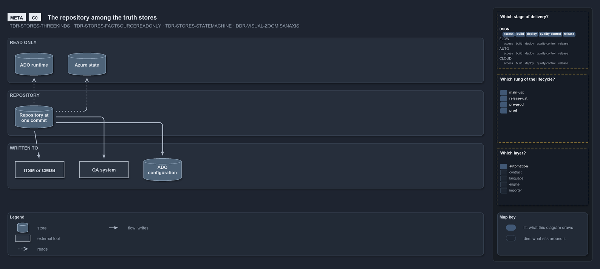
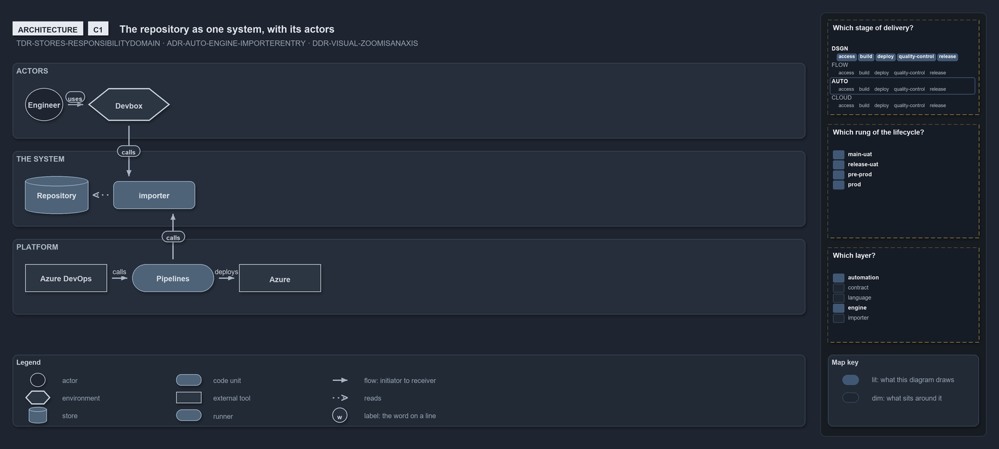
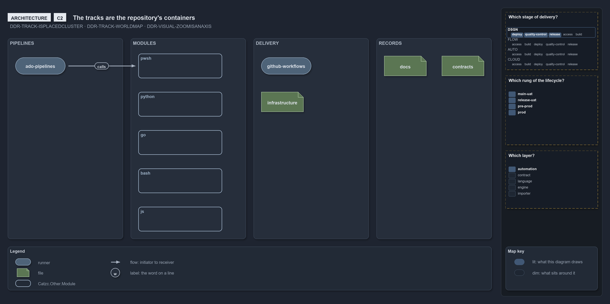

# Zooming in on the repository root: the landscape, the system and its containers

```text
The repository root at C0, C1 and C2: among the truth stores, as one system with its actors, and as its tracks.

C0  landscape    the repository is one truth store among fact sources, state machines and an adjacent store
C1  context      the engineer, the devbox, the pipelines, Azure DevOps and Azure around one system
C2  containers   the tracks, each a placed cluster of one track type

Supports DDR-VISUAL-ZOOMISANAXIS, TDR-STORES-THREEKINDS and DDR-TRACK-WORLDMAP.
```

The first ladder stands at the repository root and zooms in three times, from the stores around it down to its tracks
([the zoom ladder](the-zoom-ladder.md)).

## C0: among the truth stores



The repository is one of the three kinds of truth store
([TDR-STORES-THREEKINDS](../../drs/thesis/truth-stores.md#rule-tdr-stores-threekinds)). It reads the fact sources and never writes them
([TDR-STORES-FACTSOURCEREADONLY](../../drs/thesis/truth-stores.md#rule-tdr-stores-factsourcereadonly)), reports to the state machines at a
junction ([TDR-STORES-STATEMACHINE](../../drs/thesis/truth-stores.md#rule-tdr-stores-statemachine)), and drives the adjacent store, the
platform's configuration, one way from its pipelines.

## C1: one system and its actors



One repository holds one responsibility domain
([TDR-STORES-RESPONSIBILITYDOMAIN](../../drs/thesis/truth-stores.md#rule-tdr-stores-responsibilitydomain)). The engineer works on the
devbox; the devbox and the pipelines both run the one importer
([ADR-AUTO-ENGINE-IMPORTERENTRY](../../drs/automation/execution-engines.md#rule-adr-auto-engine-importerentry)), and the pipelines deploy
to Azure.

## C2: the tracks



The containers are the tracks, each a placed cluster of one track type
([DDR-TRACK-TRACKISPLACEDCLUSTER](../../drs/design/tracks.md#rule-ddr-track-trackisplacedcluster)), and crossing them with the file
languages gives the world map ([DDR-TRACK-WORLDMAP](../../drs/design/tracks.md#rule-ddr-track-worldmap)). The [pwsh ladder](zoom-pwsh.md)
zooms into one of them.
