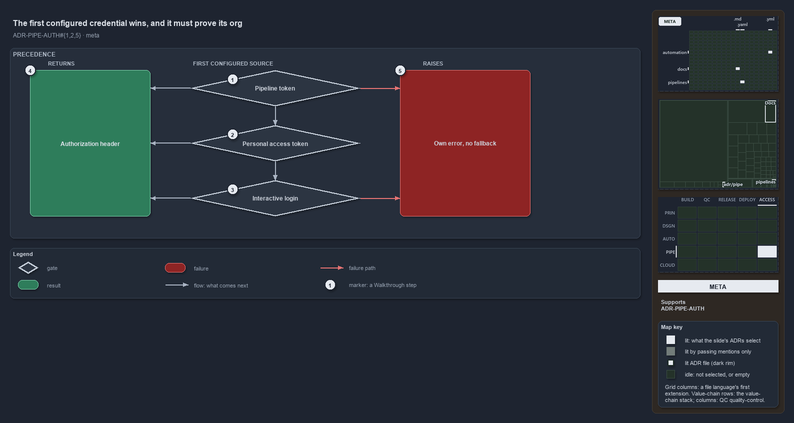

# The first configured credential wins, and it must prove its org

```text
The first configured credential wins, proves its org, and never falls back.

1  Pipeline token          the agent's token, used first; its org must match
2  Personal access token   an operator-set token, used when there is no pipeline token
3  Interactive login       the developer's session; it must be in the tenant and yield a token
4  Authorization header    the one result every source returns
5  Own error, no fallback  a failing source raises its own error

Supports ADR-PIPE-AUTH#1, #2 and #5 (meta lens).
```

Every call cats makes to the Azure DevOps REST API needs an `Authorization` header, and three kinds of credential can supply one. Cats picks
the credential by what is configured, in a fixed order, and never by trial and error. The source it picks must show that it targets the
configured organization or tenant before a header leaves, and when it fails it raises its own error instead of handing over to the next
source.



The diagram is described element by element in [its asset description](configured-credential-proves-its-org.drawio.md).

## Walkthrough

1. **Pipeline token.** The agent's own token comes first. It exists only inside a pipeline step, and only when the step template maps it in.
   Before it is used, the pipeline's organization must match the configured one; if it does not, the source raises.
2. **Personal access token.** When there is no pipeline token, a personal access token that an operator has set, locally or in CI, comes
   next. It has no check at selection time: it reaches the configured org because the API addresses are built from it.
3. **Interactive login.** Otherwise the developer's own login session is used. The session must be in the tenant behind the organization,
   and it must actually yield a token.
4. **Authorization header.** Each source returns the same single result: a header aimed at the configured organization or tenant.
5. **Own error, no fallback.** When the source it picks fails its proof, or when the last source yields nothing, the call stops with that
   source's own error. The last case names what to fix: set a personal access token, or log in with an Entra ID account.

## Why it holds

- The credential is chosen by which one is configured, in a fixed order, and a source that fails raises its own error rather than degrading
  to the next (ADR-PIPE-AUTH#1).
- Each source proves it targets the configured organization or tenant before it returns a header, so a credential that happens to be present
  never resolves to a different org by accident (ADR-PIPE-AUTH#2).
- When the last source yields nothing, the error names the actionable causes (ADR-PIPE-AUTH#5).

A function that guessed which credential was meant, or fell back to another source when the first failed, would turn auth failures into
opaque 401 errors, or worse, into a token aimed at the wrong organization.

## Where the code and the ADR differ

- The ADR says every source proves its org, but the personal access token has no runtime proof. Its binding "by construction" holds only by
  default, because each API function accepts an `-Organization` override that nothing checks against the header.
- The ADR says the source for the pipeline asserts the collection address, but the code skips that check when the address is empty.

## See also

- [Dual authentication](../../adr/pipelines/dual-authentication.md) — the decision this article explains.
- The other lenses on the same precedence: [architecture](one-header-function-owns-precedence.md),
  [implementation](three-guarded-early-returns.md), [operations](what-you-set-decides-the-credential.md) and
  [governance](which-auth-rungs-have-a-gate.md).
- [The pipelines explanations](index.md) · [How to read the diagrams](../index.md#how-to-read-the-diagrams)
